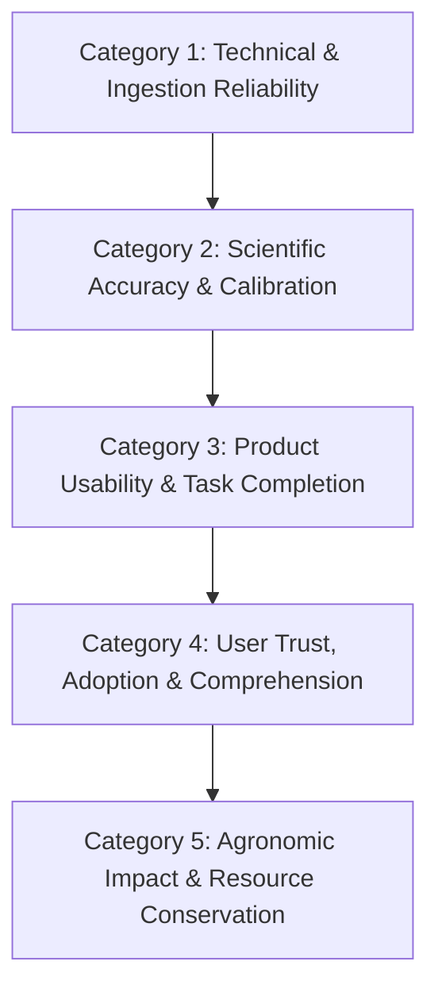

# Ritucast: Success Measurement & Evaluation Plan

## 1. Measurement Architecture & Impact Attribution

Evaluating an agricultural intelligence platform requires a disciplined attribution hierarchy. Simply presenting data to a user does not guarantee that a decision changed, nor does a changed decision guarantee higher crop yields due to confounding variables (seed quality, fertilizer adulteration, pest attacks, market fluctuations).

Ritucast establishes an operational 5-category measurement framework:

---

## 2. Operational Success Metrics Matrix

---

### Category 1: Technical & Ingestion Reliability

| Metric ID | Metric Name & Definition | Why It Matters | Measurement Method & Instrumentation | Feasible Phase | Baseline Status | Operational Target | Confounding Factors |
| :--- | :--- | :--- | :--- | :---: | :--- | :--- | :--- |
| **`MET-TECH-01`** | **Pipeline Ingestion Success Rate**: % of scheduled automated satellite and weather ETL jobs completed successfully without unhandled errors. | Stale inputs produce dangerous, outdated advisories. | Automated pipeline task logging; Prometheus / Grafana alerts. | Phase 8+ | None (Pre-implementation) | $\ge 99.0\%$ operational success on daily cron runs. | Upstream provider downtime (NASA/ESA). |
| **`MET-TECH-02`** | **Data Freshness / Latency**: Time delta between satellite/weather data publication by provider and ingestion by Ritucast. | Flash flood and storm alerts lose value within 6 hours. | Ingestion pipeline timestamp logging against upstream metadata. | Phase 8+ | None | $<4\text{ hours}$ from upstream publication. | Upstream processing delays; API rate throttling. |
| **`MET-TECH-03`** | **PWA Cold Load & Bundle Size**: Total gzipped JS/CSS size and Time-to-Interactive (TTI) on throttled 3G ($400\text{Kbps}$, $400\text{ms}$ RTT). | Heavy apps crash or stall on rural budget Android devices. | Google Lighthouse CI; automated bundle analyzer on every build. | Phase 11 / 14 | None | Bundle $\le 1.5\text{MB}$; $\text{TTI} \le 3.5\text{s}$ on 3G. | Cellular network latency fluctuations. |

---

### Category 2: Scientific Accuracy & Calibration

| Metric ID | Metric Name & Definition | Why It Matters | Measurement Method & Instrumentation | Feasible Phase | Baseline Status | Operational Target | Confounding Factors |
| :--- | :--- | :--- | :--- | :---: | :--- | :--- | :--- |
| **`MET-SCI-01`** | **Precipitation Forecast Skill (Brier Score)**: Mean squared error of 48-hour probabilistic precipitation forecast ($\ge 5\text{mm}$). | Inaccurate rain predictions destroy farmer trust. | Brier score calculation against BMD synoptic rain gauge records in pilot zones. | Phase 15 | To be benchmarked using 3-yr BMD historical data in Phase 4. | $\text{Brier Score} \le 0.18$ for 48h horizon. | Convective microbursts; localized topography. |
| **`MET-SCI-02`** | **SAR Flood Inundation Agreement (IoU)**: Intersection over Union of Sentinel-1 radar watermask against verified ground flood extents. | Prevents false emergency harvest alarms or missed haor floodings. | Spatial comparison against BWDB ground inundation reports and cloud-free optical validation. | Phase 15 | None | $\text{IoU} \ge 0.75$ on confirmed inundation events. | Wind surface roughening on open water. |
| **`MET-SCI-03`** | **Evapotranspiration Consistency**: Deviation of satellite Penman-Monteith $ET_0$ against regional benchmark stations. | Ensures water balance does not over- or under-estimate irrigation needs. | RMSE evaluation against BMDA and BRRI lysimeter/pan evaporation records. | Phase 15 | None | $\text{RMSE} \le 0.8\text{ mm/day}$ on 10-day rolling mean. | Regional microclimates. |

---

### Category 3: Product Usability & Task Completion

| Metric ID | Metric Name & Definition | Why It Matters | Measurement Method & Instrumentation | Feasible Phase | Baseline Status | Operational Target | Confounding Factors |
| :--- | :--- | :--- | :--- | :---: | :--- | :--- | :--- |
| **`MET-UX-01`** | **Primary Journey Completion Rate**: % of user sessions successfully completing location + crop selection and viewing primary advisory. | Core indicator of whether the mobile UI is intuitive and navigable. | Privacy-preserving client event analytics (zero PII logging). | Phase 11 / 14 | None | $\ge 85\%$ completion rate without session drop-off. | Intermittent network disconnection mid-session. |
| **`MET-UX-02`** | **Advisory Comprehension Score**: % of test participants who correctly explain the action, reasoning, and uncertainty. | Advice that is misunderstood causes faulty agronomic actions. | Structured usability interviews (5-point rubric) with 10 SAAOs and 15 lead farmers. | Phase 14 / 17 | None | $\ge 90\%$ accurate comprehension without external prompting. | Regional dialect differences in spoken Bangla. |
| **`MET-UX-03`** | **Social Advisory Share Rate**: % of active sessions that trigger the "শেয়ার করুন" (Share) export function. | Validates peer dissemination across WhatsApp and IMO farming groups. | Client share event logging. | Phase 11 / 17 | None | $\ge 15\%$ of active SAAO sessions export a share card. | Device OS sharing restrictions. |

---

### Category 4: User Trust & Adoption

| Metric ID | Metric Name & Definition | Why It Matters | Measurement Method & Instrumentation | Feasible Phase | Baseline Status | Operational Target | Confounding Factors |
| :--- | :--- | :--- | :--- | :---: | :--- | :--- | :--- |
| **`MET-TRU-01`** | **Advisory Adherence / Adoption Rate**: % of surveyed farmers reporting they adjusted a farming operation based on an advisory. | Bridges the intention-to-action gap. | End-of-season recall surveys across pilot upazila cohorts (100–150 farmers). | Phase 17 | None | $\ge 40\%$ self-reported adoption among active pilot users. | Pressure from tubewell operators; social conformity. |
| **`MET-TRU-02`** | **Explainability Drawer Engagement**: % of sessions where users tap "কেন এই পরামর্শ?" to review underlying evidence. | Indicates user interest in understanding underlying science. | Anonymous client UI interaction event tracking. | Phase 11 / 17 | None | $\ge 30\%$ of advisory views expand the explainability drawer. | Repeat users who already understand the logic. |

---

### Category 5: Agronomic Impact & Resource Conservation

| Metric ID | Metric Name & Definition | Why It Matters | Measurement Method & Instrumentation | Feasible Phase | Baseline Status | Operational Target | Confounding Factors |
| :--- | :--- | :--- | :--- | :---: | :--- | :--- | :--- |
| **`MET-AGR-01`** | **Avoided Tubewell Pumping Hours / Fuel Cost**: Reduction in diesel/electricity spending from weather-synchronized irrigation postponement. | Primary direct financial return for smallholders in the Barind tract. | Paired-plot log comparison or pre/post survey of pumping logs in Barind pilot. | Phase 17 / 18 | Current practice: fixed 4–6 day pumping cycles. | $10–20\%$ reduction in non-essential irrigation runs (est. 1,500–2,200 BDT/acre saved). | Electricity load-shedding; diesel price swings. |
| **`MET-AGR-02`** | **Mitigated Haor Harvest Crop Losses**: Value of mature Boro rice harvested prior to flood submersion following early warning. | Prevents catastrophic household loss in wetland basins. | DAE damage assessments and farmer group recall surveys following flash flood events. | Phase 17 / 18 | Historical haor flood loss baselines (e.g., 2017 catastrophe). | Measurable reduction in unharvested crop acreage relative to adjacent unwarned blocks. | Requires an actual flood trigger event during Boro maturity to measure. |

---

## 3. Principles of Responsible Reporting

1. **Pre-Baseline Discipline**: Quantitative targets in Categories 4 and 5 represent aspirational evaluation benchmarks. Formal baseline measurements must be established during field trials in Phase 14–17.
2. **Transparent Error Auditing**: When a false positive (e.g., missed rain forecast causing unnecessary irrigation delay) occurs, it must be recorded in an open error audit log to calibrate agronomic thresholds.
3. **No Unwarranted Causal Claims**: Ritucast will never claim that regional yield increases are solely caused by platform usage without a rigorous quasi-experimental control group.
