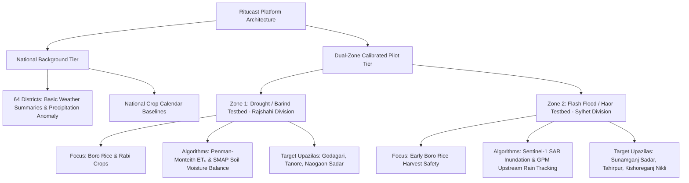

# Ritucast: Geographic & Agricultural Scope Assessment

## 1. Agro-Ecological Landscape of Bangladesh

Bangladesh features 30 distinct Agro-Ecological Zones (AEZs) characterized by varied physiography, soils, hydrological regimes, and climate exposures (BARC / FAO, 1988). An agricultural intelligence platform cannot treat the entire country as a homogeneous plain without courting operational failure.

### Regional Agro-Ecological Contrasts
1. **The Northwestern Barind Tract (AEZ 25, 26)**:
   - High elevation relative to floodplains; clayey red soils with low water-holding capacity.
   - High temperature extremes (>40°C in summer; <9°C winter fog).
   - Acute groundwater depletion from intensive deep tubewell Boro irrigation.
   - **Primary Hazard**: Drought, dry spells, excessive irrigation pumping costs.
2. **The Northeastern Haor Wetland Basin (AEZ 20, 21)**:
   - Deep bowl-shaped depressions surrounded by the Meghalaya hills (India).
   - Monoculture of winter Boro rice, which yields ~20% of national Boro production.
   - Sudden pre-monsoon flash floods (April–May) from transboundary torrential runoff.
   - **Primary Hazard**: Complete crop submergence within 24–72 hours prior to harvest.
3. **The Southern Coastal Saline Belt (AEZ 13, 18)**:
   - Tidal inundation, cyclonic surges, and dry-season surface/soil salinity intrusion.
   - Limited freshwater for dry-season Boro; heavy dependence on Kharif-2 T. Aman.
   - **Primary Hazard**: Salinity spikes, storm surge inundation, drainage congestion.
4. **The Central Active River Floodplains (AEZ 7, 8, 9 - Brahmaputra/Jamuna/Meghna)**:
   - Fertile alluvial silt deposits; highly vulnerable to mid-monsoon river overflow and riverbank erosion.
   - Intensive multi-cropping (Aman rice $\rightarrow$ Mustard/Vegetables $\rightarrow$ Boro/Jute).
   - **Primary Hazard**: Monsoon river inundation, seedling loss.

---

## 2. Crop Calendar & Cropping Systems Framework

Rice dominates over 75% of total cultivated area across three distinct seasons (BBS Yearbook of Agricultural Statistics):

```mermaid
gantt
    title Bangladesh Major Agricultural Cropping Calendar (BBS / BRRI)
    dateFormat  MM
    axisFormat  %b

    section Boro Rice (Irrigated)
    Seedbed & Transplanting   :01, 2M
    Vegetative & Flowering    :02, 2.5M
    Harvesting & Flash Flood Risk :04, 2M

    section Aus Rice (Pre-Monsoon)
    Sowing / Transplanting    :03, 2M
    Harvesting                :06, 2M

    section Aman Rice (Monsoon)
    Seedbed & Transplanting   :06, 2.5M
    Grain Filling & Harvest   :10, 2.5M

    section Rabi Non-Rice (Dry)
    Mustard / Potato / Maize  :10, 4M
```

### Strategic Crop Importance
- **Boro Rice**: Highest yielding (3.9–4.3 MT/ha milled rice), critical to national food security, highest cash input expenditure (irrigation + fertilizer).
- **Aman Rice**: Largest acreage (~5.8 million hectares), primarily rainfed, subject to rainfall variability at establishment and terminal dry spells.
- **Rabi Cash Crops (Potato, Mustard, Maize)**: High capital investment, highly sensitive to soil moisture extremes and unseasonal winter rain.

---

## 3. Evaluation of Scope Models: National vs. Targeted Pilot

| Scope Dimension | Pure National Deployment (Day 1) | Dual-Zone Pilot + National Background |
| :--- | :--- | :--- |
| **Data Ingestion** | Ingest and process satellite and weather arrays for all 64 districts (495 Upazilas). | Ingest national coarse datasets (POWER, GPM), but calibrate algorithms on 2 specific zones. |
| **Ground-Truth Calibration** | Impossible to validate across 30 AEZs simultaneously without massive field teams. | High-quality field calibration against established DAE and research stations (BRRI Rajshahi, Habiganj). |
| **Model Verification** | High risk of generalized errors and false alarms in specialized terrains (e.g., salinity or flash floods). | Precision-tuned rules for distinct hazard signatures (one moisture deficit, one flood inundation). |
| **Adoption & Usability** | Diluted feedback; difficult to support thousands of SAAOs. | Concentrated user testing with 10–20 SAAOs and 50 lead farmers. |

---

## 4. Recommended Initial Scope Strategy

### The "Dual-Zone Anchor" Model
Ritucast recommends a **Dual-Zone Representative Pilot** for initial detailed decision calibration and field validation, supported by a **National Background Agro-Weather Tier**:

### Justification for Selected Zones and Crops
1. **Zone 1 (Rajshahi / Barind Tract)**:
   - *Why*: Represents Bangladesh’s most critical dry-season irrigation challenge. Validates the **Moisture Deficit & Irrigation Timing Engine**.
   - *Anchor Crops*: Dry-season **Boro Rice** and **Potato/Mustard**.
   - *Partnership/Validation*: Strong presence of BMDA automated weather stations and BRRI Regional Station Rajshahi.
2. **Zone 2 (Sylhet / Sunamganj Haor Basin)**:
   - *Why*: Represents Bangladesh’s most severe early-monsoon catastrophe zone. Validates the **Flash-Flood Inundation & Emergency Harvest Advisory Engine**.
   - *Anchor Crop*: Haor **Boro Rice**.
   - *Partnership/Validation*: Active BWDB flood gauge network and DAE Haor crop monitoring desks.

---

## 5. Phased Geographical Expansion Plan

- **Phase 1–11 (Initial Release)**: Calibrate, test, and release for **Rajshahi (Barind)** and **Sunamganj (Haor)** pilot zones with national coarse agro-weather availability.
- **Phase 12–15 (Validation & Tuning)**: Expand to the **Southern Coastal Saline Zone** (Satkhira/Khulna for salinity and Aman drainage) and **Rangpur (Tista Floodplain)**.
- **Phase 17–18 (National Expansion)**: Full automated upazila coverage across all 8 divisions and 30 AEZs.
