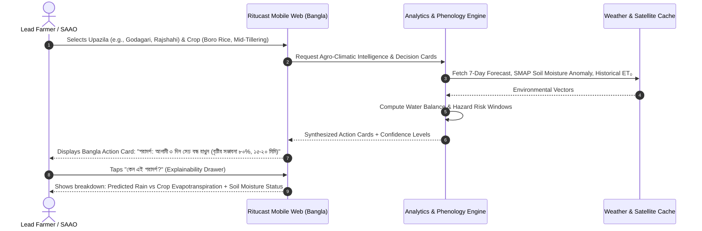

# Ritucast: Initial Product Scope & Capability Prioritization

## 1. Scope Definition Framework

The initial release of Ritucast focuses strictly on high-impact, scientifically validated capabilities that directly empower frontline extension officers (SAAOs) and progressive lead farmers. Capabilities are systematically classified into four categories:

- **Essential (Must Have)**: Fundamental to delivering the core value proposition of agro-climatic decision support. Required for the initial complete user journey.
- **Important (Should Have)**: Significant user value; targeted for initial release if resources allow, or immediate follow-up.
- **Later (Post-Initial Release)**: High value but introduces heavy operational or computational overhead. Deferred to subsequent development phases.
- **Research Required (Uncertain)**: Scientifically ambiguous or lacking validated data sources; cannot be implemented without dedicated scientific trials.

---

## 2. Comprehensive Capability Assessment

| Candidate Capability | Classification | Problem Solved | Target User Value | Scientific & Data Requirements | Complexity | Dependencies |
| :--- | :--- | :--- | :--- | :--- | :--- | :--- |
| **Location-Based Agro-Weather Summaries** | **Essential** | Lack of localized rainfall and temperature tracking. | Critical | NASA POWER daily ag-meteorology, BMD station data, numerical forecast APIs. | Low-Med | Geocoding, weather caching pipeline. |
| **Soil-Moisture & Water-Deficit Indicators** | **Essential** | Excessive pumping costs and crop moisture stress during dry spells. | Critical | SMAP L3/L4 soil moisture, Penman-Monteith $ET_0$ calculations, BRRI crop coefficients ($K_c$). | Med-High | Agrometeorological computation service. |
| **Waterlogging & Flood Risk Inundation Alerting** | **Essential** | Crop loss in lowlands and haor basins from sudden inundation. | Critical | Sentinel-1 SAR backscatter change detection, GPM IMERG upstream rainfall tracking. | High | SAR ingestion, raster thresholding, catchment geometry. |
| **Crop-Stage Aware Advisory Engine** | **Essential** | Generic advice failing to reflect crop phenology. | Critical | BRRI/BARI crop calendars (Boro, Aman, Aus), thermal degree days (GDD). | Medium | Agronomic rules engine, crop-stage tracking logic. |
| **Explainable Advisory Cards in Bangla** | **Essential** | Mistrust of black-box outputs; language barriers. | Critical | Agronomic reasoning templates, verified Bangla translation dictionaries. | Low-Med | UI component library, localization service. |
| **Responsive, Low-Bandwidth Mobile Interface** | **Essential** | Budget phone crashes, expensive mobile data. | Critical | Lightweight web architecture (<1.5MB initial bundle), PWA caching. | Medium | Frontend performance tuning, offline service workers. |
| **Interactive Spatial Risk & Overview Maps** | **Important** | Need for regional situational awareness by SAAOs. | High | Upazila administrative GeoJSONs, Mapbox/Leaflet vector tiles. | Medium | Spatial tile server, client-side rendering. |
| **Multi-Week Historical Weather Comparisons** | **Important** | Inability to evaluate whether current season is wetter/drier than normal. | High | Historical NASA POWER (10–20 yr climatology), GPM IMERG 30-day rolling sums. | Medium | Time-series database, climatology aggregations. |
| **Push Notifications & Weather Alerts** | **Important** | Missing sudden critical weather shifts (e.g., squalls, hail, heavy rain). | High | Web push notifications, background workers, event triggering thresholds. | Medium | User notification preferences, push service. |
| **Optical Satellite Vegetation Monitoring (NDVI/EVI)** | **Important** | Visual confirmation of vegetative vigor in dry/Rabi season. | Moderate | MODIS 250m 16-day composites, Sentinel-2 MSI (dry season only). | Medium | Raster processing, cloud masking pipeline. |
| **Automated Crop Yield Forecasting (Bu/Acre)** | **Later** | Macro-economic yield planning. | Low for daily farm decisions | Multi-year historical crop-cut yield statistics (BBS), calibrated crop-growth simulation models. | Very High | Phase 9/15 validation, extensive ground truth data. |
| **SMS / IVR Voice Delivery** | **Later** | Reaching non-smartphone marginal farmers. | High (Outreach) | Telecom SMS gateway integration, Bangla text-to-speech IVR engine. | High (Cost & Ops) | Phase 11/16 infrastructure, recurring telecom budgets. |
| **Field-Level Pest & Disease Computer Vision** | **Research Required** | Crop destruction from blight, planthoppers. | High | Validated field-photo dataset for Bangladesh pests, smartphone camera pipeline. | High | Dedicated field trials, DAE plant protection validation. |
| **Autonomous Irrigation Valve Control** | **Later / Excluded** | Automated pump shutoff. | Low (Niche) | IoT telemetry hardware, remote cellular actuators on tubewells. | Very High | Hardware fabrication, commercial field IoT. |

---

## 3. Explicit Boundaries and Exclusions for Initial Release

To maintain scientific integrity and project feasibility, Ritucast establishes clear **non-goals** and boundaries for the initial release:

### 1. No Individual-Field Plot Delineation or Farm-Level Yield Predictions
- **Boundary**: Ritucast provides *upazila- and union-level agro-climatic intelligence* and *regional soil-moisture deficit trends*. 
- **Reasoning**: Satellite pixel resolutions (9km SMAP, 250m MODIS, 10km IMERG) cannot resolve boundary disputes or sub-acre yield variations without extensive field-level sensor networks.
- **Commitment**: The system will explicitly disclaim farm-level yield guarantees.

### 2. No Autonomous Irrigation or Machinery Actuation
- **Boundary**: Ritucast generates *decision-support recommendations* for human operators.
- **Reasoning**: Safety, liability, and hardware maintenance constraints preclude remote actuator control in rural power grids.

### 3. No Automated Disease Diagnosis from Coarse Satellite Imagery
- **Boundary**: Macro-environmental indicators (humidity, temperature) may inform a general "disease favorability index" in future phases, but the initial release will not diagnose specific pathogens from orbit.
- **Reasoning**: Fungal spores and insect pests cannot be directly imaged from 800km in orbit.

### 4. No Commercial Input Promotion
- **Boundary**: Ritucast will never promote branded agrochemicals or seeds within advisory cards.
- **Reasoning**: Preserving impartial public trust is paramount for adoption by extension officers and farmers.

---

## 4. Minimum Viable Journey (MVJ) for Initial Release

---

## 5. Scope Governance and Acceptance Gates

Any capability addition to the initial scope must meet three strict criteria:
1. **Available Free/Open Data Pipeline**: Must not rely on proprietary or prohibitively expensive API tiers.
2. **Agronomic Validation**: Must reference established BRRI, BARI, or FAO guidelines.
3. **Bandwidth Efficiency**: Must operate seamlessly on a sub-1.5MB web payload.
