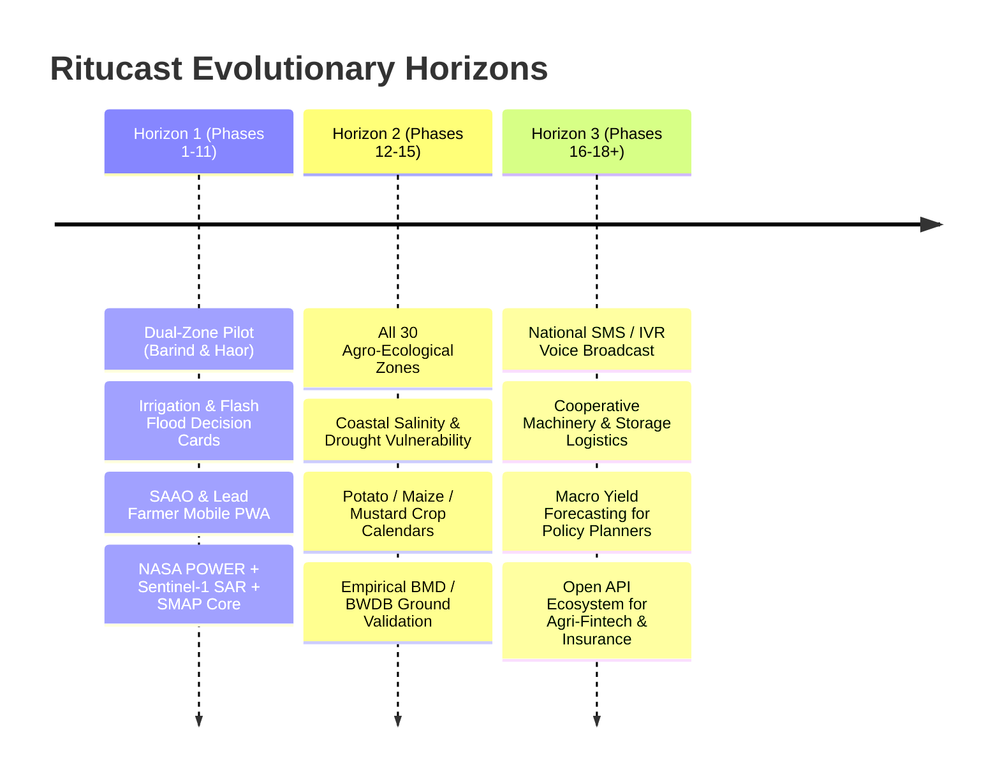

# Ritucast: Long-Term Product Vision & Expansion Horizons

## 1. Strategic Horizons Framework

To maintain engineering discipline during the initial development phases while preserving long-term ambition, Ritucast organizes its evolutionary trajectory into three distinct strategic horizons:

- **Horizon 1: Core Agro-Climatic Decision Engine (Phases 1–11)**: Focuses on the dual-anchor users (SAAOs and lead farmers), dual-zone pilots (Barind and Haor), core irrigation water-balance calculations, and flash-flood inundation alerting.
- **Horizon 2: National Scaling & Multi-Crop Analytics (Phases 12–15)**: Expands coverage across all 8 administrative divisions, incorporates coastal salinity indices, and integrates major cash crops (Potato, Maize, Mustard, Jute).
- **Horizon 3: Comprehensive Agricultural Intelligence Ecosystem (Phases 16–18+)**: Integrates multi-channel voice/SMS dissemination, cooperative logistics, seasonal yield forecasting, and third-party institutional APIs.

---

## 2. Long-Term Capability Expansion Areas

---

### Expansion Area 1: Coastal Salinity Intrusion Modeling
- **Value**: The southern coastal delta (Khulna, Bagerhat, Satkhira, Barishal, Patuakhali) suffers from dry-season river and soil salinization (often exceeding 4–8 dS/m), which severely restricts Rabi crop choices.
- **Data & Scientific Dependencies**:
  - Integration of BWDB river salinity monitoring stations with satellite-derived surface water salinity proxies.
  - Soil electrical conductivity (EC) mapping and crop salt-tolerance thresholds (e.g., BRRI dhan67, BARI sarisha-18).
- **Prerequisites for Implementation**:
  - Direct institutional data-sharing agreement with Soil Resource Development Institute (SRDI) and BWDB.
  - Completion of Horizon 1 core stability.

---

### Expansion Area 2: Macro-Level Crop Yield Forecasting
- **Value**: Enables DAE, Ministry of Agriculture, and the Directorate General of Food to anticipate seasonal harvest surpluses or regional shortfalls 3–4 weeks prior to national harvest.
- **Data & Scientific Dependencies**:
  - Calibrated crop growth models (e.g., DSSAT, WOFOST) driven by satellite radiation and temperature.
  - Multi-year, georeferenced BBS crop-cut yield statistics for model training and bias correction.
- **Prerequisites for Implementation**:
  - High-density historical yield ground-truth dataset spanning at least 5 seasons across diverse AEZs.
  - Formal scientific validation protocol (Phase 15).

---

### Expansion Area 3: Low-Bandwidth Dissemination (SMS & IVR Voice Push)
- **Value**: Bridges the digital divide to directly reach marginal smallholders who possess only 2G feature phones or struggle with textual literacy.
- **Data & Scientific Dependencies**:
  - High-throughput telecom SMS gateway integration in Bangladesh (e.g., Grameenphone, Banglalink, Robi).
  - Automated Bangla text-to-speech (TTS) or pre-recorded audio synthesis engine delivering localized voice advisories.
- **Prerequisites for Implementation**:
  - Sustainable operational financing or public-private sponsorship to cover recurring per-SMS / per-call telecom transit fees.
  - Proven advisory accuracy in pilot zones (preventing costly mass transmission of inaccurate advice).

---

### Expansion Area 4: Cooperative Harvester & Logistics Optimization
- **Value**: In Haor basins and intensive cereal belts, combine harvesters are shared or rented through contractors. A sudden 48-hour flash flood alert requires coordinated machine routing across villages.
- **Data & Scientific Dependencies**:
  - Fleet tracking APIs and cooperative machinery inventory registers.
  - Spatial multi-criteria optimization algorithms matching machine availability with harvest urgency scores.
- **Prerequisites for Implementation**:
  - Partnership with DAE Agricultural Mechanization wing and local machinery rental cooperatives.

---

## 3. Governance Policy Against Premature Expansion

1. **No Code for Future Horizons in Current Sprints**: No backend services, database tables, or UI navigation elements for Horizon 2 or Horizon 3 features will be written during Phases 1 through 11.
2. **Strict Evaluation Gates**: An expansion area can only be promoted to an active roadmap phase when its prerequisite data sources, institutional access, and scientific validation benchmarks are fully secured.
