# Ritucast: Project Overview

## 1. Executive Summary

**Ritucast** is an agricultural intelligence platform designed to transform earth observation (EO) satellites, numerical weather predictions, soil-moisture datasets, and agricultural statistics into localized, actionable agronomic intelligence for Bangladesh's farming ecosystem. 

In Bangladesh, agriculture employs over 38% of the labor force and contributes significantly to national GDP and food security. However, smallholder and medium-scale producers face compounding agro-climatic challenges—including unseasonal rainfall, prolonged dry spells, flash floods in the northeast haor basins, salinity intrusion in the southern coastal zone, and increasing temperature variability. 

While multiple global satellite missions (e.g., NASA POWER, Sentinel-1/2, GPM IMERG, SMAP, MODIS) and national agrometeorological initiatives (e.g., DAE's BAMIS) generate substantial environmental data, a critical **"last-mile translation gap"** persists. Farmers and field extension officers frequently lack accessible, timely, and explainable tools that convert raw sensor readings and multi-kilometer gridded weather forecasts into concrete, field-level agronomic decisions (such as optimal sowing windows, irrigation timing, and proactive flood/dry-spell risk mitigation).

Ritucast bridges this gap by synthesizing multi-source environmental observations with crop-phenology calendars and localized risk models, delivering transparent, evidence-backed advisories tailored to regional cropping systems.

---

## 2. Core Purpose and Mission

### Why Ritucast Exists
1. **Reduce Climate Vulnerability**: Provide advance warning of agro-climatic hazards (flash floods, moisture deficits, heat stress) before crop damage becomes irreversible.
2. **Optimize Resource Allocation**: Guide smallholders on irrigation necessity, fertilizer application timing relative to precipitation events, and sowing/harvesting windows to reduce input waste and crop losses.
3. **Democratize Agrometeorological Intelligence**: Translate complex multi-spectral satellite data and climate models into clear, low-bandwidth, Bangla-accessible decision support tools for field intermediaries and farmers.
4. **Maintain Scientific Transparency**: Ensure that every advisory clearly separates empirical satellite observations from forecast models, avoiding overconfident claims or black-box predictions.

---

## 3. High-Level System Concept

```mermaid
flowchart LR
    subgraph DataInputs [Multi-Source Data Ingestion]
        A[NASA POWER / BMD Weather]
        B[Sentinel-1 SAR / Sentinel-2 Optical]
        C[GPM IMERG Rainfall]
        D[SMAP Soil Moisture]
        E[BBS / BRRI Crop Calendars]
    end

    subgraph RitucastCore [Ritucast Analytics Core]
        F[Regional Baseline & Phenology Engine]
        G[Agro-Climatic Stress & Hazard Detector]
        H[Explainable Decision & Advisory Synthesizer]
    end

    subgraph DeliveryChannels [User Delivery & Dissemination]
        I[Web / Mobile Interface - Bangla / English]
        J[DAE Extension Officer / SAAO Portal]
        K[Community Lead Farmers & Co-ops]
    end

    DataInputs --> RitucastCore
    RitucastCore --> DeliveryChannels
```

---

## 4. Key Project Constraints & Principles

1. **Evidence-Based Stance**: No black-box yield predictions or unvalidated claims. Field-level recommendations must be grounded in verified agrometeorological science.
2. **Spatial Reality & Sub-Plot Scale**: Bangladesh's farming landscape is fragmented into smallholder parcels (often <0.5 to 1 acre). Gridded satellite products (e.g., 0.1° precipitation, 9–36 km SMAP, 250m MODIS) represent *macro/regional environmental contexts*, not individual parcel boundaries. Ritucast clearly communicates this spatial context to prevent false precision.
3. **Cloud-Penetrating Modalities**: During the monsoon (Aman season), cloud cover approaches 80–90%, making optical satellites (Sentinel-2, MODIS) intermittently blind. Radar (Sentinel-1 C-band SAR) and microwave precipitation estimates (GPM IMERG) must serve as core modalities for waterlogging and flood detection.
4. **Phased Development Governance**: Project execution strictly follows an 18-phase roadmap, maintaining discipline, rigorous documentation, and stakeholder review before transitioning across phases.

---

## 5. Traceability and Cross-References

- [Problem Definition](file:///Users/kazi/Projects/RITUCAST/docs/project/problem-definition.md)
- [Target Users & Stakeholders](file:///Users/kazi/Projects/RITUCAST/docs/project/target-users.md)
- [Product Vision & Positioning](file:///Users/kazi/Projects/RITUCAST/docs/project/product-vision.md)
- [Initial Product Scope](file:///Users/kazi/Projects/RITUCAST/docs/project/initial-scope.md)
- [Geographic & Agricultural Scope](file:///Users/kazi/Projects/RITUCAST/docs/project/geographic-agricultural-scope.md)
- [18-Phase Project Roadmap](file:///Users/kazi/Projects/RITUCAST/docs/planning/roadmap.md)
