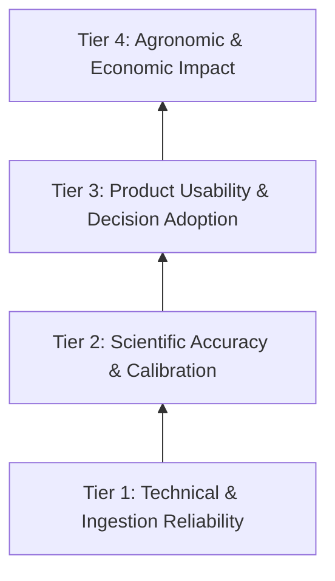

# Ritucast: Preliminary Success Metrics Framework

## 1. Measurement Architecture & Impact Attribution

Evaluating an agricultural intelligence platform requires a disciplined attribution hierarchy. Providing data to a user does not guarantee that a decision changed, nor does a changed decision guarantee higher crop yields due to confounding factors (seed quality, fertilizer adulteration, pest outbreaks, market prices).

Ritucast establishes a four-tier measurement pyramid:

---

## 2. Metric Categories and Evaluation Matrix

### Tier 1: Technical & Ingestion Reliability
*Measures whether the underlying data ingestion and application delivery operate predictably.*

| Metric Name | What It Measures | Why It Matters | Measurement Method & Data Source | Feasible Timeline | Baseline / Target Justification |
| :--- | :--- | :--- | :--- | :--- | :--- |
| **Pipeline Ingestion Success Rate** | % of scheduled daily weather and satellite jobs completed without failure. | Stale inputs lead to dangerous outdated advisories. | System log monitoring; Prometheus/Grafana automated task tracking. | Phase 8+ (Pipeline dev) | Target: $\ge 99.0\%$ on operational runs. Baseline established in Phase 8. |
| **Observation Freshness / Latency** | Time delta between satellite/weather data publication and platform ingestion. | Flash flood and storm alerts lose value within 6 hours. | Pipeline timestamp delta logging across NASA POWER, GPM, Sentinel-1 APIs. | Phase 8+ | Target: $< 4\text{ hours}$ from provider availability. |
| **PWA Bundle Size & Cold Load Time** | Initial JavaScript/CSS payload size and Time-to-Interactive (TTI) on 3G network. | Heavy web apps crash or stall on rural budget Android devices. | Google Lighthouse CI, synthetic 3G throttling tests. | Phase 11+ (Frontend dev) | Target: Bundle size $< 1.5\text{MB}$; TTI $< 3.5\text{s}$ on throttled 3G. |

---

### Tier 2: Scientific Quality & Calibration
*Measures whether the analytical indices agree with empirical reality and convey honest uncertainty.*

| Metric Name | What It Measures | Why It Matters | Measurement Method & Data Source | Feasible Timeline | Baseline / Target Justification |
| :--- | :--- | :--- | :--- | :--- | :--- |
| **Rainfall Forecast Skill (Brier Score / Reliability)** | Brier score of daily precipitation probability ($\ge 5\text{mm}$, $\ge 15\text{mm}$). | If farmers are told rain is 80% likely and it doesn't rain, trust collapses. | Verification against BMD ground rain gauges and GPM IMERG Final observations. | Phase 9 / 15 | Target: Brier Score $< 0.18$ for 48h horizon. Must be calibrated against historical BMD records. |
| **SAR Flood Extent Agreement** | Spatial correlation between Sentinel-1 radar watermask and verified haor inundation boundaries. | Prevents false emergency harvest alarms or missed flood crests. | Intersection over Union (IoU) / F1-score against BWDB ground reports and cloud-free optical validation. | Phase 9 / 15 | Target: $\text{IoU} \ge 0.75$ on confirmed inundation events. |
| **Evapotranspiration Consistency** | Deviation of satellite-derived Penman-Monteith $ET_0$ against regional meteorological benchmark stations. | Ensures water-balance models do not systematically over- or under-estimate irrigation needs. | Root Mean Square Error (RMSE) against BMDA and BRRI agrometeorological lysimeter/pan records. | Phase 15 (Validation phase) | Target: $\text{RMSE} \le 0.8\text{ mm/day}$ on 10-day rolling averages. |

---

### Tier 3: Product Usability & Decision Adoption
*Measures whether target users understand the advice and use it to guide decisions.*

| Metric Name | What It Measures | Why It Matters | Measurement Method & Data Source | Feasible Timeline | Baseline / Target Justification |
| :--- | :--- | :--- | :--- | :--- | :--- |
| **Primary User Journey Completion Rate** | % of sessions where a user successfully selects their Upazila + Crop and views actionable advisory cards. | Core indicator that the UI is navigable and intuitive. | Privacy-preserving client event analytics. | Phase 11 / 14 | Target: $\ge 85\%$ completion rate without abandonment. |
| **Advisory Comprehension Score** | User's accurate verbal interpretation of an advisory card during structured user testing. | An advisory that is misunderstood leads to faulty agronomic actions. | Structured usability interviews (5-point rubric) with SAAOs and lead farmers. | Phase 14 / 17 | Target: $\ge 90\%$ of test participants correctly explain the recommendation and the "why". |
| **Advisory Adherence / Adoption Rate** | % of surveyed farmers who report modifying a farming action (postponing irrigation, harvesting early) based on an alert. | Validates that recommendations cross the intention-action gap. | Seasonal survey sampling across pilot upazila cohorts (100–200 farmers). | Phase 17 (Feedback phase) | Target: $\ge 40\%$ self-reported adoption among active users in pilot zones. |

---

### Tier 4: Agronomic & Economic Impact
*Measures long-term welfare, resource conservation, and risk reduction.*

| Metric Name | What It Measures | Why It Matters | Measurement Method & Data Source | Feasible Timeline | Baseline / Target Justification |
| :--- | :--- | :--- | :--- | :--- | :--- |
| **Avoided Irrigation Pumping Hours / Fuel Cost** | Reduction in diesel/electricity expenditure from weather-synchronized irrigation postponement. | Primary direct financial return for smallholders and tubewell operators. | Paired-plot or pre/post seasonal survey of pumping logs in Barind pilot. | Phase 17 / 18 | Target: $10–20\%$ reduction in non-essential irrigation runs (est. 1,000–2,000 BDT/acre saved). |
| **Mitigated Haor Harvest Losses** | Estimated value of Boro crop safely harvested prior to flash flood inundation following alert. | Prevents catastrophic total crop write-offs. | DAE damage reports and farmer recall surveys following flood trigger events. | Phase 17 / 18 | Requires an actual flood trigger event during Boro maturity to measure. |

---

## 3. Principles of Responsible Reporting

1. **No False Causal Attribution**: Ritucast will never claim that yield increases are solely caused by platform usage without a rigorous randomized or quasi-experimental control group.
2. **Pre-Baseline Discipline**: Quantitative targets in Tiers 3 and 4 represent aspirational evaluation benchmarks, not current operational realities. Formal baselines will be measured during pilot field trials in Phases 14–17.
3. **Open Error Auditing**: When a false positive (e.g., missed rain or false flood alarm) occurs, it must be logged and evaluated in a transparent post-mortem log to improve the agronomic heuristics.
