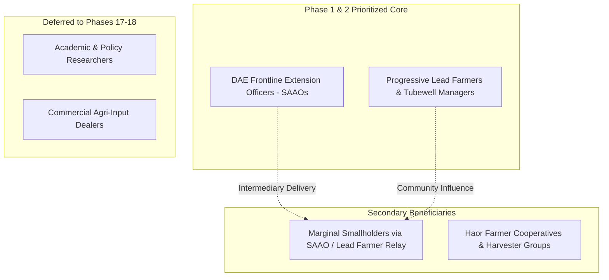

# Ritucast: Target User Analysis & Prioritization

## 1. Context and User Ecosystem in Bangladesh Agriculture

Agriculture in Bangladesh operates through a layered ecosystem comprising direct producers, government extension networks, input dealers, and farmer cooperatives. 

Designing an agricultural intelligence system requires recognizing three critical structural realities:
1. **The Smallholder Intermediary Dynamic**: Over 80% of farming households cultivate smallholdings under 1.0 hectare (BBS Agriculture Census). While smartphone penetration is expanding rapidly, direct smartphone usage for complex data dashboards among older smallholders remains constrained by literacy, digital confidence, and visual screen ergonomics.
2. **The Frontline Role of SAAOs**: The Department of Agricultural Extension (DAE) employs approximately 14,000 Sub-Assistant Agriculture Officers (SAAOs), with each SAAO responsible for 1,000–1,500 farming households across multiple agricultural blocks (*Union* level). SAAOs are equipped with smartphones, have functional digital literacy, and serve as the primary trusted human conduits for agricultural advisories.
3. **The Emerging Progressive / Lead Farmer**: In almost every village cluster, younger "lead farmers" (*Krishok Dal* leaders, tubewell managers, or agri-entrepreneurs) act as local technology champions and decision influencers.

---

## 2. Multi-Segment Evaluation Matrix

| User Segment | Goals & Responsibilities | Key Farming Decisions | Digital Literacy & Devices | Recommended Priority | Rationale |
| :--- | :--- | :--- | :--- | :--- | :--- |
| **Agricultural Extension Officers (SAAOs)** | Advise 1,000+ farmers per block; monitor crop progress; issue pest/weather alerts; report to Upazila Agriculture Officer (UAO). | Weekly advisory issuance; flood evacuation/harvest recommendations; irrigation scheduling campaigns. | **High/Moderate**: Android smartphones, WhatsApp/BAMIS usage, high Bangla literacy, basic English terminology. | **Primary Target (Co-Anchor)** | SAAOs amplify Ritucast's reach 1000x; they possess the agronomic knowledge to interpret risk indices into actionable community advice. |
| **Progressive Lead Farmers & Tubewell Managers** | Maximize yield and commercial profit; manage shared irrigation resources (BMDA/STWs); test new crop varieties. | When to operate deep/shallow tubewells; seed purchase timing; pesticide/fertilizer application; harvest timing. | **Moderate**: Low-to-mid range Android smartphones; active Facebook/YouTube users; full Bangla fluency. | **Primary Target (Direct Farmer Anchor)** | Tech-receptive, directly manages capital and machinery, influences neighboring smallholders by example. |
| **Smallholder Marginal Farmers** | Household subsistence and cash-crop survival; debt minimization; yield security. | Daily field work; irrigation payment; emergency harvesting; family labor deployment. | **Low/Variable**: Feature phones or shared family budget smartphones; low digital literacy; prefers voice/Bangla audio or SAAO advice. | **Secondary / Indirect Beneficiary (Initial Release)** | Must not be excluded, but delivering dense visual satellite dashboards directly to them creates immediate UX failure. Served via simplified Bangla cards and SAAO mediation. |
| **Farmer Cooperatives & FPOs** | Collective input purchasing; bulk grain storage and marketing; machinery sharing (combine harvesters). | Scheduling harvester rentals across blocks; bulk harvest timing; storage protection against damp/rain. | **Moderate**: Android tablets/smartphones; PC access at union digital centers. | **Secondary** | High leverage for harvesting logistics (especially in flood-prone Haor zones). |
| **Agricultural Researchers & Academics** | Phenology modeling; climate resilience studies; variety testing. | Research trial validation; regional yield modeling. | **High**: Laptops, GIS software, advanced English. | **Deferred (Later Phase)** | Serving researchers risks turning Ritucast into a complex scientific GIS dashboard, compromising farmer utility. |
| **Private Agri-Input Dealers & Advisors** | Sell fertilizers, seeds, and agrochemicals; offer informal agronomic advice. | Stock ordering; recommending sprays and seeds to walk-in farmers. | **Moderate**: Android smartphones; commercial motive. | **Deferred / Monitored** | Commercial conflict of interest (incentive to sell chemical inputs regardless of weather necessity). |

---

## 3. Deep-Dive Profile of Target User Segments

---

### Segment A: DAE Sub-Assistant Agriculture Officers (SAAOs) — *Primary Co-Anchor*

- **Profile**: Civil service field extension workers stationed at Union parishad levels. Age 24–55. Responsible for holding courtyard meetings (*Uthan Boithok*), demonstrating new technologies, and reporting crop acreage.
- **Current Difficulties**:
  - Overloaded with administrative reporting; forced to rely on broad, district-level PDF weather bulletins that lack upazila-level specificity.
  - Lack convenient digital tools to verify whether a dry spell or waterlogging is occurring uniformly across their block.
- **Platform Usage Frequency**: 2–4 times per week; daily during extreme weather alerts (cyclones, pre-monsoon rains, heatwaves).
- **Device & Connectivity Constraints**: Mid-tier Android phones (2GB–4GB RAM, 720p screens), 4G in town centers, intermittent 3G/EDGE in remote rural blocks. Need lightweight web bundle and offline caching.
- **Language**: 100% Bangla terminology aligned with standard DAE agrometeorological vocabulary.
- **Adoption Barriers**: Skepticism if digital predictions conflict with local reality; resistance if tool requires burdensome data entry.
- **Potential Value**: Reduces advisory preparation time; provides verifiable, visual satellite evidence to show farmers during block visits.

---

### Segment B: Progressive Lead Farmers & Tubewell Operators — *Primary Co-Anchor*

- **Profile**: Cultivates 2.5–7.5 acres (own or leased); frequently operates irrigation tubewells or custom-hiring machinery. Highly motivated by input cost savings (diesel, electricity, fertilizer).
- **Current Difficulties**:
  - Unpredictable rainfall timing wastes expensive irrigation pumping runs.
  - Sudden pre-monsoon downpours destroy unharvested mature crops.
  - Confusing weather apps that only show generic cloud/rain icons without soil moisture or farming recommendations.
- **Platform Usage Frequency**: Daily during critical crop stages (land preparation, transplanting, flowering, harvesting); weekly during vegetative maintenance.
- **Device & Connectivity Constraints**: Budget Android smartphones (Xiaomi, Symphony, Walton, Realme); variable cellular connectivity; high sensitivity to mobile data consumption.
- **Language & UX**: Clear Bangla text, high-contrast visual icons, zero technical jargon (e.g., avoid "Normalized Difference Vegetation Index"; use "ফসলের সতেজতা ও স্বাস্থ্য সূচক").
- **Potential Value**: Direct financial savings of 2,000–5,000 BDT/acre in avoided diesel pumping and preserved harvest quality.

---

### Segment C: Marginal Smallholders — *Indirect / Secondary Target*

- **Profile**: Cultivates 0.2–1.5 acres; risk-averse; relies on family labor.
- **Key Consideration**: Designing Ritucast as a complex interactive GIS tool would isolate this user. In Phase 1 and 2, Ritucast addresses this segment through:
  - High-clarity **"Advisory Cards"** that lead farmers and SAAOs can easily share via WhatsApp, IMO, or verbal relay.
  - Future roadmap provisions (Phase 11+) for automated voice (IVR) or SMS push summaries.

---

## 4. User Prioritization Decision and Phasing

### Strategic Recommendation for Initial Release
1. **Primary Target Archetype**: The **Dual-Anchor Model**—serving the **Agro-Extension Intermediary (SAAO)** and the **Tech-Enabled Progressive Lead Farmer**.
2. **Design Implication**: The user interface must support two presentation modes:
   - *Quick Action View*: Fast, icon-driven Bangla advisory cards for immediate farming action (irrigate, postpone, spray, harvest).
   - *Detail & Diagnostic View*: Agro-climatic trend charts, satellite anomaly overlays, and uncertainty bounds for SAAOs to explain the advisory to farmers.
3. **Validation Requirements for Phase 2**: Direct user interviews with 5–10 SAAOs and lead farmers across target upazilas to validate screen density, vocabulary, and notification timing preferences.
