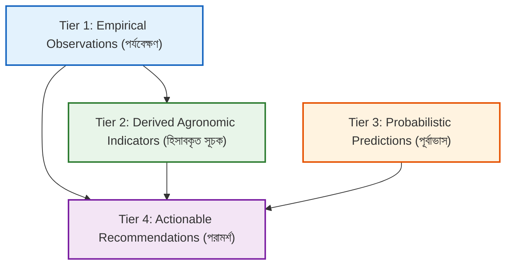

# Ritucast: Recommendation Quality & Scientific Safety Requirements

## 1. Safety Mandate and Agronomic Responsibility

Agricultural recommendations in smallholder farming carry severe economic and household survival implications. Advising a farmer to withhold irrigation prior to a dry spell, or failing to issue an emergency harvest alert before a flash flood, can result in complete crop failure, household indebtedness, and food insecurity.

Ritucast enforces a strict **"Do No Harm"** agronomic safety architecture. Recommendations are treated as safety-critical decisions that must satisfy explicit scientific gates, uncertainty disclosures, and automated fallback suppressions.

---

## 2. Four-Tier Information Taxonomy

The platform interface and analytical pipelines must maintain strict visual and structural separation across four distinct categories of information:

### Tier 1: Empirical Observations (*পরিমাপকৃত উপগ্রহ ও আবহাওয়া পর্যবেক্ষণ*)
- **Definition**: Direct physical measurements collected by satellite sensors or meteorological surface stations.
- **Examples**: NASA CERES solar radiation, Sentinel-1 radar backscatter ($\sigma^\circ$), BMD gauge rainfall total over the past 24 hours.
- **Rule**: Must be labeled with exact sensor mission, capture timestamp, and provider agency.

### Tier 2: Derived Agronomic Indicators (*হিসাবকৃত কৃষি সূচক*)
- **Definition**: Values computed from Tier 1 observations using standardized, peer-reviewed mathematical or physical equations.
- **Examples**: FAO-56 Reference Evapotranspiration ($ET_0$), 7-day rainfall accumulation anomaly, radar surface watermask polygon.
- **Rule**: Must cite the underlying equation/method and acknowledge spatial resolution limits.

### Tier 3: Probabilistic Predictions (*গাণিতিক পূর্বাভাস*)
- **Definition**: Estimates of future atmospheric or hydrological conditions generated by numerical weather prediction (NWP) or flood models.
- **Examples**: 48-hour rainfall probability (%), forecasted maximum temperature, upstream runoff projection.
- **Rule**: Must always display confidence intervals or probability percentages; never presented as absolute certainties.

### Tier 4: Actionable Recommendations (*কৃষি সিদ্ধান্ত ও পরামর্শ*)
- **Definition**: Synthesized agronomic guidance recommending a specific operational action.
- **Examples**: *"সেচ স্থগিত রাখুন"* (Postpone Irrigation for 3 Days), *"জরুরি ধান কর্তন প্রস্তুতি"* (Mobilize Emergency Harvest).
- **Rule**: Must be accompanied by a plain-language explanation ("কেন এই পরামর্শ?"), confidence rating, and local verification advice.

---

## 3. Recommendation Quality & Safety Rules

---

### Rule 1: Mandatory Phenological & Geographic Gating
- A recommendation **cannot be generated** without explicit user selection or verified confirmation of:
  1. The specific administrative Upazila.
  2. The active crop (e.g., Boro Rice).
  3. The current phenological growth stage (e.g., Flowering).
- *Safety Justification*: What is beneficial advice during the tillering stage (e.g., allowing slight water drying) can cause catastrophic spikelet sterility if applied during flowering.

---

### Rule 2: Conditions for Automated Suppression (When NOT to Advise)
The system must automatically **suppress recommendations** and display a safe fallback notice under any of the following operational conditions:
1. **Data Staleness**: Weather forecast observations are $>36\text{ hours}$ old (`NFR-REL-03`).
2. **Extreme Meteorological Uncertainty**: Ensemble weather models show a high spread with rain probability between $40\%$ and $60\%$ without clear consensus.
3. **Out-of-Season Crop Selection**: The selected crop cannot biologically grow during the current agro-climatic calendar month.
4. **Data Corruption / Missing Indicators**: Essential variables ($T_{\text{max}}$, rain, or soil status) are null or fail range validation.

*Mandatory Fallback Copy*:
> *"তথ্য হালনাগাদ হচ্ছে বা পূর্বাভাসের অনিশ্চয়তা বেশি থাকায় এই মুহূর্তে সুনির্দিষ্ট স্বয়ংক্রিয় পরামর্শ দেয়া সম্ভব হচ্ছে না। সেচ বা কর্তনের সিদ্ধান্ত নেয়ার আগে আপনার জমির বর্তমান অবস্থা নিজে পর্যবেক্ষণ করুন এবং স্থানীয় উপ-সহকারী কৃষি কর্মকর্তা (SAAO)-এর পরামর্শ নিন।"*  
> *(Data is updating or forecast uncertainty is high; automated advice cannot be generated right now. Inspect field conditions directly and consult your local SAAO before deciding).*

---

### Rule 3: Anti-Overconfidence & Language Safeguards
To protect smallholders from blind reliance and protect the platform from liability:
- **No Yield Guarantees**: System text must never promise specific harvest yields (e.g., *"Following this will yield 6 MT/ha"*). System must use risk-mitigation language (*"ঝুঁকি হ্রাস"*).
- **No Absolute Assertions**: Phrases such as *"১০০% নিশ্চিত"* (100% certain) or *"অবশ্যই বৃষ্টি হবে"* (it will definitely rain) are strictly banned.
- **Mandatory Field-Level Cross-Check**: Every irrigation postponement advisory must include the instruction: *"সেচ বন্ধ করার আগে জমির আইল এবং মাটির রস নিজে হাত দিয়ে পরীক্ষা করুন।"* (Check field bunds and soil moisture by hand before shutting down pumps).

---

### Rule 4: Explainability by Design
Every recommendation card must feature a visible **"কেন এই পরামর্শ?"** button that opens a transparent breakdown displaying:
1. What was observed in the past 7 days.
2. What is predicted for the next 48–72 hours.
3. How the crop's daily water balance was evaluated.
4. The confidence level of the prediction.

---

## 4. Modeling Philosophy & Anti-Complexity Rules

1. **Rule-Based & Physical Baselines First**: Ritucast prioritizes transparent, physically grounded equations (FAO-56 Penman-Monteith, water balance, agronomic thermal thresholds) over complex machine learning models for the initial release.
2. **Justification Gate for Machine Learning**: Machine learning models (e.g., Random Forests, Gradient Boosted Trees, Neural Networks) will only be introduced in subsequent phases (Phase 9/15) if:
   - A clear baseline (FAO-56 or linear regression) has been benchmarked.
   - The ML model demonstrates statistically significant, peer-reviewed improvement on an independent test dataset.
   - The model includes verifiable explainability mechanisms (e.g., SHAP feature attributions).
3. **Zero Data Leakage Standard**: All future predictive models must enforce strict temporal and spatial cross-validation splits to prevent overfitting across seasons and adjacent upazilas.
