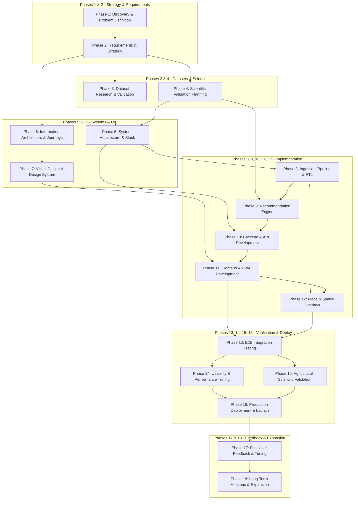

# Ritucast: Requirements Traceability Matrix (RTM)

## 1. Traceability Architecture

The Ritucast Requirements Traceability Matrix connects every functional and non-functional requirement through a verifiable, closed-loop value chain:

$$\text{User Problem} \longrightarrow \text{User Need} \longrightarrow \text{Requirement ID} \longrightarrow \text{Priority} \longrightarrow \text{Downstream Phases} \longrightarrow \text{Success Metric}$$

---

## 2. Comprehensive Traceability Matrix

| Requirement ID | Problem / Need Addressed | Capability Name | Priority | Key Downstream Phase Dependencies | Acceptance Test & Validation Method | Linked Success Metric |
| :--- | :--- | :--- | :---: | :--- | :--- | :--- |
| **`FR-LOC-01`** | Need for localized administrative advice across Bangladesh. | Upazila Location Selector | **P0** | Phase 5 (Arch), Phase 6 (IA), Phase 10 (Backend) | Verify 495 Upazilas selectable; selection persists on refresh. | `MET-UX-01` |
| **`FR-LOC-02`** | Generic advice ignores biological crop sensitivity. | Crop & Phenology Configuration | **P0** | Phase 4 (Phenology), Phase 6 (IA), Phase 9 (Analytics) | Verify stage selection alters crop coefficient ($K_c$) within $<300\text{ms}$. | `MET-SCI-03` |
| **`FR-LOC-03`** | Complex menus slow down mobile onboarding. | Geolocation with Manual Fallback | **P1** | Phase 10 (Backend API), Phase 11 (Frontend) | Verify GPS maps to nearest Upazila; denying GPS leaves UI responsive. | `MET-UX-01` |
| **`FR-ENV-01`** | Need for reliable 7-day field-level forecasts. | 7-Day Agro-Weather Forecast | **P0** | Phase 3 (Data), Phase 8 (Pipeline), Phase 10 (API) | Verify daily max/min temp, rain mm, RH, and wind render cleanly. | `MET-TECH-02` |
| **`FR-ENV-02`** | Inability to evaluate whether week is unusually dry/wet. | 7-Day Rainfall Anomaly | **P1** | Phase 3 (Data), Phase 8 (ETL), Phase 9 (Analytics) | Verify rolling 7-day sum compares against 10-yr historical terciles. | `MET-SCI-01` |
| **`FR-ENV-03`** | Surface cracking deceives farmers about root moisture. | Root-Zone Soil Moisture Deficit | **P1** | Phase 3 (SMAP), Phase 8 (ETL), Phase 9 (Analytics) | Verify deficit categorized into 3 tiers with mandatory disclaimer. | `MET-SCI-01` |
| **`FR-ENV-04`** | Sudden overland flash floods submerge Haor crops. | Radar Surface Inundation Alert | **P1** | Phase 3 (SAR/GPM), Phase 8 (ETL), Phase 9 (Analytics) | Verify upstream rain $>100\text{mm}$ triggers high-priority Haor alert card. | `MET-SCI-02` |
| **`FR-ENV-05`** | Stale data destroys trust and damages crops. | Data Freshness & Attribution | **P0** | Phase 8 (Metadata), Phase 11 (Frontend) | Verify data $>18\text{h}$ shows warning; $>36\text{h}$ suppresses recommendation. | `MET-TECH-02` |
| **`FR-ADV-01`** | Farmers pump tubewells right before rain, wasting money. | Weather-Synced Irrigation Advisory | **P0** | Phase 4 (FAO-56), Phase 9 (Engine), Phase 11 (UI) | Verify 72h rain $\ge 15\text{mm}$ generates postponement card with fuel savings. | `MET-AGR-01` |
| **`FR-ADV-02`** | 100% loss of mature Boro rice in flash floods. | Flash-Flood Emergency Harvest Alert | **P1** | Phase 4 (Hydrology), Phase 9 (Engine), Phase 11 (UI) | Verify ripening stage + upstream storm outputs 80% harvest mobilization card. | `MET-AGR-02` |
| **`FR-ADV-03`** | Agrochemical wash-off and spray drift. | Safe Spray & Fertilizer Window | **P2** | Phase 4 (Agronomy), Phase 9 (Engine), Phase 11 (UI) | Verify rain $<1\text{mm/h}$ and wind $<15\text{km/h}$ generates green safe window badge. | `MET-AGR-01` |
| **`FR-ADV-04`** | Farmers reject opaque black-box algorithms. | Interactive Explainability Drawer | **P0** | Phase 6 (IA), Phase 9 (Analytics), Phase 11 (Frontend) | Verify drawer opens in $<200\text{ms}$ with observation vs forecast breakdown. | `MET-UX-02` |
| **`FR-ADV-05`** | False certainty destroys trust when forecasts miss. | Confidence Rating Display | **P0** | Phase 9 (Analytics), Phase 11 (Frontend) | Verify 3 confidence tiers clearly displayed with icons and text. | `MET-SCI-01` |
| **`FR-DSH-01`** | Complex dashboards crash on budget mobile screens. | Mobile Action-First Card Layout | **P0** | Phase 6 (IA), Phase 7 (Design System), Phase 11 (UI) | Verify viewport renders cleanly at 360px without horizontal scroll. | `MET-UX-01` |
| **`FR-DSH-02`** | SAAOs lack regional district-level situational awareness. | Upazila Risk Choropleth Map | **P2** | Phase 5 (Tiles), Phase 8 (Geo), Phase 12 (Maps) | Verify map tiles load in $<1.5\text{s}$; heap memory $<40\text{MB}$ RAM. | `MET-TECH-03` |
| **`FR-DSH-03`** | Rural fields frequently lose cellular connectivity. | Offline PWA Local Caching | **P0** | Phase 5 (Arch), Phase 11 (Frontend/PWA), Phase 14 | Verify app opens offline; loads cached advisories in $<1.5\text{s}$ with badge. | `MET-TECH-03` |
| **`FR-DSH-04`** | Advice cannot reach non-smartphone farmers directly. | One-Tap WhatsApp/IMO Share | **P1** | Phase 11 (Frontend Web Share API) | Verify generates formatted PNG card ($<250\text{KB}$) within $<500\text{ms}$. | `MET-UX-03` |
| **`NFR-PERF-01`** | Heavy web apps crash low-cost Android phones. | Bundle Size Budget ($\le 1.5\text{MB}$) | **P0** | Phase 5 (Tech Stack), Phase 11 (Frontend), Phase 14 | Webpack / Vite bundle analysis in CI/CD pipeline. | `MET-TECH-03` |
| **`NFR-PERF-02`** | Slow networks cause user abandonment. | Time-to-Interactive ($\le 3.5\text{s}$ on 3G) | **P1** | Phase 11 (Frontend), Phase 14 (Optimization) | Automated Google Lighthouse CI audit on throttled 3G profile. | `MET-TECH-03` |
| **`NFR-REL-03`** | Stale advice causes severe agronomic damage. | Hard 36h Staleness Ceiling | **P0** | Phase 8 (Pipeline), Phase 9 (Engine), Phase 11 (UI) | Unit test simulating $>36\text{h}$ old data verifies automated suppression. | `MET-TECH-02` |
| **`NFR-SEC-01`** | Surveillance and data-harvesting risks. | Zero Mandatory PII Collection | **P0** | Phase 5 (Architecture), Phase 10 (Backend) | Security audit confirms zero PII fields stored in database or logs. | `MET-SEC-01` |

---

## 3. Phase Dependency Mapping

---

## 4. Gated Requirements & Progression Triggers

Specific high-value features cannot proceed to implementation until explicit scientific and operational conditions are satisfied:

1. **Gated Feature: Automated Irrigation Postponement (`FR-ADV-01`)**:
   - *Condition to Unlock*: Phase 3 must verify that NASA POWER daily precipitation and solar radiation data exhibits $<15\%$ variance against BMD synoptic stations in Rajshahi; Phase 4 must formalize the Penman-Monteith calibration parameters for Boro rice.
2. **Gated Feature: Flash Flood Emergency Harvest Alert (`FR-ADV-02`)**:
   - *Condition to Unlock*: Phase 3 must verify access to Sentinel-1 C-band SAR GRD datasets over Sylhet/Sunamganj with a processing latency $<12\text{ hours}$ of satellite acquisition.
3. **Gated Feature: Regional Risk Choropleth Map (`FR-DSH-02`)**:
   - *Condition to Unlock*: Phase 5 must benchmark vector/raster tile rendering memory consumption on simulated 2GB Android hardware to confirm it does not exceed the $45\text{MB}$ heap budget (`NFR-PERF-03`).
