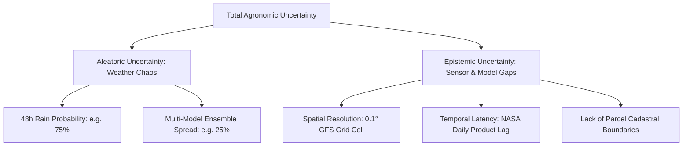

# Model Limitations, Uncertainty, and Explainability — Ritucast

## 1. Overview

Ritucast combines physics-based agro-meteorological equations with heuristic decision rules to generate farm guidance. This document defines the mathematical bounds, physical limitations, uncertainty representations, and explainability standards enforced across all analytical components.

---

## 2. Physics-Based Model Specifications & Bounds

### 2.1 Reference Evapotranspiration ($ET_0$)
- **Methodology**: FAO-56 Penman-Monteith equation ([`analytics/indicators/penman_monteith.py`](file:///Users/kazi/Projects/RITUCAST/analytics/indicators/penman_monteith.py)).
- **Input Variables**: Net radiation ($R_n$), 2-meter air temperature ($T$), wind speed at 2m ($u_2$), saturation vapor pressure deficit ($e_s - e_a$), and psychrometric constant ($\gamma$).
- **Physical Bounds**:
  - $0.0 \le ET_0 \le 15.0\text{ mm/day}$ (Barind winter/pre-monsoon bounds: typical range $2.5\text{--}6.5\text{ mm/day}$).
  - Out-of-bounds calculations trigger immediate pipeline validation errors.

### 2.2 Crop Evapotranspiration ($ET_c$) and Water Demand
- **Methodology**: Single crop coefficient approach ($ET_c = K_c \times ET_0$) calibrated for Boro rice phenology ([`analytics/indicators/crop_water_demand.py`](file:///Users/kazi/Projects/RITUCAST/analytics/indicators/crop_water_demand.py)).
- **Calibrated $K_c$ Table (BRRI 2024 / FAO-56)**:
  - Initial / Transplanting: $K_c = 1.05$
  - Vegetative / Tillering: $K_c = 1.10$
  - Mid-Season / Panicle Initiation & Flowering: $K_c = 1.20$
  - Late Season / Ripening & Dough: $K_c = 0.95$

### 2.3 Soil Water Deficit ($D_t$)
- **Methodology**: Daily soil water balance ($D_t = D_{t-1} + ET_c - P_{\text{eff}} - I + DP$) ([`analytics/indicators/soil_water_deficit.py`](file:///Users/kazi/Projects/RITUCAST/analytics/indicators/soil_water_deficit.py)).
- **Agronomic Thresholds**:
  - Raw Water Capacity ($RAW = p \times TAW$, where $p=0.20$ for flooded rice ponding).
  - Alternate Wetting and Drying (AWD) trigger: Perched water depth drops to $-15\text{ cm}$ below ground level.

### 2.4 Haor Flash-Flood Hazard Index ($I_{\text{flood}}$)
- **Methodology**: Multi-criteria weighted index ([`analytics/indicators/haor_flood_index.py`](file:///Users/kazi/Projects/RITUCAST/analytics/indicators/haor_flood_index.py)):
  $$I_{\text{flood}} = w_1 \left(\frac{WL - DL_{\text{safe}}}{DL - DL_{\text{safe}}}\right) + w_2 \left(\frac{dP}{dt}\right) + w_3 \left(\frac{P_{48h}}{P_{\text{thresh}}}\right)$$
- **Limitations**:
  - Valid only for Sylhet Basin Haor testbeds (Sunamganj Sadar, Tahirpur).
  - Relies on upstream Meghalaya transboundary rainfall signals. Does not model sub-embankment breaches (embankment failure mechanics).

---

## 3. Epistemic vs. Aleatoric Uncertainty Representation

Ritucast explicitly separates and communicates two types of uncertainty:

1. **Weather Uncertainty (Aleatoric)**: Presented as calibrated percentage probabilities ($P_{\text{rain}}$) and lead times, not binary rain/no-rain statements.
2. **Model Gaps (Epistemic)**: Communicated via qualitative confidence tiers (`HIGH`, `MODERATE`, `LOW`) accompanied by explanatory notes.

---

## 4. Explainability Without False Causal Claims

Agronomic recommendation cards provide scientific and economic explanations (`rationale_breakdown` in Tier 4):
- **Requirement**: Explanations must clearly state the physical criteria triggering the rule (e.g. *"পূর্বাভাসে ৪৮ ঘণ্টায় ২৪ মিমি বৃষ্টি প্রত্যাশিত এবং মাটির আর্দ্রতা ঘাটতি ১০ মিমি-এর নিচে"*).
- **Prohibition of False Causal Claims**: Explanations must **not** claim that following the advice guarantees a specific crop yield or economic profit (e.g. *"এই সেচ বন্ধ করলে আপনি ৫,০০০ টাকা লাভ করবেন"* is strictly banned; instead, the explanation states: *"অপ্রয়োজনীয় ভূগর্ভস্থ পানি পাম্পিং এড়িয়ে ডিজেল বা বিদ্যুৎ খরচ সাশ্রয় হতে পারে"*).

---

## 5. Domain Bounds & Out-of-Distribution Handling

If query inputs fall outside validated pilot distributions:
- **Unsupported Crops**: Crops other than calibrated varieties (e.g., Tea, Sugarcane) are rejected at the contextual gate.
- **Unsupported Locations**: Upazilas outside Godagari, Tanore, Sunamganj Sadar, and Tahirpur are returned as 404 outside pilot scope.
- **Extreme Weather**: Values exceeding historical 100-year records are intercepted by suppression middleware for human agronomist review.

Related documentation:
- [`docs/responsible-ai/agricultural-recommendation-safeguards.md`](file:///Users/kazi/Projects/RITUCAST/docs/responsible-ai/agricultural-recommendation-safeguards.md)
- [`docs/responsible-ai/geographic-coverage-and-fairness.md`](file:///Users/kazi/Projects/RITUCAST/docs/responsible-ai/geographic-coverage-and-fairness.md)
- [`docs/responsible-ai/appropriate-use-and-misuse-prevention.md`](file:///Users/kazi/Projects/RITUCAST/docs/responsible-ai/appropriate-use-and-misuse-prevention.md)
