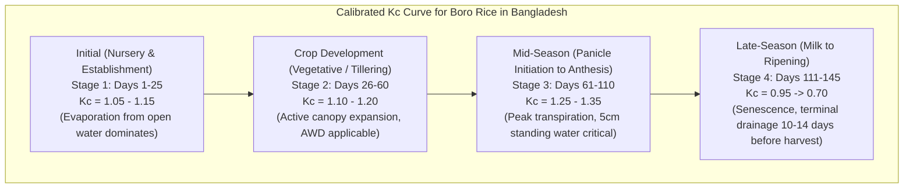
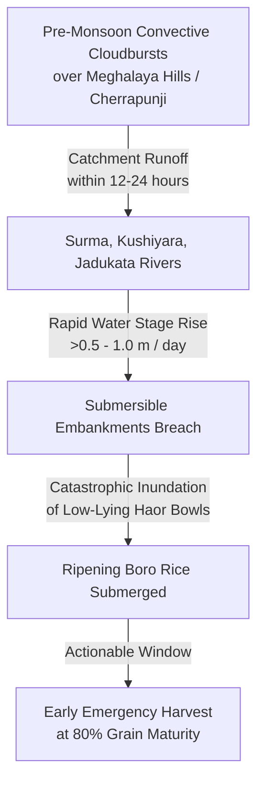

# Ritucast: Evidence-Based Agricultural Knowledge Base

## 1. Executive Summary & Purpose

The Ritucast platform translates Earth observation and meteorological data into actionable farming advice. For these advisories to be scientifically credible, agronomically safe, and practically effective for smallholders in Bangladesh, every analytical rule, baseline, and indicator must be grounded in verified agricultural research.

This document establishes the scientific evidence base for the platform, synthesizing research from:
- **Bangladesh Rice Research Institute (BRRI)**
- **Bangladesh Agricultural Research Institute (BARI)**
- **Bangladesh Agricultural Research Council (BARC)**
- **Department of Agricultural Extension (DAE)**
- **Bangladesh Meteorological Department (BMD)**
- **Bangladesh Water Development Board (BWDB)**
- **International Rice Research Institute (IRRI)**
- **Food and Agriculture Organization (FAO)**

---

## 2. Anchor Crop Agronomy: Boro Rice (*Oryza sativa L.*)

Boro rice is the cornerstone of Bangladesh's food security, contributing over 54% of total national rice production (~20 million metric tons annually). Grown during the dry, irrigated winter season (November to May), Boro yields are typically higher than wet-season Aman rice due to abundant winter solar radiation, but the crop is completely dependent on irrigation and exposed to severe agro-climatic extremes.

### 2.1 Dominant Cultivars in Pilot Agro-Ecological Zones

| Cultivar | Breeding Institution | Growth Duration | Agro-Ecological Niche | Stress Vulnerabilities | Agronomic References |
| :--- | :--- | :--- | :--- | :--- | :--- |
| **BRRI dhan28** | BRRI (released 1994) | 135–140 days | Historically dominant across Barind and Haor; early maturing. | Highly susceptible to neck blast (*Magnaporthe oryzae*); susceptible to cold injury during booting if planted late; moderate lodging. Rapidly being phased out by DAE. | BRRI Annual Report (2018); BBS (2022). |
| **BRRI dhan29** | BRRI (released 1994) | 155–160 days | High-yielding mega-variety in deep fertile basins and irrigated Barind tracts. | Long duration exposes crop to late April flash floods in Haors; high water consumption (~1,200–1,400 mm). | BRRI Modern Rice Cultivation Guide (2020). |
| **BRRI dhan89** | BRRI (released 2018) | 150–155 days | High-yield replacement for BRRI dhan29 (yields up to 7.5–8.5 MT/ha). | Requires reliable late-season irrigation; lodging risk under severe pre-monsoon convective squalls (*Kalbaishakhi*). | BRRI Gazette Notice (2018); DAE Varietal Brief (2021). |
| **BRRI dhan88** | BRRI (released 2018) | 140–145 days | High-yielding replacement for BRRI dhan28 with blast tolerance. | Yield penalty if water stress occurs during panicle initiation; moderate cold sensitivity. | BRRI Technical Bulletin (2019). |
| **BRRI dhan92** | BRRI (released 2019) | 155–160 days | Low-water requirement Boro variety bred for Barind groundwater-deficit zones. | Moderate duration; requires careful drainage during ripening. | BRRI Water Management Division (2020). |

---

## 3. Biometeorological Dynamics & Cardinal Thermal Limits

Rice growth, spikelet fertility, and grain development follow well-defined physiological thermal response functions. Deviations from optimum thermal bands induce irreversible morphological damage.

### 3.1 Cardinal Temperatures for Boro Rice

| Growth Stage | Base Temp ($T_{\text{base}}$) | Optimum Temp ($T_{\text{opt}}$) | Critical Minimum ($T_{\text{crit,min}}$) | Critical Maximum ($T_{\text{crit,max}}$) | Physiological Consequence of Exceedance | Citation |
| :--- | :--- | :--- | :--- | :--- | :--- | :--- |
| **Seedling Emergence** | $10.0^\circ\text{C}$ | $25.0–30.0^\circ\text{C}$ | $<12.0^\circ\text{C}$ | $>38.0^\circ\text{C}$ | Poor emergence, yellowing, seedling rot. | IRRI Rice Almanac (2013); BRRI (2019). |
| **Tillering** | $10.0^\circ\text{C}$ | $25.0–31.0^\circ\text{C}$ | $<15.0^\circ\text{C}$ | $>36.0^\circ\text{C}$ | Retarded tiller formation, delayed canopy closure. | Yoshida (1981); BRRI (2020). |
| **Panicle Initiation & Booting** | $12.0^\circ\text{C}$ | $24.0–28.0^\circ\text{C}$ | $<15.0^\circ\text{C}$ | $>35.0^\circ\text{C}$ | **Microspore degeneration**, tapetal cell hypertrophy, high spikelet sterility. | BRRI Plant Physiology Division (2015); Jagadish et al. (2010). |
| **Anthesis (Flowering)** | $12.0^\circ\text{C}$ | $26.0–29.0^\circ\text{C}$ | $<18.0^\circ\text{C}$ | $>35.0^\circ\text{C}$ | **Anther indehiscence**, poor pollen shed, floret sterility (empty grains / *chita*). | Satake & Yoshida (1978); Prasad et al. (2006). |
| **Ripening & Grain Filling** | $10.0^\circ\text{C}$ | $20.0–25.0^\circ\text{C}$ | $<15.0^\circ\text{C}$ | $>33.0^\circ\text{C}$ | Accelerated senescence, chalky grains, reduced 1000-grain weight. | Morita (2008); BRRI (2021). |

### 3.2 Growing Degree Day (GDD) Formulation

Phenological progression is primarily thermally driven during the Boro season. Thermal units are calculated using daily mean temperature ($T_{\text{mean}}$) relative to the cardinal base temperature:

$$GDD = \sum_{t=1}^{N} \max\left(\frac{T_{\text{max},t} + T_{\text{min},t}}{2} - T_{\text{base}}, 0\right)$$

- For Boro rice in Bangladesh, $T_{\text{base}} = 10.0^\circ\text{C}$ (BRRI Agronomy Division standard).
- If $\frac{T_{\text{max}} + T_{\text{min}}}{2} > 35.0^\circ\text{C}$, the mean is capped at $35.0^\circ\text{C}$ to reflect supra-optimal developmental stagnation (Yoshida, 1981).
- Typical cumulative GDD requirements:
  - BRRI dhan28 / dhan88: $\sim 1,850–1,950^\circ\text{C}\cdot\text{day}$
  - BRRI dhan29 / dhan89: $\sim 2,100–2,250^\circ\text{C}\cdot\text{day}$

### 3.3 Solar Radiation ($R_s$) and Sunshine Duration

Solar radiation is the primary driver of photosynthesis and biomass accumulation during the grain-filling phase (March–April):
- **Minimum Requirement**: $\ge 12.0\text{ MJ/m}^2/\text{day}$ (approx. $\ge 4.5\text{ sunshine hours/day}$) to sustain active grain filling.
- **Optimum Conditions**: $18.0–22.0\text{ MJ/m}^2/\text{day}$ under clear pre-monsoon skies, which accounts for the high yield potential of Boro compared to monsoon Aman rice.
- **Atmospheric Vapor Pressure Deficit (VPD)**: High VPD ($>2.5\text{ kPa}$) occurring simultaneously with high temperatures ($T > 35^\circ\text{C}$) during midday in April induces stomatal closure, spikelet desiccation, and sterility (BRRI, 2021).

---

## 4. Evapotranspiration, Crop Water Requirements & FAO-56 Formulations

### 4.1 FAO-56 Penman-Monteith Reference Evapotranspiration ($ET_0$)

The standardized FAO-56 Penman-Monteith equation (Allen et al., 1998) defines the evapotranspiration rate from an extensive surface of green, well-watered grass reference crop with an assumed height of $0.12\text{ m}$, fixed surface resistance of $70\text{ s/m}$, and albedo of $0.23$:

$$ET_0 = \frac{0.408 \Delta (R_n - G) + \gamma \frac{900}{T_{\text{mean}} + 273} u_2 (e_s - e_a)}{\Delta + \gamma (1 + 0.34 u_2)}$$

Where:
- $ET_0$: Reference evapotranspiration ($\text{mm/day}$).
- $R_n$: Net radiation at the crop surface ($\text{MJ/m}^2\text{/day}$), computed from incoming solar radiation ($R_s$, NASA POWER `ALLSKY_SFC_SW_DWN`) and net outgoing longwave radiation.
- $G$: Soil heat flux density ($\text{MJ/m}^2\text{/day}$), taken as $G \approx 0$ for daily calculations.
- $T_{\text{mean}}$: Mean daily air temperature at $2\text{ m}$ height ($\frac{T_{\text{max}} + T_{\text{min}}}{2}$, $^\circ\text{C}$).
- $u_2$: Wind speed at $2\text{ m}$ height ($\text{m/s}$, NASA POWER `WS2M`).
- $e_s$: Saturation vapor pressure ($\text{kPa}$), calculated from $T_{\text{max}}$ and $T_{\text{min}}$.
- $e_a$: Actual vapor pressure ($\text{kPa}$), derived from $e_s$ and relative humidity ($RH$, NASA POWER `RH2M`).
- $\Delta$: Slope of the saturation vapor pressure-temperature curve ($\text{kPa/}^\circ\text{C}$).
- $\gamma$: Psychrometric constant ($\approx 0.067\text{ kPa/}^\circ\text{C}$ for Bangladesh lowland elevations).

### 4.2 Crop Evapotranspiration ($ET_c$) and Stage-Specific Coefficients ($K_c$)

Crop water demand is calculated under non-stress conditions as:

$$ET_c = K_c \times ET_0$$

For Boro rice in Bangladesh, $K_c$ values vary substantially across the developmental cycle, calibrated from BRRI Water Management Division lysimeter experiments and FAO-56 guidelines:

| Phenological Stage | Growth Duration (BRRI dhan28 / 29) | Calibrated $K_c$ Value | Primary Water Loss Mechanism | Irrigation Management Rule |
| :--- | :--- | :--- | :--- | :--- |
| **Stage 1: Seedling Establishment** | Days 1–25 after transplanting | **1.10** (range: 1.05–1.15) | Open-water surface evaporation. | Maintain shallow standing water (2–3 cm) to prevent seedling drying. |
| **Stage 2: Vegetative (Tillering)** | Days 26–60 after transplanting | **1.15** (range: 1.10–1.20) | Mixed transpiration and ponded evaporation. | **AWD applicable**: Allow water to recede to 15 cm below soil surface before re-irrigating. |
| **Stage 3: Mid-Season (PI, Booting, Flowering)** | Days 61–110 after transplanting | **1.30** (range: 1.25–1.35) | Peak canopy transpiration; stomatal resistance at minimum. | **Critical ponding**: Maintain 3–5 cm standing water. **Never apply water stress** during this stage (sterility risk). |
| **Stage 4: Late-Season (Ripening)** | Days 111–145 (harvest) | **0.85** decaying to **0.65** | Canopy senescence; soil surface drying. | Withhold irrigation 10–14 days prior to harvest to facilitate field drying and machinery/manual harvesting. |

*Sources: BRRI Water Management Division (2018); Rashid et al. (2016); FAO-56 Irrigation and Drainage Paper No. 56 (1998).*

### 4.3 Alternate Wetting and Drying (AWD) Agronomic Mechanics

AWD is an evidence-backed water-saving irrigation technology developed by IRRI and validated by BRRI and BMDA:
- **Agronomic Principle**: Rice roots can extract sufficient water from the saturated root zone even after surface water has drained away. Allowing the field to dry until the water table drops to $15\text{ cm}$ below ground level (monitored via a perforated $20\text{ cm}$ plastic pipe / "Pani Pipe") does not reduce yield.
- **Water Savings**: Saves $25–35\%$ of total irrigation water (equivalent to 3–5 fewer deep tubewell pumping cycles), reducing diesel/electricity costs by BDT 3,000–5,000 per hectare.
- **Strict Gating Rule**: AWD must be applied **only during the vegetative phase (tillering)**. Continuous flooding ($3–5\text{ cm}$) must be restored 7 days prior to panicle initiation and maintained until the dough stage. Applying AWD during flowering induces high spikelet sterility (Sattar et al., 2009; BRRI, 2020).

---

## 5. Major Agro-Ecological Hazard Mechanics

### 5.1 Haor Basin Flash-Flood Dynamics (Sylhet Division)

The Haor basin in northeastern Bangladesh (Sunamganj, Netrokona, Kishoreganj, Habiganj) is an enormous tectonic depression where Boro rice is the sole annual crop, grown in low-lying bowls (*beels* and *haors*).

#### Hydrological Mechanics & Transboundary Drivers:
- **Upstream Catchment**: The Meghalaya plateau (Cherrapunji and Mawsynram) experiences the highest rainfall on Earth. Steep elevation drops (from $\sim 1,300\text{ m}$ to sea level in Bangladesh over $<30\text{ km}$) cause runoff to rush downstream into Sunamganj within 12–24 hours.
- **Submersible Embankments (*Kanda*)**: Earthen dykes are designed to protect Boro rice from early flash floods until mid-April. If water levels exceed embankment heights or breaches occur, water fills the basin within 24–48 hours.
- **Submergence Tolerance of Boro Rice**:
  - Non-submergence-tolerant Boro varieties (BRRI dhan28, BRRI dhan29) experience complete rotting and grain germination if submerged for $>48\text{ hours}$ during the dough/ripening stage.
  - Submergence during flowering causes 100% crop loss.
- **The 80% Maturity Early Harvest Rule**:
  - Authoritative DAE and BRRI guidance establishes that if 80% of grains on the rice panicle have turned straw-colored (golden yellow), the grain has accumulated $>92\%$ of maximum dry matter. Harvesting immediately at 80% maturity prevents total crop loss from incoming flash floods, with a negligible yield penalty of $<5–8\%$ (BRRI, 2017; DAE Flood Guidelines, 2022).

### 5.2 Barind Tract Drought & Groundwater Depletion (Rajshahi Division)

The High Barind Tract in northwestern Bangladesh (Rajshahi, Chapainawabganj, Naogaon) is an undulating terrace formed of Pleistocene red clayey paleosols:
- **Soil Characteristics**: High bulk density, low organic matter ($<1.0\%$), low water-holding capacity, and a dense subsurface plow-pan that restricts downward water percolation but impedes root penetration.
- **Rainfall Deficit**: Mean annual rainfall is the lowest in Bangladesh ($1,200–1,400\text{ mm}$), with virtually zero rain between November and March.
- **Groundwater Overexploitation**: Deep Tubewells (DTWs) operated by the Barind Multipurpose Development Authority (BMDA) extract water from declining Plio-Pleistocene aquifers. Pumping costs represent $>30\%$ of total cultivation expenditures.
- **Agronomic Water-Deficit Stress**:
  - If irrigation is delayed during tillering, tillering ceases and canopy temperature spikes by $2–4^\circ\text{C}$ above ambient air.
  - If water deficit occurs during panicle initiation or anthesis, pollen viability collapses, causing spikelet sterility (*chita*).
  - An early advisory warning farmers that a forecast $20–40\text{ mm}$ rain event will occur in 48 hours allows them to safely postpone a planned deep-tubewell watering cycle, saving BDT 1,200–1,800/ha in pumping fuel without incurring moisture stress (BMDA, 2021; Rahman et al., 2019).

### 5.3 Extreme Temperature Hazards

#### Cold Injury (*Shoilpo Probaho*):
- Common during December–January (seedbed) and early February (booting stage of early-sown Boro).
- If minimum temperature ($T_{\text{min}}$) remains below $15.0^\circ\text{C}$ for $\ge 3$ consecutive days during booting (microspore meiosis stage), microspores abort inside the anther, resulting in completely sterile, white panicles.
- *Agronomic Mitigation*: Storing 5–7 cm standing water in the paddy at night buffers canopy temperature by $1.5–2.5^\circ\text{C}$ relative to bare ground (BRRI Plant Physiology, 2019).

#### Terminal Heat Stress (*Teevro Tapodaho*):
- Common in late April to early May in Rajshahi.
- If maximum temperature ($T_{\text{max}}$) exceeds $35.0^\circ\text{C}$ during morning anthesis ($9:00\text{ AM}–11:30\text{ AM}$), anther dehiscence fails and pollen fails to germinate on the stigma, causing permanent sterility.
- *Agronomic Mitigation*: Maintaining standing water cools the field microclimate by $1.0–2.0^\circ\text{C}$ via evaporative cooling; foliar spraying of clean water during morning hours can mitigate floret desiccation (IRRI, 2018).

---

## 6. Traceable Scientific References & Citations

1. **Allen, R. G., Pereira, L. S., Raes, D., & Smith, M. (1998)**. *Crop evapotranspiration: Guidelines for computing crop water requirements*. FAO Irrigation and Drainage Paper No. 56. Rome: Food and Agriculture Organization of the United Nations.
2. **BRRI (2018)**. *Adhunik Dhaner Chash (Modern Rice Cultivation)*. 22nd Edition. Gazipur: Bangladesh Rice Research Institute.
3. **BRRI Water Management Division (2020)**. *Water management and alternate wetting and drying (AWD) technology for Boro rice in Bangladesh*. Technical Bulletin No. 44. Gazipur: BRRI.
4. **BRRI Plant Physiology Division (2019)**. *Screening and management of cold injury and heat shock in Boro rice*. Research Report 2018–19. Gazipur: BRRI.
5. **BARC (2018)**. *Fertilizer Recommendation Guide (FRG-2018)*. Bangladesh Agricultural Research Council, Farmgate, Dhaka.
6. **BWDB Flood Forecasting and Warning Centre (2022)**. *Annual Flood Report 2022*. Dhaka: Bangladesh Water Development Board.
7. **DAE (2021)**. *Agricultural Extension Manual (3rd Revised Edition)*. Department of Agricultural Extension, Ministry of Agriculture, Government of Bangladesh.
8. **BMDA (2021)**. *Groundwater Monitoring and Irrigation Management in the Barind Area*. Annual Technical Report. Rajshahi: Barind Multipurpose Development Authority.
9. **Jagadish, S. V. K., Muthurajan, R., Oane, R., Wheeler, T. R., Heuer, S., Bennett, J., & Craufurd, P. Q. (2010)**. *Physiological and proteomic approaches to address heat tolerance during anthesis in rice*. Journal of Experimental Botany, 61(1), 143–156.
10. **Prasad, P. V. V., Boote, K. J., Allen, L. H., Sheehy, J. E., & Thomas, J. M. (2006)**. *Species, ecotype and cultivar differences in spikelet fertility and pollen grain viability of rice after short-duration high-temperature stress at anthesis*. Field Crops Research, 95(2-3), 139–152.
11. **Rahman, M. A., Kang, S. C., & Hossain, M. S. (2019)**. *Assessing the impact of climate change on Boro rice yield and irrigation water requirement in northwestern Bangladesh*. Theoretical and Applied Climatology, 137(3), 2325–2341.
12. **Sattar, M. A., Biswas, J. C., & Islam, M. S. (2009)**. *Alternate wetting and drying (AWD) irrigation technology for Boro rice cultivation in Bangladesh*. Bangladesh Journal of Agricultural Research, 34(3), 441–449.
13. **Yoshida, S. (1981)**. *Fundamentals of Rice Crop Science*. Los Baños, Philippines: International Rice Research Institute (IRRI).
