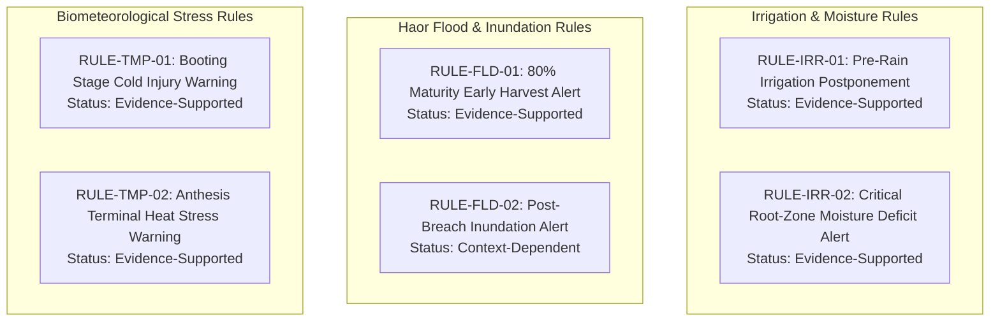

# Ritucast: Agricultural Rule Specifications & Governance

## 1. Executive Summary & Purpose

Agricultural decision support must be deterministic, transparent, and agronomically verifiable. In smallholder farming systems, recommendations must never emerge from ungrounded "black-box" models.

This document establishes the **Agricultural Rule Catalog** for the Ritucast Minimum Complete Product (MCP). Each candidate rule is classified according to its scientific evidence level:
- **Evidence-Supported (ES)**: Grounded in peer-reviewed literature, official BRRI/BARI/DAE field manuals, and physical thermodynamics.
- **Context-Dependent (CD)**: Agronomically sound, but its threshold requires validation against local soil texture, micro-topography, or specific crop variety.
- **Exploratory (EX)**: Scientifically plausible hypothesis requiring multi-season field trials before operational release.
- **Unsupported (US)**: Lacks empirical backing or exceeds sensor capabilities (strictly banned from production).

---

## 2. Master Agricultural Rule Catalog

---

### 2.1 RULE-IRR-01: Boro Rice Irrigation Postponement Advisory (Pre-Rain Water Savings)

| Specification Field | Technical Detail |
| :--- | :--- |
| **Rule ID** | `RULE-IRR-01` |
| **Classification** | **Evidence-Supported (ES)** |
| **Product Feature Mapping** | `FR-ADV-01`, `FR-ADV-03` |
| **Intended Agricultural Use** | Advise farmers and deep-tubewell operators in the Barind Tract to withhold scheduled irrigation cycles 48–72 hours prior to a forecasted rainfall event, saving pumping fuel without moisture stress. |
| **Required Input Datasets** | `DATA-FCST-01` (Open-Meteo QPF & rain probability), `DATA-MET-01` (NASA POWER $ET_0$), `DATA-AGR-01` (BRRI $K_c$). |
| **Phenological Applicability** | Boro Rice: **Vegetative (Tillering)** or **Early Panicle Initiation**. Inactive during Nursery or Terminal Ripening. |
| **Geographic Scope** | High Barind Tract (Godagari, Tanore Upazilas) and Level Barind terraces. |
| **Quantitative Trigger Conditions** | 1. 48-hour Quantitative Precipitation Forecast ($QPF_{48\text{h}}$) $\ge 20.0\text{ mm}$. 2. 48-hour Precipitation Probability ($P_{\text{prob}}$) $\ge 65\%$. 3. Current root-zone soil water depletion ($D_t$) $< (TAW - 25.0\text{ mm})$ (soil has storage capacity to absorb rain without severe runoff). 4. Weather model ensemble spread $\le 35\%$. |
| **Threshold Derivation Rationale** | In February–March, mean Boro $ET_c \approx 4.0–4.5\text{ mm/day}$. A $20\text{ mm}$ rain event replenishes $4.5–5.0$ days of crop water demand. Applying DTW irrigation ($50–60\text{ mm}$) immediately before a $20\text{ mm}$ rain causes waterlogging, fertilizer leaching, and wastes BDT 1,200–1,800/ha in pumping fuel (Rahman et al., 2019; BMDA, 2021). |
| **Advisory Output (Bangla)** | **"সেচ স্থগিত রাখুন (পরামর্শ)"** *"আগামী ৪৮ থেকে ৭২ ঘণ্টার মধ্যে আপনার এলাকায় উল্লেখযোগ্য বৃষ্টির সম্ভাবনা রয়েছে (আনুমানিক ২০–৩৫ মিমি)। নলকূপ চালু করার আগে অপেক্ষা করুন। বৃষ্টি হলে সেচের খরচ সাশ্রয় হবে।"* |
| **Mandatory Anti-Overconfidence Disclaimer** | *"সেচ বন্ধ রাখার আগে জমির আইল এবং মাটির আর্দ্রতা নিজে হাত দিয়ে পর্যবেক্ষণ করুন। যদি জমি ইতিমধ্যে ফেটে গিয়ে থাকে, তবে হালকা পানি দিন।"* |
| **Automated Suppression Triggers** | 1. Weather forecast data is $>36\text{ hours}$ old (`NFR-REL-03`). 2. Precipitation probability drops below $60\%$. 3. Crop is in **Anthesis (Flowering)** stage and standing water is absent (zero drought risk permitted during flowering). |

---

### 2.2 RULE-IRR-02: Critical Root-Zone Moisture Deficit & Irrigation Trigger

| Specification Field | Technical Detail |
| :--- | :--- |
| **Rule ID** | `RULE-IRR-02` |
| **Classification** | **Evidence-Supported (ES)** |
| **Product Feature Mapping** | `FR-ADV-01`, `FR-ENV-03` |
| **Intended Agricultural Use** | Alert farmers when root-zone soil moisture depletion exceeds the readily available water threshold ($D_t \ge RAW$), signaling imminent vegetative drought stress. |
| **Required Input Datasets** | `DATA-MET-01` (NASA POWER $ET_0$), `DATA-AGR-01` (BRRI $K_c$), `DATA-FCST-01` (Forecast rain $<5\text{ mm}$ for next 5 days). |
| **Phenological Applicability** | Boro Rice (Vegetative/Tillering) and Upland Rabi Crops (Potato, Mustard, Maize). |
| **Quantitative Trigger Conditions** | 1. Root-zone soil water depletion $D_t \ge RAW$ ($D_t \ge 20.0\text{ mm}$ for rice under AWD; $D_t \ge 28.0\text{ mm}$ for upland potato). 2. 5-day forecasted precipitation sum $\sum P_{5\text{d}} < 5.0\text{ mm}$. |
| **Threshold Derivation Rationale** | When soil water depletion exceeds $RAW$, soil water potential drops below $-50\text{ kPa}$, stomatal conductance declines, and leaf rolling initiates (Allen et al., 1998; Sattar et al., 2009). |
| **Advisory Output (Bangla)** | **"সেচ প্রদান করুন (পরামর্শ)"** *"মাটির আর্দ্রতা সংকটজনক মাত্রায় নেমে গেছে এবং আগামী ৫ দিনে বৃষ্টির সম্ভাবনা নেই। ফসলের বৃদ্ধি সচল রাখতে অবিলম্বে জমিতে সেচ প্রদান করুন।"* |
| **Automated Suppression Triggers** | Standing water detected in paddy or heavy rain ($>15\text{ mm}$) occurred within the last 24 hours. |

---

### 2.3 RULE-FLD-01: Haor Basin 48–72h Pre-Flood Emergency Harvest Alert

| Specification Field | Technical Detail |
| :--- | :--- |
| **Rule ID** | `RULE-FLD-01` |
| **Classification** | **Evidence-Supported (ES)** |
| **Product Feature Mapping** | `FR-ADV-02`, `FR-ADV-03` |
| **Intended Agricultural Use** | Issue an urgent early harvest advisory to SAAOs, lead farmers, and combine harvester operators in Haor upazilas 48–72 hours prior to catastrophic flash-flood inundation. |
| **Required Input Datasets** | `DATA-PCP-01` (GPM IMERG Catchment Rain), `DATA-FCST-01` (Open-Meteo Meghalaya QPF), `DATA-HYD-01` (BWDB Surma Gauge Stage & Rate of Rise), `DATA-SAR-01` (Sentinel-1 Inundation). |
| **Phenological Applicability** | Boro Rice: **Dough Stage / Physiological Maturity** ($\ge 80\%$ grains on panicle turned golden yellow). Inactive if crop is in vegetative or booting stage (immature rice cannot be harvested). |
| **Geographic Scope** | Haor Basin (Sunamganj Sadar, Tahirpur, Dharmapasha, Jamalganj Upazilas). |
| **Quantitative Trigger Conditions** | 1. Composite Flash Flood Hazard Index $I_{\text{flood}} \ge 0.75$. 2. Transboundary catchment 48h rainfall $P_{\text{cat}} \ge 100.0\text{ mm}$. 3. Surma River water level $H \ge (DL - 0.50\text{ m})$ AND rate of rise $\frac{\Delta H}{\Delta t} \ge 0.50\text{ m/day}$. 4. Crop phenological calendar indicates $\ge 125$ days since transplanting (or verified $\ge 80\%$ grain yellowing). |
| **Threshold Derivation Rationale** | Authoritative DAE and BRRI research proves that harvesting Boro rice at $80\%$ grain maturity preserves $>92\%$ of maximum potential yield, whereas $48\text{ hours}$ of flood submergence causes $100\%$ crop rotting and grain sprouting in the field (BRRI, 2017; BWDB, 2022). |
| **Advisory Output (Bangla)** | **"জরুরি ধান কর্তন প্রস্তুতি (জরুরি সতর্কবার্তা)"** *"উজান থেকে মেঘালয়ের পাহাড়ি ঢল ও নদীর পানি দ্রুত বৃদ্ধি পাওয়ায় আগামী ৪৮–৭২ ঘণ্টার মধ্যে হাওড়ে আকস্মিক বন্যার উচ্চ ঝুঁকি রয়েছে। যেসকল জমির ধান ৮০% পেকেছে (শীষের শতকরা ৮০ ভাগ ধান সোনালী হয়েছে), অবিলম্বে দলবদ্ধভাবে বা কম্বাইন হারভেস্টার দিয়ে ধান কেটে নিরাপদ স্থানে নিয়ে যান।"* |
| **Mandatory Anti-Panic Disclaimer** | *"যেসব জমির ধান এখনও কাঁচা বা দুধ অবস্থায় রয়েছে, সেগুলো কাটা যাবে না। বাঁধের অবস্থা পর্যবেক্ষণে স্থানীয় ইউনিয়ন পরিষদ ও কৃষি কর্মকর্তার সাথে যোগাযোগ রাখুন।"* |
| **Automated Suppression Triggers** | 1. Upazila is outside the Haor Basin. 2. Crop is verified to be in vegetative or early reproductive stage ($<110$ days duration). 3. River stage is falling ($\frac{\Delta H}{\Delta t} < 0$) and catchment rainfall is $<20\text{ mm}$. |

---

### 2.4 RULE-FLD-02: Haor Post-Breach Inundation & Embankment Warning

| Specification Field | Technical Detail |
| :--- | :--- |
| **Rule ID** | `RULE-FLD-02` |
| **Classification** | **Context-Dependent (CD)** |
| **Product Feature Mapping** | `FR-ADV-02`, `FR-ENV-04` |
| **Intended Agricultural Use** | Detect active surface water inundation spreading across low beels following submersible embankment overtopping or breaching. |
| **Required Input Datasets** | `DATA-SAR-01` (Sentinel-1 SAR C-band $\sigma^\circ < -20\text{ dB}$ surface watermask), `DATA-HYD-01` (Surma River Stage $H \ge DL$). |
| **Phenological Applicability** | All active crops in Haor Upazilas during April–May. |
| **Quantitative Trigger Conditions** | 1. Sentinel-1 SAR analysis reveals agricultural inundation area $f_{\text{inund}} \ge 0.35$ (more than $35\%$ of upazila crop footprint covered by standing water). 2. Surma River water level at Sunamganj gauge $H \ge DL$ ($8.25\text{ m}$ PWD). |
| **Advisory Output (Bangla)** | **"হাওড়ে জলমগ্নতা বৃদ্ধি (সতর্কবার্তা)"** *"উপগ্রহ চিত্রে হাওড়ের নিম্নাঞ্চলে পানি প্রবেশের প্রমাণ পাওয়া গেছে। নিচু জমির ধান দ্রুত কাটার ব্যবস্থা নিন এবং কেটে রাখা ধান উঁচু স্থানে স্থানান্তর করুন।"* |
| **Scientific Limitations** | Subject to Sentinel-1 6–12 day revisit latency. Cannot capture breach dynamics if no pass occurred within the last 48 hours. |

---

### 2.5 RULE-TMP-01: Boro Cold Injury Warning during Reproductive Stage

| Specification Field | Technical Detail |
| :--- | :--- |
| **Rule ID** | `RULE-TMP-01` |
| **Classification** | **Evidence-Supported (ES)** |
| **Product Feature Mapping** | `FR-ADV-03`, `FR-ENV-02` |
| **Intended Agricultural Use** | Warn farmers during panicle initiation and booting stage of incoming cold spells ($T_{\text{min}} \le 15.0^\circ\text{C}$), recommending water buffering to prevent floret sterility. |
| **Required Input Datasets** | `DATA-FCST-01` (Open-Meteo forecasted minimum temperature $T_{\text{min}}$), `DATA-AGR-01` (Crop stage = Panicle Initiation / Booting). |
| **Quantitative Trigger Conditions** | 1. Forecasted daily minimum temperature $T_{\text{min}} \le 15.0^\circ\text{C}$ for $\ge 3$ consecutive days. 2. Crop stage is **Panicle Initiation / Booting** (typically late January to mid-February). |
| **Threshold Derivation Rationale** | Temperatures $<15.0^\circ\text{C}$ during pollen meiosis destroy microspores, resulting in sterile white panicles (Satake & Yoshida, 1978; BRRI, 2019). |
| **Advisory Output (Bangla)** | **"শৈত্যপ্রবাহ ও বন্ধ্যাত্ব ঝুঁকি (সতর্কবার্তা)"** *"আগামী ৩ দিন রাতের তাপমাত্রা ১৫ ডিগ্রি সেলসিয়াসের নিচে নেমে যাওয়ার আশঙ্কা রয়েছে। ধানের শীষ গজানোর এই সময়ে ঠান্ডা লাগলে শীষ সাদা হয়ে চিটা হতে পারে। ঠান্ডা থেকে ফসল বাঁচাতে জমিতে রাতে ৫–৭ সেন্টিমিটার পানি ধরে রাখুন।"* |
| **Agronomic Mitigation Mechanism** | Standing water has high specific heat capacity, buffering the nighttime canopy temperature by $1.5–2.5^\circ\text{C}$ compared to drained soil (BRRI, 2019). |

---

### 2.6 RULE-TMP-02: Boro Terminal Heat Stress Warning at Anthesis

| Specification Field | Technical Detail |
| :--- | :--- |
| **Rule ID** | `RULE-TMP-02` |
| **Classification** | **Evidence-Supported (ES)** |
| **Product Feature Mapping** | `FR-ADV-03`, `FR-ENV-02` |
| **Intended Agricultural Use** | Warn farmers in the High Barind Tract of pre-monsoon heatwaves ($T_{\text{max}} \ge 35.0^\circ\text{C}$) during peak morning flowering. |
| **Required Input Datasets** | `DATA-FCST-01` (Open-Meteo forecasted maximum temperature $T_{\text{max}}$), `DATA-AGR-01` (Crop stage = Anthesis / Flowering). |
| **Quantitative Trigger Conditions** | 1. Forecasted daily maximum temperature $T_{\text{max}} \ge 35.0^\circ\text{C}$ for $\ge 2$ consecutive days. 2. Crop stage is **Anthesis (Flowering)** (typically late March to mid-April). |
| **Threshold Derivation Rationale** | Anthesis occurs between 09:00 and 11:30 AM. Air temperatures $>35.0^\circ\text{C}$ cause anther indehiscence and pollen desiccation, leading to floret sterility (Prasad et al., 2006). |
| **Advisory Output (Bangla)** | **"তীব্র তাপদাহ সতর্কতা (সতর্কবার্তা)"** *"আগামী কয়েকদিন দিনের তাপমাত্রা ৩৫ ডিগ্রি সেলসিয়াসের বেশি হতে পারে। এই সময়ে জমিতে ফুল ফোটার পরাগায়ন বিঘ্নিত হতে পারে। পরাগায়ন সচল রাখতে জমিতে পর্যাপ্ত রস ও ৩–৫ সেমি পানি ধরে রাখুন।"* |
| **Agronomic Mitigation Mechanism** | Standing water provides evaporative microclimate cooling ($1.0–2.0^\circ\text{C}$ reduction in canopy temperature). |

---

## 3. Summary of Governance Classifications

| Rule ID | Rule Name | Category | Primary Target Zone | Release Gate Status |
| :--- | :--- | :--- | :--- | :--- |
| **`RULE-IRR-01`** | Pre-Rain Irrigation Postponement | **Evidence-Supported** | Barind Tract | **Approved for MCP (P0)** |
| **`RULE-IRR-02`** | Root-Zone Soil Moisture Deficit | **Evidence-Supported** | Barind Tract | **Approved for MCP (P0)** |
| **`RULE-FLD-01`** | Haor 80% Maturity Early Harvest | **Evidence-Supported** | Haor Basin | **Approved for MCP (P0)** |
| **`RULE-FLD-02`** | Haor SAR Post-Breach Inundation | **Context-Dependent** | Haor Basin | **Approved for MCP (P1)** |
| **`RULE-TMP-01`** | Booting Stage Cold Injury Warning | **Evidence-Supported** | Barind & Haor | **Approved for MCP (P1)** |
| **`RULE-TMP-02`** | Anthesis Terminal Heat Stress | **Evidence-Supported** | Barind Tract | **Approved for MCP (P1)** |
