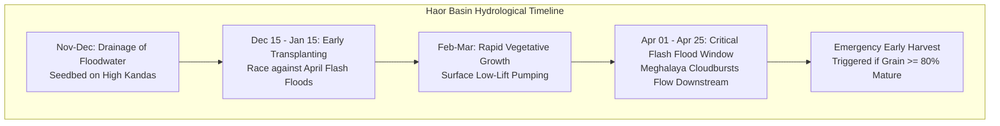

# Ritucast: Crop and Regional Context Specification

## 1. Executive Summary & Purpose

Bangladesh features 30 distinct Agro-Ecological Zones (AEZs), each characterized by unique landforms, soil types, hydrological dynamics, and climatic regimes. A generic national crop calendar or uniform moisture threshold fails because an identical meteorological observation produces completely different agricultural outcomes across different agro-ecological settings.

This document establishes the detailed agro-ecological, hydrological, and phenological profiles for Ritucast's approved Dual-Zone Pilot testbeds:
1. **The High Barind Tract (AEZ 25, 26)** — Rajshahi Division (Godagari, Tanore Upazilas). Focus: *Drought, groundwater deficit, irrigation scheduling*.
2. **The Sylhet Basin / Haor Region (AEZ 21)** — Sylhet Division (Sunamganj Sadar, Tahirpur Upazilas). Focus: *Pre-monsoon flash floods, transboundary runoff, early harvest decisions*.

---

## 2. Regional Agro-Ecological Comparison

| Parameter | Testbed Zone 1: High Barind Tract | Testbed Zone 2: Haor Basin |
| :--- | :--- | :--- |
| **Administrative Units** | Rajshahi Division (Godagari, Tanore Upazilas) | Sylhet Division (Sunamganj Sadar, Tahirpur Upazilas) |
| **Agro-Ecological Zone** | AEZ 25 (Level Barind Tract), AEZ 26 (High Barind Tract) | AEZ 21 (Sylhet Basin / Surma-Kushiyara Haor Basin) |
| **Geomorphology** | Undulating Pleistocene terrace; elevation $15–40\text{ m}$ above MSL; well-incised gullies. | Saucer-shaped tectonic depression; elevation $2–6\text{ m}$ above MSL; seasonal inland sea. |
| **Annual Precipitation** | $1,200–1,400\text{ mm}$ (lowest in Bangladesh). Dry season rain $<30\text{ mm}$. | $3,500–5,000\text{ mm}$ (highest in Bangladesh). Pre-monsoon rain $>600\text{ mm}$ (April–May). |
| **Predominant Soil Type** | Deep Grey Terrace Soils and Red-Brown Terrace Soils (Alfisols/Inceptisols). | Non-calcareous Dark Grey Floodplain Soils and Acid Basin Clays (Entisols/Inceptisols). |
| **Soil Physical Properties** | Heavy silty clay / clay; organic matter $<1.0\%$; dense subsurface plow pan at $15–20\text{ cm}$; low permeability. | Heavy clay to silty clay; high organic matter ($2.0–3.5\%$); soft puddled mud; poor drainage. |
| **Hydrological Regime** | Severe surface water deficit; $>95\%$ dependent on BMDA Deep Tubewells (DTW); declining water table. | Seasonal deep flooding ($3–6\text{ m}$) from June–Nov; surface Low-Lift Pumps (LLP) from rivers and beels. |
| **Cropping Pattern** | Boro rice – Fallow – T. Aman; or Mustard/Potato – Boro – T. Aman. | **Monoculture Boro rice** – Fallow / Deepwater fishery (6–7 months submerged). |
| **Critical Agro-Climatic Risks** | Groundwater depletion, pumping fuel costs, terminal heat stress ($>35^\circ\text{C}$ in April). | Early pre-monsoon flash floods (April), river embankment breaches, lightning strikes during harvest. |

---

## 3. Testbed 1: High Barind Tract (Rajshahi Division)

### 3.1 Soil Physical Properties & Water-Holding Capacity

The High Barind Tract soils present extreme physical challenges to water management:
- **Soil Texture**: Silty clay to clay (sand: 12%, silt: 48%, clay: 40%).
- **Bulk Density**: $1.50–1.62\text{ g/cm}^3$ (high compaction in topsoil).
- **Field Capacity ($\theta_{\text{FC}}$)**: $\sim 30–33\%$ volumetric water content ($0.30–0.33\text{ m}^3/\text{m}^3$).
- **Permanent Wilting Point ($\theta_{\text{PWP}}$)**: $\sim 16–18\%$ volumetric water content ($0.16–0.18\text{ m}^3/\text{m}^3$).
- **Plant Available Water Capacity (AWC)**: $\sim 140–150\text{ mm/m}$ of soil depth.
- **Saturated Hydraulic Conductivity ($K_{\text{sat}}$)**: Very low ($0.5–2.0\text{ mm/day}$ through the plow pan), which favors rice ponding once puddled, but limits infiltration of light rainfall events.

### 3.2 Boro Rice Phenological Calendar in Barind

Due to severe winter cold during December–January, transplanting in the Barind tract typically occurs in mid to late January to avoid seedling mortality:

| Phenological Stage | Typical Date Range | Cumulative Duration | GDD Accumulation ($T_{\text{base}}=10^\circ\text{C}$) | Water & Climatic Management Focus |
| :--- | :--- | :--- | :--- | :--- |
| **Seedbed / Nursery** | Nov 20 – Dec 31 | 40–45 days | $380–420^\circ\text{C}\cdot\text{d}$ | Polyethylene cover over nursery to protect seedlings from dense fog and cold injury ($<12^\circ\text{C}$). |
| **Transplanting & Recovery** | Jan 10 – Jan 31 | 10–12 days | $120–150^\circ\text{C}\cdot\text{d}$ | Maintain shallow standing water (2–3 cm) to prevent seedling dehydration during dry winter winds. |
| **Vegetative / Tillering** | Feb 01 – Feb 28 | 28–30 days | $380–420^\circ\text{C}\cdot\text{d}$ | **Primary AWD Window**: Apply alternate wetting and drying. Let water recede to 15 cm below surface. |
| **Panicle Initiation & Booting** | Mar 01 – Mar 25 | 25 days | $420–460^\circ\text{C}\cdot\text{d}$ | **Critical Water Window**: Maintain 3–5 cm ponded water. High cold sensitivity ($T_{\text{min}}<15^\circ\text{C}$). |
| **Anthesis (Flowering)** | Mar 26 – Apr 08 | 12–14 days | $240–280^\circ\text{C}\cdot\text{d}$ | **Heat Stress Window**: Daily $T_{\text{max}}>35^\circ\text{C}$ causes floret sterility. Maintain standing water for cooling. |
| **Milk & Dough Stage** | Apr 09 – Apr 25 | 16–18 days | $340–380^\circ\text{C}\cdot\text{d}$ | Gradual soil drying; water demand declines. |
| **Physiological Maturity & Harvest** | Apr 26 – May 15 | 15–20 days | $250–300^\circ\text{C}\cdot\text{d}$ | Withhold all irrigation 10–14 days prior to harvest; field dry for harvest operations. |

---

## 4. Testbed 2: Haor Basin (Sylhet Division)

### 4.1 Soil Physical Properties & Water Dynamics

The Haor Basin soils are heavy riverine alluvium and acid basin clays:
- **Soil Texture**: Heavy clay to silty clay (clay content: $45–65\%$).
- **Bulk Density**: $1.15–1.30\text{ g/cm}^3$ (loose, soft puddled mud).
- **Field Capacity ($\theta_{\text{FC}}$)**: $\sim 42–48\%$ volumetric water content ($0.42–0.48\text{ m}^3/\text{m}^3$).
- **Permanent Wilting Point ($\theta_{\text{PWP}}$)**: $\sim 24–28\%$ volumetric water content ($0.24–0.28\text{ m}^3/\text{m}^3$).
- **Drainage Characteristics**: Extremely poor; surface water remains ponded for weeks; water table sits at or near the ground surface throughout the dry season.
- **Micro-Topography**: Highly differentiated between low *beel* bottoms ($2–3\text{ m}$ elevation) and high ridges / *kanda* ($5–7\text{ m}$ elevation). Low beel plots are planted earliest and flooded earliest.

### 4.2 Boro Rice Phenological Calendar in the Haor Basin

Haor farmers deliberately accelerate their sowing schedule by 15–20 days compared to Barind farmers in an urgent attempt to harvest before the April flash floods:

| Phenological Stage | Typical Date Range | Cumulative Duration | GDD Accumulation ($T_{\text{base}}=10^\circ\text{C}$) | Water & Climatic Management Focus |
| :--- | :--- | :--- | :--- | :--- |
| **Seedbed / Nursery** | Nov 01 – Dec 10 | 35–40 days | $360–400^\circ\text{C}\cdot\text{d}$ | Established on elevated kandas or floating seedbeds as floodwaters recede. |
| **Transplanting & Recovery** | Dec 15 – Jan 15 | 10–12 days | $110–140^\circ\text{C}\cdot\text{d}$ | Transplanted into soft wet mud immediately upon water recession. |
| **Vegetative / Tillering** | Jan 10 – Feb 20 | 35–40 days | $400–450^\circ\text{C}\cdot\text{d}$ | Surface water abundant in nearby beels/khals; pumped via LLPs. |
| **Panicle Initiation & Booting** | Feb 15 – Mar 15 | 25–28 days | $420–460^\circ\text{C}\cdot\text{d}$ | High vulnerability to hail and early squalls (*Kalbaishakhi*). |
| **Anthesis (Flowering)** | Mar 15 – Mar 31 | 14–16 days | $260–300^\circ\text{C}\cdot\text{d}$ | Critical floret fertilization; dry pre-monsoon winds. |
| **Milk & Dough Stage** | Apr 01 – Apr 20 | 18–20 days | $380–420^\circ\text{C}\cdot\text{d}$ | **Peak Flash Flood Hazard Window**: Upstream Meghalaya rainfall monitoring essential. |
| **Harvest / Emergency Harvest** | Apr 15 – May 05 | 15–20 days | $280–320^\circ\text{C}\cdot\text{d}$ | **80% Maturity Rule**: Mobilize all labor/combines if flood risk index $I_{\text{flood}}>0.75$. |

---

## 5. Satellite Observation Constraints & Regional Adjustments

| Remote Sensing Modality | High Barind Tract Implications | Haor Basin Implications |
| :--- | :--- | :--- |
| **Sentinel-1 SAR C-Band (`DATA-SAR-01`)** | Dry clay soils show low backscatter ($\sigma^\circ \approx -14\text{ to } -18\text{ dB}$); bunded paddies with standing water drop to $<-20\text{ dB}$. Surface roughness changes during tillage. | Open water bodies and submerged paddies produce near-perfect specular reflection ($\sigma^\circ < -22\text{ dB}$). Sharp contrast against elevated vegetated kandas ($\sigma^\circ \approx -11\text{ to } -13\text{ dB}$). |
| **SMAP L3 Soil Moisture (`DATA-SMC-01`)** | Regional 9km radiometer accurately captures broad dry-down trends in upland terraces, but underestimates rapid evaporation from saturated paddy tops. | Radiometer saturates at $0.45–0.50\text{ m}^3/\text{m}^3$ across entire 9km pixel due to open beels and wetlands; **cannot distinguish field soil moisture from surface standing water**. |
| **GPM IMERG Precipitation (`DATA-PCP-01`)** | Useful for tracking convective pre-monsoon thunderstorms; $10\text{km}$ resolution captures localized squall cells across Barind districts. | **Vital for transboundary catchment tracking**: IMERG pixels over the southern Meghalaya escarpment (India) track intense runoff feeding the Surma-Kushiyara basin 24–48h before local rain. |
| **NASA POWER Agrometeorology (`DATA-MET-01`)** | High accuracy for regional solar radiation and temperature across flat/undulating terrain ($0.5^\circ$ grid captures regional Barind climate well). | Surma-Kushiyara basin microclimate is influenced by the proximity of the Meghalaya hill barrier (orographic cloudiness); grid-scale estimates require local BMD station bias checks. |

---

## 6. Synthesis: Operational Implications for Ritucast

1. **Two Distinct Algorithmic Pipelines**:
   - For Barind Upazilas: Execute the **Irrigation & Water Deficit Optimization Pipeline** (`RULE-IRR-01`, `RULE-IRR-02`, FAO-56 Penman-Monteith).
   - For Haor Upazilas: Execute the **Hydrological Flash Flood Early Warning Pipeline** (`RULE-FLD-01`, `RULE-FLD-02`, Transboundary Runoff Index).
2. **Phenological Date Offsets**:
   - The platform cannot hardcode single calendar dates. Upazila-level crop stage tracking must offset Haor phenology by $-15\text{ days}$ relative to Barind phenology.
3. **Soil Hydraulic Differentiation**:
   - The soil water balance model must initialize available water capacity (AWC) as $145\text{ mm/m}$ in Barind clay terraces, and $200\text{ mm/m}$ in Haor basin clays.
