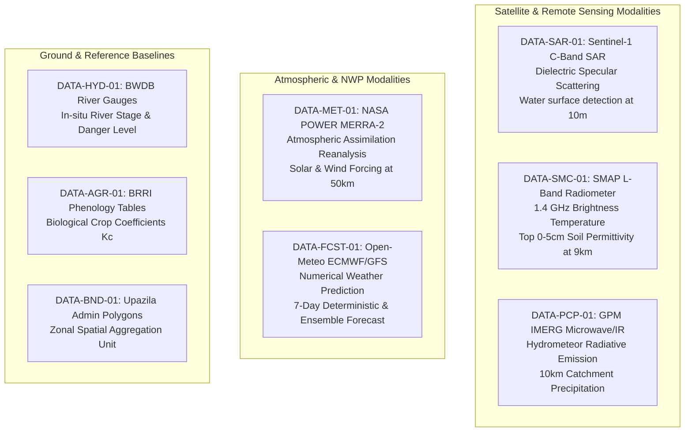
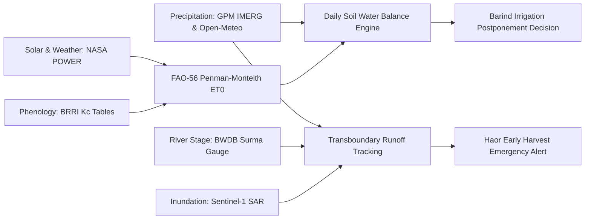

# Ritucast: Scientific Interpretation of Core Datasets

## 1. Executive Summary & Purpose

A primary failure mode of agricultural intelligence applications is treating raw satellite pixels or gridded model outputs as direct, ground-level field measurements. Every remote sensing sensor and meteorological model measures an indirect physical proxy (e.g., microwave brightness temperature, radar backscatter, atmospheric reanalysis state) with inherent spatial, temporal, and radiative limitations.

This document establishes the rigorous scientific translation for each of the 8 core datasets selected in Phase 3 (`DEC-11`), defining:
- The exact physical variable measured.
- The observational mechanism and scientific transformation.
- Valid agricultural interpretations.
- Strict boundaries: what the dataset **cannot** scientifically support.

---

## 2. Dataset Scientific Profiles

---

### 2.1 DATA-MET-01: NASA POWER Daily Agrometeorology

| Parameter | Scientific Specification |
| :--- | :--- |
| **Provider & Source** | NASA Langley Research Center / Goddard Space Flight Center (MERRA-2 Reanalysis & GEOS Assimilation). |
| **Native Spatial Resolution** | $0.5^\circ \text{ latitude} \times 0.625^\circ \text{ longitude}$ (approximately $55\text{ km} \times 65\text{ km}$ across Bangladesh). |
| **Temporal Frequency & Latency** | Daily updates; operational publication latency is 2 to 3 days behind real time. |
| **Physical Mechanism** | Global atmospheric data assimilation combining spaceborne sounders, radiosondes, and surface stations with a physically consistent global circulation model. |

#### Scientific Interpretation of Variables:
- **`ALLSKY_SFC_SW_DWN` (All-Sky Surface Shortwave Downward Irradiance, $\text{MJ/m}^2/\text{day}$)**: Total solar insolation reaching the Earth's surface (direct + diffuse beam). Driven by CERES satellite top-of-atmosphere observations and ISCCP cloud parameterizations. **Physical Meaning**: Primary energy source driving photosynthesis and the radiation term ($R_n$) in the FAO-56 Penman-Monteith equation.
- **`T2M_MAX` / `T2M_MIN` ($2\text{m}$ Air Temperature, $^\circ\text{C}$)**: Reanalysis temperature assimilated at the screen height of $2\text{ m}$. **Physical Meaning**: Ambient thermal regime determining Growing Degree Days (GDD), cold injury risk, and vapor pressure deficit.
- **`RH2M` ($2\text{m}$ Relative Humidity, $\%$ )**: Ratio of actual vapor pressure to saturation vapor pressure. **Physical Meaning**: Controls atmospheric evaporative demand and crop transpiration resistance.
- **`WS2M` ($2\text{m}$ Wind Speed, $\text{m/s}$)**: Wind velocity adjusted to standard $2\text{ m}$ height above ground. **Physical Meaning**: Governs aerodynamic turbulence and vapor transport away from the canopy boundary layer.

#### What DATA-MET-01 CANNOT Scientifically Support:
1. **Micro-topographic temperature inversions**: Cannot capture local $2–3^\circ\text{C}$ cold air pooling in low-lying Haor depressions or river valleys during still winter nights.
2. **Individual-plot solar shading**: Grid cell aggregates cloudiness across $3,000\text{ km}^2$; cannot identify field-scale cloud shadows.
3. **Same-day real-time alerting**: Due to a 2–3 day publication latency, it functions as a **historical baseline forcing dataset**, not an emergency real-time alert trigger.

---

### 2.2 DATA-FCST-01: Open-Meteo Operational NWP Forecasts

| Parameter | Scientific Specification |
| :--- | :--- |
| **Provider & Source** | Open-Meteo API (seamlessly integrating ECMWF IFS 9km and NOAA GFS 13km models). |
| **Native Spatial Resolution** | $0.1^\circ \times 0.1^\circ$ (ECMWF IFS $\sim 9\text{ km}$ grid spacing). |
| **Temporal Frequency & Latency** | Hourly and daily updates; updated every 6 hours ($00, 06, 12, 18\text{ UTC}$ runs); zero operational latency. |
| **Physical Mechanism** | Numerical Weather Prediction (NWP) solving non-hydrostatic Navier-Stokes hydrodynamic and thermodynamic equations on supercomputing architectures. |

#### Scientific Interpretation of Variables:
- **Quantitative Precipitation Forecast (`precipitation_sum`, $\text{mm}$)**: Total accumulated rainfall predicted over the next 24, 48, and 72 hours.
- **Precipitation Probability (`precipitation_probability`, $\%$ )**: Statistical likelihood that measurable precipitation ($\ge 0.1\text{ mm}$) will occur at the grid point.
- **Ensemble Spread**: Disagreement among model ensemble members. When ECMWF and GFS forecasts diverge substantially ($>50\%$ spread), atmospheric predictability is low.

#### What DATA-FCST-01 CANNOT Scientifically Support:
1. **Guaranteed pinpoint cloudburst timing**: Convective pre-monsoon thunderstorms (*Kalbaishakhi*) develop rapidly on sub-mesoscale dimensions ($<5\text{ km}$) and cannot be guaranteed to hit an individual acre.
2. **Deterministic truth beyond 72 hours**: Forecast skill in tropical monsoon basins decays sharply after 72 hours; forecasts for days 4–7 represent general synoptic tendencies, not deterministic field advice.

---

### 2.3 DATA-PCP-01: GPM IMERG V07 Precipitation

| Parameter | Scientific Specification |
| :--- | :--- |
| **Provider & Source** | NASA Goddard Space Flight Center / JAXA (GPM Multi-Satellite Algorithm, Version 07). |
| **Native Spatial Resolution** | $0.1^\circ \times 0.1^\circ$ (approximately $10\text{ km} \times 10\text{ km}$). |
| **Temporal Frequency & Latency** | Half-hourly and daily grids. **IMERG Early Run** is published within $<4–6\text{ hours}$ of sensing. |
| **Physical Mechanism** | Inter-calibrated passive microwave (PMW) radiometers (GPM Core GMI, NOAA ATMS, DMSP SSMIS, MetOp MHS) providing physically direct hydrometeor scattering/emission observations, gridded and propagated forward/backward using geostationary infrared (IR) cloud-motion vectors. |

#### Scientific Interpretation in Ritucast:
- **Transboundary Catchment Runoff Tracking**: IMERG is Ritucast's primary tool for monitoring rainfall over the steep, un-gauged Meghalaya hills (Cherrapunji/Mawsynram plateau, India).
- **Extreme Rainfall Accumulation**: 48-hour accumulation over the transboundary catchment ($P_{\text{cat}}$) serves as the primary leading indicator for downstream river surges into Sunamganj.

#### What DATA-PCP-01 CANNOT Scientifically Support:
1. **Station-grade gauge precision at a point**: Satellite microwave estimates systematically smooth out peak rain rates over steep mountain escarpments (orographic cloudbursts may be underestimated by $15–30\%$).
2. **Direct soil penetration**: Measures atmospheric hydrometeor water content, not soil moisture or ponded water depth.

---

### 2.4 DATA-SAR-01: Sentinel-1 C-Band SAR GRD

| Parameter | Scientific Specification |
| :--- | :--- |
| **Provider & Source** | European Space Agency (ESA) Copernicus Programme via Copernicus Data Space Ecosystem (CDSE). |
| **Native Spatial Resolution** | $10\text{ m} \times 10\text{ m}$ pixel spacing (IW mode Ground Range Detected, GRD). |
| **Temporal Frequency & Latency** | 6 to 12 days repeat cycle over Bangladesh; published on CDSE within **2 hours and 5 minutes** of sensing. |
| **Physical Mechanism** | Active microwave Synthetic Aperture Radar operating at C-band ($5.405\text{ GHz}$, wavelength $\lambda \approx 5.55\text{ cm}$). Emits radar pulses and measures backscattered energy ($\sigma^\circ$, dB). |

#### Scientific Scattering Mechanics:
- **Smooth Standing Water (Flooded Paddies / Beels)**: Acting as a specular reflector, calm water reflects the incident microwave pulse away from the satellite antenna. Produces extremely dark pixels with backscatter values dropping below $-20\text{ to } -25\text{ dB}$ in VV polarization.
- **Rough / Dry Bare Soil**: Diffuse surface scattering produces moderate backscatter ($-14\text{ to } -18\text{ dB}$).
- **Dense Rice Canopy (Mid/Late Season)**: Volume scattering within the randomly oriented canopy elements produces moderate to high backscatter ($-12\text{ to } -15\text{ dB}$ in VV, $-18\text{ to } -22\text{ dB}$ in VH).
- **Flooded Emergent Rice (Double-Bounce Scattering)**: Radar pulse reflects off the smooth standing water surface, hits vertical rice culms, and bounces directly back to the sensor. Can create an anomalous backscatter spike ($-8\text{ to } -11\text{ dB}$) that requires dual-polarization (VV/VH) ratio analysis to differentiate from dry urban structures.

#### What DATA-SAR-01 CANNOT Scientifically Support:
1. **Daily flood hydrograph monitoring**: Because the satellite passes once every 6–12 days, it cannot capture flash floods that crest and recede within 48–72 hours if the event occurs between satellite overpasses.
2. **Sub-canopy standing water during peak heading without calibration**: When the rice canopy reaches maximum biomass ($LAI > 4.5$), C-band microwaves ($5.6\text{ cm}$) attenuate in the upper leaves, reducing sensitivity to standing water beneath dense foliage.

---

### 2.5 DATA-SMC-01: SMAP Enhanced L3 9km Soil Moisture

| Parameter | Scientific Specification |
| :--- | :--- |
| **Provider & Source** | NASA Jet Propulsion Laboratory (JPL) & Goddard Space Flight Center (GSFC). |
| **Native Spatial Resolution** | 9 km nominal grid spacing (Backus-Gilbert optimal interpolation on EASE-Grid 2.0). |
| **Temporal Frequency & Latency** | Daily composite of descending ($06:00\text{ AM}$) and ascending ($06:00\text{ PM}$) passes; 12–24h latency. |
| **Physical Mechanism** | Passive microwave radiometer operating at L-band ($1.41\text{ GHz}$, wavelength $\lambda \approx 21\text{ cm}$). Measures surface brightness temperature ($T_B$) to invert the dielectric constant ($\varepsilon$) of the top $0–5\text{ cm}$ of soil. |

#### Scientific Mechanics & Physics Constraints:
- **Dielectric Permittivity Contrast**: Dry soil has a relative permittivity of $\varepsilon \approx 3–5$, whereas liquid water has $\varepsilon \approx 80$. This massive contrast allows precise retrieval of volumetric soil moisture ($\text{m}^3/\text{m}^3$).
- **The Flooded Paddy Saturation Artifact (`RSK-13`)**:
  - L-band microwaves do not penetrate through liquid standing water.
  - In a 9km pixel where $40–60\%$ of fields are flooded rice paddies, the radiometer detects the open water layer and retrieves saturation moisture ($0.45–0.50\text{ m}^3/\text{m}^3$), even if neighboring un-irrigated upland fields (potato/mustard) are experiencing severe drought.
  - **Operational Rule**: SMAP data is scientifically valid **only as a regional macro-trend indicator for unflooded upland terraces in the High Barind Tract**. It must never be interpreted as individual paddy water depth.

---

### 2.6 Terrestrial Baselines: BRRI Phenology, BWDB Gauges & Upazila Polygons

| Dataset | Scientific Role in Ritucast | Strict Limitations & Scientific Safeguards |
| :--- | :--- | :--- |
| **`DATA-AGR-01` (BRRI/BARI Phenology & $K_c$)** | Defines physiological stage intervals and $K_c$ crop coefficients for Boro rice varieties. Translates $ET_0$ into actual crop water demand $ET_c$. | Tables represent experimental trials under optimal management. Real-world sowing dates vary by $\pm 10–14\text{ days}$ depending on winter cold and seed availability. |
| **`DATA-HYD-01` (BWDB River Stage Logs)** | Provides ground-truth water level ($H$, meters above PWD datum) and rate of rise ($\Delta H/\Delta t$) at Surma (Sunamganj) and Kushiyara (Sheola) gauging stations. | Gauges measure river channel stage, not basin interior water depth. Water inside the haor bowl rises after embankment overtopping or sluice leakage. |
| **`DATA-BND-01` (Bangladesh Admin GeoJSON)** | Standard geographic boundary polygons (495 Upazilas) for spatial zonal aggregation. | Administrative borders do not follow hydrologic watershed divides or soil classification boundaries. Aggregating coarse pixels within an upazila does not increase resolution. |

---

## 3. Synthesis: Cross-Modality Information Value Chain

