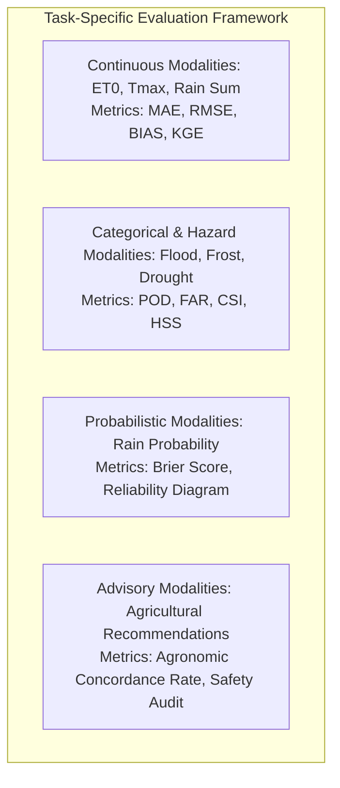

# Ritucast: Evaluation Metrics & Scientific Acceptance Criteria

## 1. Executive Summary & Purpose

A single statistical metric cannot evaluate an entire agricultural decision-support system. While a weather forecast might be assessed using Root Mean Squared Error ($RMSE$), an emergency flash-flood harvest warning must be evaluated by the catastrophic cost of missed events ($Misses$) versus the fatigue of false alarms ($False\ Alarms$).

This document establishes the **Evaluation Metrics and Scientific Acceptance Framework** for Ritucast, defining:
- Statistical formulations for continuous, categorical, probabilistic, and advisory outputs.
- Asymmetric loss functions reflecting smallholder economic risk.
- Explicit numerical gating thresholds required to approve models for operational deployment in Phase 9 and Phase 15.

---

## 2. Evaluation Metrics by Output Modality

---

### 2.1 Continuous Meteorological & Evapotranspiration Metrics

Used to evaluate NASA POWER variables, Open-Meteo forecasts, and FAO-56 Penman-Monteith $ET_0$ against BMD station records:

| Metric | Mathematical Formulation | Agronomic Interpretation | Acceptance Threshold for Deployment |
| :--- | :--- | :--- | :--- |
| **Mean Absolute Error ($MAE$)** | $MAE = \frac{1}{N}\sum_{i=1}^{N} \lvert \hat{y}_i - y_i \rvert$ | Average magnitude of errors in physical units. | $T_{\text{max}} \le 1.8^\circ\text{C}$; $ET_0 \le 0.65\text{ mm/day}$. |
| **Root Mean Squared Error ($RMSE$)** | $RMSE = \sqrt{\frac{1}{N}\sum_{i=1}^{N} (\hat{y}_i - y_i)^2}$ | Penalizes large outlier errors heavily (critical for temperature spikes). | $T_{\text{max}} \le 2.4^\circ\text{C}$; $ET_0 \le 0.85\text{ mm/day}$. |
| **Mean Bias ($BIAS$)** | $BIAS = \frac{1}{N}\sum_{i=1}^{N} (\hat{y}_i - y_i)$ | Identifies systematic overestimation or underestimation. | $\lvert BIAS \rvert \le 0.5^\circ\text{C}$; $\lvert BIAS \rvert \le 0.30\text{ mm/day}$. |
| **Kling-Gupta Efficiency ($KGE$)** | $KGE = 1 - \sqrt{(r - 1)^2 + \left(\frac{\sigma_{\hat{y}}}{\sigma_y} - 1\right)^2 + \left(\frac{\mu_{\hat{y}}}{\mu_y} - 1\right)^2}$ | Comprehensive benchmark integrating linear correlation ($r$), variability bias ($\frac{\sigma_{\hat{y}}}{\sigma_y}$), and mean bias ($\frac{\mu_{\hat{y}}}{\mu_y}$). | **$KGE \ge 0.70$** (High hydrological simulation skill). |

---

### 2.2 Categorical Hazard & Binary Decision Metrics

Used to evaluate event triggers: Pre-Rain Irrigation Postponement (`RULE-IRR-01`), Haor Emergency Flood Harvest (`RULE-FLD-01`), and Temperature Warnings (`RULE-TMP-01/02`).

#### $2 \times 2$ Contingency Table:
| Observed Condition | Forecast: Event Triggered | Forecast: Event Not Triggered |
| :--- | :---: | :---: |
| **Event Occurred** | **Hit ($a$)** | **Miss ($c$)** |
| **Event Did Not Occur** | **False Alarm ($b$)** | **Correct Negative ($d$)** |

#### Metrics Formulations & Smallholder Trade-Offs:
1. **Probability of Detection ($POD$ / Recall)**:
   $$POD = \frac{a}{a + c}$$
   - *Meaning*: Percentage of actual disaster events that Ritucast successfully detected.
   - *Smallholder Mandate*: For Haor flash floods, a **Miss ($c$)** means complete loss of a farmer's only annual crop ($100\%$ economic devastation). Therefore, $POD$ must be prioritized.
   - **Acceptance Threshold**: **$POD \ge 85\%$** for Haor flash floods; $POD \ge 80\%$ for rain events $\ge 20\text{ mm}$.
2. **False Alarm Ratio ($FAR$)**:
   $$FAR = \frac{b}{a + b}$$
   - *Meaning*: Percentage of issued alerts where the event failed to occur.
   - *Adoption Mandate*: If Ritucast repeatedly advises farmers to harvest immature crop or withhold irrigation and rain never falls, farmers lose trust ("crying wolf").
   - **Acceptance Threshold**: **$FAR \le 25\%$** for flood alerts; $FAR \le 30\%$ for rain postponement.
3. **Critical Success Index ($CSI$ / Threat Score)**:
   $$CSI = \frac{a}{a + b + c}$$
   - *Meaning*: Measures overall event forecast skill, ignoring easy correct non-events ($d$).
   - **Acceptance Threshold**: **$CSI \ge 0.65$**.
4. **Heidke Skill Score ($HSS$)**:
   $$HSS = \frac{2(ad - bc)}{(a + c)(c + d) + (a + b)(b + d)}$$
   - *Meaning*: Accuracy adjusted for random guessing ($HSS = 1$ is perfect, $HSS \le 0$ indicates zero skill).
   - **Acceptance Threshold**: **$HSS \ge 0.50$**.

---

### 2.3 Probabilistic Calibration Metrics

Used to evaluate 24h, 48h, and 72h precipitation probabilities ($P_{\text{prob}}$, $\%$ ) from Open-Meteo:

1. **Brier Score ($BS$)**:
   $$BS = \frac{1}{N}\sum_{i=1}^{N} (f_i - o_i)^2$$
   Where $f_i \in [0, 1]$ is the forecast probability, and $o_i \in \{0, 1\}$ is actual rainfall occurrence ($\ge 0.1\text{ mm}$).
   - **Acceptance Threshold**: **$BS \le 0.15$** for 24h forecasts; **$BS \le 0.20$** for 48h forecasts.
2. **Reliability Diagram & Calibration Error**:
   - Bin forecast probabilities into deciles ($0–10\%, 10–20\%, \dots, 90–100\%$).
   - Compute the observed empirical frequency in each bin.
   - **Acceptance Threshold**: Maximum calibration error across all bins must not exceed $\pm 15\%$ (e.g., when the system reports $70\%$ rain probability, actual rainfall must occur between $55\%$ and $85\%$ of the time).

---

### 2.4 Advisory Quality & Agronomic Safety Auditing

Because actionable recommendations directly affect farmer livelihoods, they are subjected to human agronomic panel audits:

1. **Agronomic Concordance Rate ($ACR$)**:
   $$ACR = \frac{N_{\text{approved}}}{N_{\text{audited}}} \times 100\%$$
   - A random sample of $100$ generated advisory instances across Barind and Haor pilot upazilas is audited by a joint review panel of DAE Upazila Agriculture Officers (UAOs) and BRRI Agronomists.
   - **Acceptance Threshold**: **$ACR \ge 90\%$** expert approval.
2. **Safety Audit Compliance (Zero-Tolerance Standards)**:
   - **100% Suppression on Stale Data**: Zero advisory cards displayed when weather data is $>36\text{h}$ old (`NFR-REL-03`).
   - **100% Absence of Prohibited Language**: Zero yield guarantees, zero absolute certainty claims ("১০০% নিশ্চিত"), and zero automated pesticide recommendations.

---

## 3. Master Scientific Acceptance Matrix for Phase 9 & Phase 15 Gating

| Capability / Rule | Output Variable | Primary Metric | Minimum Required Gate Threshold | Benchmark Reference Dataset |
| :--- | :--- | :--- | :--- | :--- |
| **FAO-56 Evapotranspiration** | Daily $ET_0$ ($\text{mm/day}$) | $MAE$ & $KGE$ | $MAE \le 0.65\text{ mm/day}$; $KGE \ge 0.70$ | BRRI & BMDA Class-A Pan Evaporation |
| **NASA POWER Air Temperature** | Daily $T_{\text{max}}, T_{\text{min}}$ ($^\circ\text{C}$) | $RMSE$ | $RMSE \le 2.2^\circ\text{C}$ | BMD Rajshahi & Sylhet Synoptic Stations |
| **GPM IMERG Catchment Rain** | 48h Catchment Accumulation ($P_{\text{cat}}$) | $CSI$ ($\ge 50\text{ mm}$) | $CSI \ge 0.60$; $BIAS \ge -20\%$ | BMD / BWDB Border Rain Gauges |
| **RULE-IRR-01 (Pre-Rain Postpone)** | 48h Rain Event ($\ge 20\text{ mm}$) | $POD$ & $FAR$ | $POD \ge 80\%$; $FAR \le 28\%$ | BMD Station Daily Rainfall Logs |
| **RULE-FLD-01 (Haor Flood Alert)** | Flash Flood Surge ($I_{\text{flood}} \ge 0.75$) | $POD$ & Lead Time | **$POD \ge 85\%$**; **Lead Time $\ge 48\text{ hours}$** | BWDB FFWC Surma River Stage Logs |
| **RULE-TMP-01 (Cold Warning)** | Booting Cold Shock ($T_{\text{min}} \le 15^\circ\text{C}$) | $POD$ & $FAR$ | $POD \ge 85\%$; $FAR \le 20\%$ | BMD Rajshahi & Sylhet Minimum Temp |
| **RULE-TMP-02 (Heat Warning)** | Anthesis Heat ($T_{\text{max}} \ge 35^\circ\text{C}$) | $POD$ & $FAR$ | $POD \ge 85\%$; $FAR \le 20\%$ | BMD Rajshahi Maximum Temp |
| **End-to-End Recommendations** | Actionable Advisory Cards | $ACR$ & Safety Audit | **$ACR \ge 90\%$**; **Safety Violations = 0** | DAE & BRRI Expert Review Panel |
