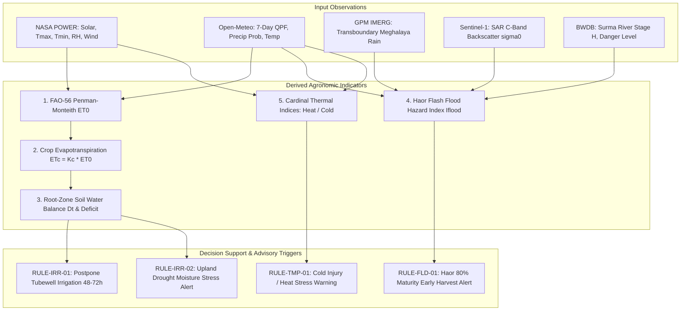
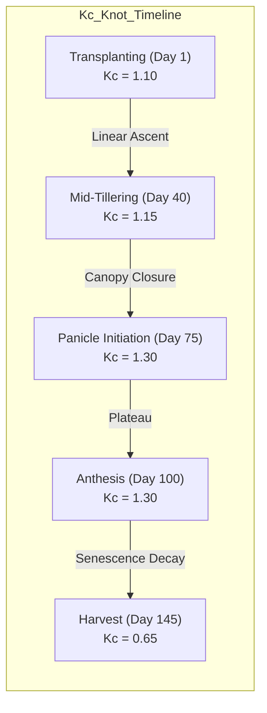
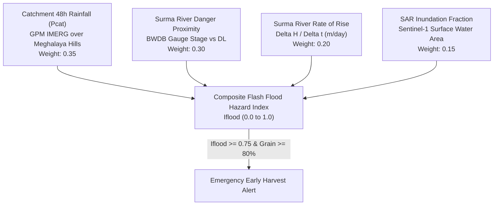

# Ritucast: Indicator Interpretation Framework

## 1. Executive Summary & Purpose

Raw Earth observation and meteorological data cannot directly drive farm-level decisions. Between physical satellite observations and a farmer's decision to start a tubewell pump or harvest early lies a sequence of mathematical modeling, agronomic calibration, and scientific uncertainty checks.

This document formalizes the **Indicator Interpretation Framework**, detailing the end-to-end transformation pipeline:
$$\text{Input Observations} \longrightarrow \text{Quality Control} \longrightarrow \text{Derived Indicator} \longrightarrow \text{Agronomic Interpretation} \longrightarrow \text{Decision Support} \longrightarrow \text{Scientific Validation}$$

It specifies the exact mathematical equations, physical coefficients, confounding factors, and validation benchmarks for Ritucast's core analytical capabilities.

---

## 2. Master Indicator Transformation Pipeline

---

## 3. Indicator 1 & 2: FAO-56 Reference Evapotranspiration ($ET_0$) & Crop Demand ($ET_c$)

### 3.1 Mathematical Specification of $ET_0$

Reference evapotranspiration ($ET_0$, $\text{mm/day}$) is computed using the FAO-56 Penman-Monteith formulation (Allen et al., 1998):

$$ET_0 = \frac{0.408 \Delta (R_n - G) + \gamma \frac{900}{T_{\text{mean}} + 273} u_2 (e_s - e_a)}{\Delta + \gamma (1 + 0.34 u_2)}$$

#### Intermediate Variable Formulations:
1. **Atmospheric Pressure ($P_{\text{atm}}$, $\text{kPa}$)**:
   $$P_{\text{atm}} = 101.3 \left(\frac{293 - 0.0065 z}{293}\right)^{5.26}$$
   Where $z$ is elevation above sea level ($z \approx 20\text{ m}$ in Godagari; $z \approx 5\text{ m}$ in Sunamganj).
2. **Psychrometric Constant ($\gamma$, $\text{kPa/}^\circ\text{C}$)**:
   $$\gamma = \frac{C_p P_{\text{atm}}}{\varepsilon \lambda} \approx 0.000665 P_{\text{atm}} \approx 0.0673\text{ kPa/}^\circ\text{C}$$
3. **Saturation Vapor Pressure ($e_s$, $\text{kPa}$)**:
   $$e^\circ(T) = 0.6108 \exp\left(\frac{17.27 T}{T + 237.3}\right)$$
   $$e_s = \frac{e^\circ(T_{\text{max}}) + e^\circ(T_{\text{min}})}{2}$$
4. **Actual Vapor Pressure ($e_a$, $\text{kPa}$)**:
   $$e_a = e_s \times \frac{RH_{\text{mean}}}{100}$$
5. **Slope of Vapor Pressure Curve ($\Delta$, $\text{kPa/}^\circ\text{C}$)**:
   $$\Delta = \frac{4098 \left[0.6108 \exp\left(\frac{17.27 T_{\text{mean}}}{T_{\text{mean}} + 237.3}\right)\right]}{(T_{\text{mean}} + 237.3)^2}$$
6. **Net Radiation ($R_n$, $\text{MJ/m}^2/\text{day}$)**:
   $$R_n = R_{ns} - R_{nl}$$
   - Net shortwave: $R_{ns} = (1 - \alpha) R_s = (1 - 0.23) R_s = 0.77 R_s$ (where $R_s$ is NASA POWER `ALLSKY_SFC_SW_DWN`).
   - Net longwave: $R_{nl} = \sigma \left[\frac{(T_{\text{max},K}^4 + T_{\text{min},K}^4)}{2}\right] (0.34 - 0.14\sqrt{e_a}) \left(1.35 \frac{R_s}{R_{so}} - 0.35\right)$, where $R_{so}$ is clear-sky solar radiation calculated from solar declination and latitude.
   - Soil heat flux $G = 0$ for daily time steps.

### 3.2 Dynamic $K_c$ Interpolation for Crop Demand ($ET_c$)

Crop evapotranspiration under standard, non-stress conditions is:
$$ET_c = K_c(t) \times ET_0$$

To prevent unnatural step-changes between growth stages, $K_c(t)$ is linearly interpolated between stage knots for Boro rice:

$$K_c(t) = K_{c,\text{prev}} + \left(\frac{t - t_{\text{prev}}}{t_{\text{next}} - t_{\text{prev}}}\right) (K_{c,\text{next}} - K_{c,\text{prev}})$$

---

## 4. Indicator 3: Root-Zone Daily Soil Water Balance & Deficit ($D_t$)

### 4.1 Water Balance Equation

For irrigated rice and upland crops in the Barind Tract, the soil water deficit ($D_t$, $\text{mm}$) in the effective root zone ($Z_r = 0.40\text{ m}$) at day $t$ is computed via a mass-balance depletion model:

$$D_t = D_{t-1} + ET_{c,t} - P_{\text{eff},t} - I_t + DP_t$$

Where:
- $D_t$: Root-zone soil water depletion at the end of day $t$ ($\text{mm}$). Constrained to $0 \le D_t \le TAW$.
- $D_{t-1}$: Depletion from the previous day ($\text{mm}$).
- $ET_{c,t}$: Daily crop evapotranspiration ($\text{mm/day}$).
- $P_{\text{eff},t}$: Effective precipitation that infiltrates into the root zone ($\text{mm/day}$).
- $I_t$: Irrigation depth applied on day $t$ ($\text{mm}$).
- $DP_t$: Deep percolation loss beyond the root zone ($\text{mm/day}$).

### 4.2 Effective Rainfall ($P_{\text{eff}}$) Formulation

Light rains ($<3\text{ mm}$) evaporate directly from the crop canopy and soil surface without replenishing root-zone moisture. Extreme storms ($>50\text{ mm}$) in heavy Barind clay exceed infiltration capacity and run off bunded paddy spillways.

Ritucast applies the calibrated USDA Soil Conservation Service (SCS) method:

$$P_{\text{eff}} = \begin{cases} 
0, & \text{if } P \le 3.0\text{ mm} \\
\frac{P \times (125 - 0.2 \times P)}{125}, & \text{if } 3.0 < P \le 250\text{ mm} \\
125 + 0.1 \times P, & \text{if } P > 250\text{ mm}
\end{cases}$$

### 4.3 Total and Readily Available Water ($TAW$ and $RAW$)

- **Total Available Water ($TAW$, $\text{mm}$)**:
  $$TAW = 1000 \times (\theta_{\text{FC}} - \theta_{\text{PWP}}) \times Z_r$$
  - In High Barind heavy clay: $\theta_{\text{FC}} = 0.32$, $\theta_{\text{PWP}} = 0.18$, $Z_r = 0.40\text{ m}$.
  - $TAW = 1000 \times (0.32 - 0.18) \times 0.40 = 56.0\text{ mm}$.
- **Readily Available Water ($RAW$, $\text{mm}$)**:
  $$RAW = p \times TAW$$
  - For Boro rice under AWD during tillering: Depletion fraction $p = 0.35 \implies RAW \approx 19.6\text{ mm}$ (soil dries to $15\text{ cm}$ below surface).
  - For Boro rice during reproductive/flowering: Depletion fraction $p = 0.10 \implies RAW \approx 5.6\text{ mm}$ (standing water layer required; zero stress tolerance).

---

## 5. Indicator 4: Haor Flash-Flood Hydrological Risk Index ($I_{\text{flood}}$)

### 5.1 Formulation of the Multi-Factor Risk Index

Pre-monsoon flash floods in the Haor basin are non-linear transboundary events. Relying on local rainfall alone creates false negatives (flood arrives under clear local skies), while relying solely on satellite radar creates a 6–12 day blind spot.

Ritucast combines four independent hydrologic proxies into a normalized Flash Flood Hazard Index ($I_{\text{flood}} \in [0, 1]$):

$$I_{\text{flood}} = w_1 \cdot f_P(P_{\text{cat}}) + w_2 \cdot f_S(H, DL) + w_3 \cdot f_R\left(\frac{\Delta H}{\Delta t}\right) + w_4 \cdot f_I(f_{\text{inund}})$$

Where weights are calibrated as:
$$w_1 = 0.35, \quad w_2 = 0.30, \quad w_3 = 0.20, \quad w_4 = 0.15 \quad (\sum w_i = 1.0)$$

#### Sub-Function Definitions:
1. **Transboundary Catchment Precipitation Sub-Index ($f_P$)**:
   $$f_P(P_{\text{cat}}) = \min\left(1.0, \frac{\max(0, P_{\text{cat}} - 30.0)}{120.0}\right)$$
   Where $P_{\text{cat}}$ is the 48-hour accumulated precipitation ($\text{mm}$) across the southern Meghalaya catchment box ($25.10–25.45^\circ\text{N}, 91.10–92.00^\circ\text{E}$). $P_{\text{cat}} < 30\text{ mm}$ represents normal baseflow; $P_{\text{cat}} \ge 150\text{ mm}$ generates catastrophic runoff.
2. **River Stage Danger Proximity Sub-Index ($f_S$)**:
   $$f_S(H, DL) = \min\left(1.0, \max\left(0, \frac{H - (DL - 1.0)}{1.2}\right)\right)$$
   Where $H$ is the current water level at BWDB Surma River at Sunamganj gauge ($DL = 8.25\text{ m}$ PWD datum). When $H$ is within $1.0\text{ m}$ of $DL$, the index rises rapidly; when $H \ge DL + 0.2\text{ m}$, $f_S = 1.0$.
3. **River Stage Rate of Rise Sub-Index ($f_R$)**:
   $$f_R\left(\frac{\Delta H}{\Delta t}\right) = \min\left(1.0, \max\left(0, \frac{\frac{\Delta H}{\Delta t} - 0.20}{0.80}\right)\right)$$
   Where $\frac{\Delta H}{\Delta t}$ is the 24-hour rate of water level rise ($\text{m/day}$). A rise $>0.50\text{ m/day}$ indicates an incoming flood wave; $\ge 1.0\text{ m/day}$ represents a catastrophic surge.
4. **Satellite Observed Inundation Fraction Sub-Index ($f_I$)**:
   $$f_I(f_{\text{inund}}) = \min\left(1.0, \frac{f_{\text{inund}}}{0.40}\right)$$
   Where $f_{\text{inund}}$ is the proportion of upazila agricultural land detected as water-covered by Sentinel-1 SAR ($\sigma^\circ < -20\text{ dB}$).

### 5.2 Calibrated Action Thresholds for $I_{\text{flood}}$

| $I_{\text{flood}}$ Value | Hazard Tier | Hydrological Condition | System Action & Advisory Output |
| :--- | :--- | :--- | :--- |
| **$< 0.35$** | **Normal / Green** | Low catchment rain; river well below danger level; normal baseflow. | Standard monitoring. No flood alerts displayed. |
| **$0.35 – 0.55$** | **Advisory / Yellow** | Moderate rainfall ($40–70\text{ mm}$) in Meghalaya; river rising steadily ($0.3–0.5\text{ m/d}$). | **Preparation Advisory**: Advise SAAOs to inspect submersible embankments and review harvest equipment readiness. |
| **$0.55 – 0.75$** | **Warning / Orange** | Heavy rainfall ($70–120\text{ mm}$) in catchment; river within $0.5\text{ m}$ of danger level. | **Urgent Warning**: Advise farmers that floodwater may enter low beels within 48 hours. Secure stored grains. |
| **$\ge 0.75$** | **Emergency / Red** | Severe cloudburst ($>120\text{ mm}$); river exceeding danger level; embankments overtopping. | **RULE-FLD-01 Trigger**: **Immediate Emergency Harvest Alert** for all fields where grain maturity is $\ge 80\%$. |

---

## 6. Indicator 5 & 6: Cardinal Thermal Stress Indices

### 6.1 Anthesis Heat Stress Index ($I_{\text{heat}}$)

Anthesis in Boro rice occurs between $9:00\text{ AM}$ and $11:30\text{ AM}$. Air temperatures exceeding $35.0^\circ\text{C}$ during these morning hours induce floret sterility.

$$I_{\text{heat}} = \begin{cases}
0, & \text{if } T_{\text{max}} < 35.0^\circ\text{C} \\
\frac{T_{\text{max}} - 35.0}{5.0}, & \text{if } 35.0 \le T_{\text{max}} \le 40.0^\circ\text{C} \\
1.0, & \text{if } T_{\text{max}} > 40.0^\circ\text{C}
\end{cases}$$

- **Trigger Condition**: If $I_{\text{heat}} > 0.0$ for $\ge 2$ consecutive days and crop stage is **Anthesis (Flowering)**, activate `RULE-TMP-02` (Terminal Heat Stress Advisory).

### 6.2 Booting Stage Cold Shock Index ($I_{\text{cold}}$)

During microspore mother cell meiosis (booting stage, 10–14 days prior to heading), low minimum temperatures ($T_{\text{min}} < 15.0^\circ\text{C}$) induce male pollen sterility.

$$I_{\text{cold}} = \begin{cases}
0, & \text{if } T_{\text{min}} \ge 15.0^\circ\text{C} \\
\frac{15.0 - T_{\text{min}}}{5.0}, & \text{if } 10.0 \le T_{\text{min}} < 15.0^\circ\text{C} \\
1.0, & \text{if } T_{\text{min}} < 10.0^\circ\text{C}
\end{cases}$$

- **Trigger Condition**: If $I_{\text{cold}} > 0.0$ for $\ge 3$ consecutive days and crop stage is **Panicle Initiation / Booting**, activate `RULE-TMP-01` (Cold Injury Advisory).

---

## 7. Prevention of False Causal Conclusions & Confounding Factors

| Observed Phenomenon | Misleading Premature Conclusion | Actual Confounding Agronomic Realities | Scientific Safeguard Enforced in Ritucast |
| :--- | :--- | :--- | :--- |
| **Rainfall Deficit ($P = 0\text{ mm}$ for 21 days)** | "Crop is experiencing severe water stress; issue emergency drought alert." | High Barind Boro rice is **100% irrigated via DTWs**. Farmers pump every 5–7 days. Absence of rain is the normal winter state, not an acute emergency. | Moisture deficit must be computed via root-zone soil water balance ($D_t$), integrating irrigation replenishment, not raw rainfall absence. |
| **Optical NDVI Drop ($\Delta \text{NDVI} = -0.20$)** | "Pest outbreak or fungal disease detected in field." | A drop in NDVI can be caused by: (1) normal crop harvest, (2) seasonal drying, (3) cloud/shadow contamination, (4) standing water specular reflection. | Ban automated disease diagnosis from satellite data (`DEC-06`). Satellite NDVI is strictly an auxiliary canopy greenness indicator. |
| **High Atmospheric Temperature ($T_{\text{max}} = 37^\circ\text{C}$)** | "Widespread crop sterility will destroy harvest." | High temperature only causes sterility if it coincides with **morning anthesis (floret opening)**. If the crop is already in the dough stage, high temperature accelerates ripening without causing sterility. | Mandatory phenological gating (`Rule 1`, `NFR-SCI-01`). Thermal stress rules are inactive outside the flowering window. |
| **SMAP Radiometer Saturation ($\theta = 0.48\text{ m}^3/\text{m}^3$)** | "Entire upazila soil profile is 100% waterlogged; halt all irrigation." | Bunded rice paddies hold surface standing water, saturating the 9km L-band radiometer, while adjacent upland vegetable plots may be severely parched. | Suppress SMAP interpretation for flooded paddies (`RSK-13`). Use SMAP strictly as a regional macro-trend for upland soils. |
