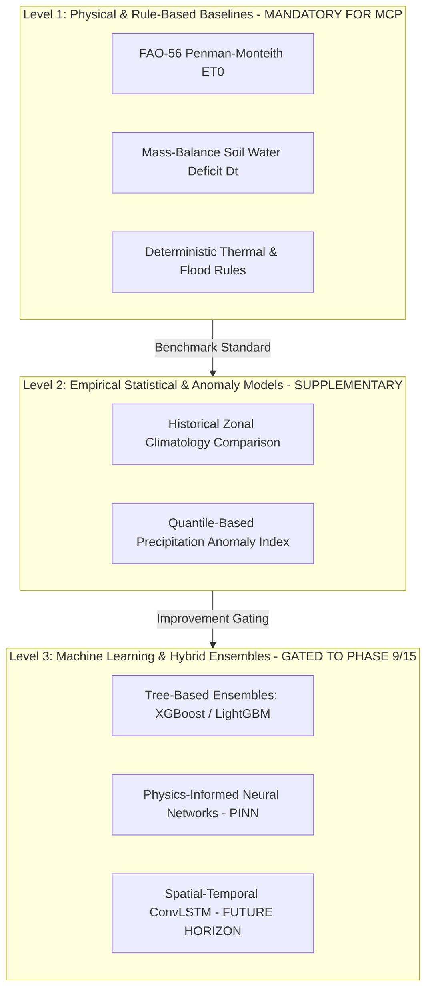

# Ritucast: Modeling Readiness & Guardrails

## 1. Executive Summary & Purpose

Agricultural intelligence platforms frequently fail when engineers deploy complex machine learning (ML) or deep learning models prematurely, before establishing physical baselines or understanding data limitations. Complex black-box models trained on sparse agricultural labels often memorize spurious correlations, hallucinate unrealistic predictions, and fail catastrophically during climate anomalies.

This document establishes the **Modeling Philosophy, Machine Learning Readiness Standards, and Anti-Complexity Guardrails** for Ritucast, mandating:
- Physical and rule-based models as the primary operational baseline for the Minimum Complete Product (MCP).
- Strict prerequisites and gating criteria before any machine learning model may be introduced in subsequent phases (Phase 9 and Phase 15).
- Zero-data-leakage cross-validation protocols and explainability standards.

---

## 2. Modeling Hierarchy & Evaluation Alternatives

### 2.1 Trade-Off Analysis of Modeling Alternatives

| Modeling Approach | Agronomic Transparency | Data Volume Requirement | Risk of Overfitting | Smallholder Credibility | Role in Ritucast Lifecycle |
| :--- | :--- | :--- | :--- | :--- | :--- |
| **Physical / Rule-Based (FAO-56, Water Balance)** | **Very High** (Direct thermodynamic equations). | **Low** (Requires physical constants and meteorological forcing). | **Zero** (Mechanistic; cannot overfit). | **High** (Accepted by BRRI/BARI/DAE agronomists). | **Primary Operational Baseline for MCP (Phases 1–8)** |
| **Statistical Anomaly Analysis (Z-scores, SPI)** | **High** (Standard climatological distributions). | **Medium** (Requires $\ge 15–20$ years of historical baseline). | **Low** (Simple linear/quantile distributions). | **High** (Standard BMD/WMO drought indices). | **Supplementary Context Tier (Phase 8/9)** |
| **Gradient Boosted Trees (XGBoost / LightGBM)** | **Moderate** (Requires SHAP post-hoc explainers). | **High** (Requires thousands of validated ground-truth samples). | **High** (Memorizes local noise without spatial blocks). | **Moderate** (Requires plain-language explanation). | **Gated to Phase 9/15 (Subject to Benchmark Gates)** |
| **End-to-End Deep Learning (CNN / Transformer)** | **Very Low** (Opaque black box). | **Very High** ($\ge 10^5$ labeled satellite patches). | **Extreme** (Spurious features, covariate shift). | **Zero** (Cannot explain "why" to SAAOs). | **Strictly Deferred to Long-Term Horizon (`DEC-06`)** |

---

## 3. Strict Prerequisites for Machine Learning Introduction

Machine learning models are strictly prohibited from generating operational recommendations in Ritucast until all of the following six gates are formally certified in Phase 9:

### Gate 1: Established Physical Baseline Benchmark
An ML model cannot be trained without first establishing the performance of the corresponding Level 1 physical model (e.g., FAO-56 Penman-Monteith or simple rainfall threshold).

### Gate 2: Statistically Significant Outperformance
The proposed ML model must demonstrate statistically significant improvement ($p < 0.01$, paired t-test or Wilcoxon signed-rank test) over the Level 1 baseline on the independent hold-out test set:
- For continuous variables: $\ge 15\%$ reduction in $RMSE$ and $\ge 0.10$ gain in $KGE$.
- For hazard classification: $\ge 10\%$ increase in Critical Success Index ($CSI$).

### Gate 3: Representative, Unbiased Ground-Truth Labels
The training set must possess clean ground-truth labels from verified sources (e.g., in-situ BMD weather stations or BWDB river logs). Models trained on unvalidated third-party synthetic data or un-calibrated satellite proxies are banned.

### Gate 4: Zero Spatial and Temporal Data Leakage
Cross-validation must enforce:
1. **Spatial Block Partitioning**: Training and validation sets must be split by distinct upazilas (**Spatial Leave-One-Upazila-Out**). Randomly splitting pixels across space causes spatial autocorrelation leakage, resulting in artificially inflated test scores.
2. **Temporal Split**: The test set must consist of entire future agricultural seasons (e.g., 2023–2025 Boro seasons held out).

### Gate 5: Mandatory Algorithmic Explainability (SHAP)
No ML model may be deployed without integrated **SHAP (SHapley Additive exPlanations)** or TreeSHAP feature attributions. For every prediction, the top 3 driving features must be extracted and converted into plain-language Bangla text:
> *"পরামর্শের কারণ: বিগত ৭ দিনের বাষ্পীভবন (৩৮ মিমি), মাটির আর্দ্রতার ঘাটতি (২২ মিমি) এবং আগামী ৪৮ ঘণ্টায় বৃষ্টির অনুপস্থিতি।"*

### Gate 6: Robustness Under Extreme Climate Anomalies
The model must be evaluated against historical extreme outlier years (e.g., the 2017 Haor deluge, 2021 pre-monsoon heatwave). If the ML model fails during climate shocks where the physical rule succeeds, the ML model is rejected.

---

## 4. Explicit Modeling Bans & Red Lines

To preserve scientific integrity, protect smallholder farmers, and comply with locked project decisions (`DEC-06`, `DEC-10`):

1. **NO Sub-Acre Field Yield Guarantees**: Deep learning models purporting to predict exact bag-per-acre yields from satellite imagery are banned. Pixel resolution ($10–50\text{km}$) cannot resolve micro-management variations across sub-acre delta plots.
2. **NO Automated Chemical Pesticide Recommendations**: Automated computer-vision diagnosis of fungal/bacterial leaf diseases from satellite pixels is banned. Remote sensing detects canopy greenness decline, not microscopic pathogen etiology.
3. **NO Uncalibrated Deep Learning Ensembles**: Black-box neural networks without uncertainty quantification or physical constraints (Physics-Informed Loss) are banned from operational advisory generation.
