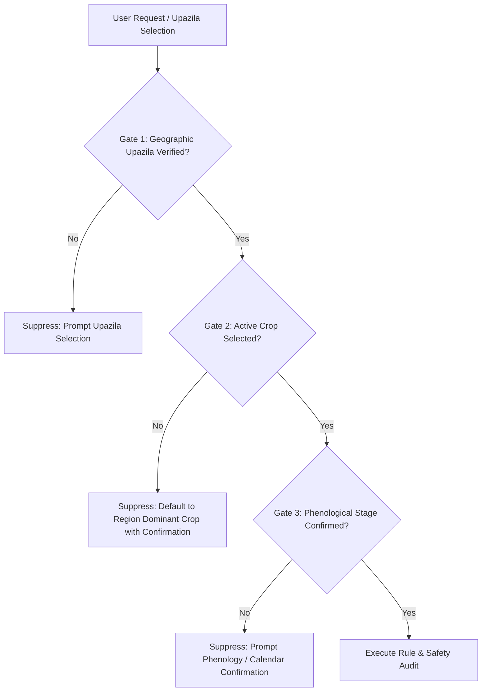
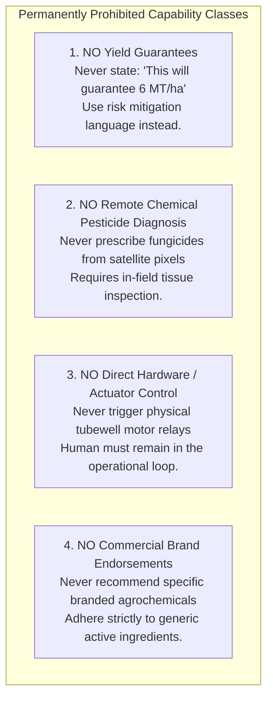

# Ritucast: Agricultural Recommendation Safety Framework

## 1. Executive Summary & Safety Mandate

In agricultural decision support for smallholder farmers, software defects and model hallucinations are not merely user experience bugs; they are safety-critical hazards. An erroneous advisory advising a smallholder to withhold irrigation prior to a phantom rain event can destroy an entire family's seasonal livelihood. Conversely, failing to issue an early harvest warning before a flash-flood breach can lead to total crop submergence.

Ritucast operates under an uncompromising **"Do No Harm"** agronomic safety architecture. This document defines:
- Operational safety guardrails and mandatory contextual gates.
- Strict data sufficiency and freshness rules with automated fallback suppression.
- Prohibited recommendation categories and user-facing liability protections.
- Expert agronomic panel review and sign-off protocols.

---

## 2. Mandatory Contextual Gating Protocol

A recommendation is strictly prohibited from executing without verified confirmation of three mandatory agronomic dimensions:



### Safety Justification:
- **Agronomic Non-Linearity**: An operational action that is highly beneficial during the vegetative tillering stage (e.g., drying the field under Alternate Wetting and Drying) causes **permanent, catastrophic spikelet sterility** if applied during anthesis (flowering).
- **Spatial Differentiation**: A flash-flood alert that saves millions in the low-lying Haor basin would be absurd and panic-inducing if broadcast in the undulating Barind terrace.

---

## 3. Data Sufficiency & Automated Suppression Triggers

The recommendation engine must automatically **suppress advisory generation** and display a safe fallback notice whenever any of the following operational failure conditions occur:

| Failure Condition | Detection Mechanism | Immediate System Action | Fallback Notice Displayed |
| :--- | :--- | :--- | :--- |
| **Data Staleness** | Weather forecast or satellite feed timestamp is $>36\text{ hours}$ old (`NFR-REL-03`). | Hard suppression of active advisory cards. | *"তথ্য হালনাগাদ হচ্ছে: সর্বশেষ আবহাওয়া তথ্য সার্ভারে পৌঁছাতে বিলম্ব হচ্ছে। সাময়িক সতর্কতার জন্য স্থানীয় কৃষি কর্মকর্তার সাথে যোগাযোগ করুন।"* |
| **Extreme NWP Uncertainty** | Multi-model ensemble spread exceeds $50\%$ with rain probability hovering ambiguously between $40\%$ and $60\%$. | Hard suppression of definitive action cards (`RULE-IRR-01`). | *"পূর্বাভাসে অনিশ্চয়তা বেশি: আগামী ৪৮ ঘণ্টার বৃষ্টিপাতের সম্ভাবনা নিয়ে আবহাওয়া মডেলগুলোতে মতভেদ রয়েছে। সেচ দেয়ার আগে জমির রস নিজে পরীক্ষা করুন।"* |
| **Corrupted / Out-of-Bounds Variables** | Inputs violate physical range checks (e.g., $T_{\text{max}} < 5^\circ\text{C}$ or $>50^\circ\text{C}$, $RH < 5\%$, $P < 0\text{ mm}$). | Abort calculation; alert engineering monitoring log (`P1 Alert`). | Fallback to safe monitoring mode; suppress automated advice. |
| **Out-of-Season Crop Selection** | User queries a crop that is biologically impossible in the selected month (e.g., Aman rice in January). | Reject crop-stage combination. | *"অনুপযুক্ত মৌসুম: নির্বাচিত ফসলটি এই সময়ে মাঠে চাষযোগ্য নয়। অনুগ্রহ করে সঠিক ফসল বা মৌসুম নির্বাচন করুন।"* |
| **Missing Soil / Phenology Metadata** | Critical soil parameter (AWC) or sowing date is null. | Fallback to regional default modal values with explicit uncertainty badge. | Display advisory with **Low Confidence Badge** and prominent disclaimer. |

---

## 4. Prohibited Recommendation Categories & Red Lines

To prevent agronomic liabilities, misrepresentation of remote sensing capabilities, and commercial exploitation, the following four capability classes are **permanently prohibited** from Ritucast:



---

## 5. Expert Review & Agronomic Sign-Off Protocol

No candidate agricultural rule, parameter modification, or threshold revision may be merged into production without formal multi-disciplinary sign-off:

```mermaid
graph LR
    Dev[Science / Modeling Team<br>Drafts Rule Specification] --> Review[Agronomic Review Panel<br>BRRI Agronomist + DAE Field UAO]
    Review --> Hindcast[Historical Hindcast Audit<br>Validates on 2017 & 2021 Case Studies]
    Hindcast --> Safety[Safety Lead Sign-Off<br>Verifies Suppression & Edge Cases]
    Safety --> Deploy[Production Release Gate (Phase 9/15)]
```

### Sign-Off Criteria:
1. **Agronomic Validity**: The rule logic aligns with current BRRI Modern Rice Cultivation Guidelines and DAE Extension Manuals.
2. **Linguistic Appropriateness**: All Bangla terms use culturally accessible, non-technical agrarian expressions validated by field extension staff.
3. **Safety Checklist**: Automated suppression triggers are empirically tested on corrupted inputs and stale data streams.
4. **Permanent Audit Trail**: Every approved rule is logged in the [Scientific Governance Registry](file:///Users/kazi/Projects/RITUCAST/docs/science/scientific-governance.md) with author, reviewer, date, and reference citations.
