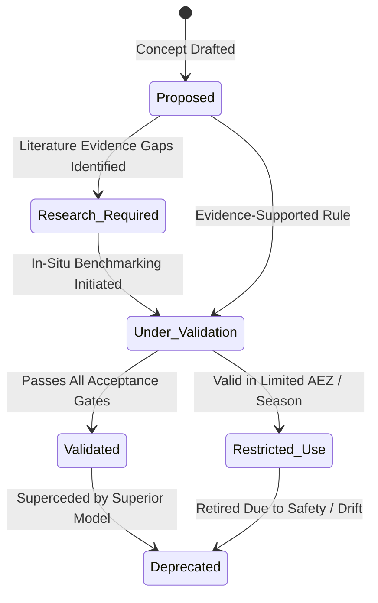

# Ritucast: Scientific Governance & Provenance Specification

## 1. Executive Summary & Purpose

Scientific credibility requires rigorous traceability. When an agricultural advisory is presented to a farmer or extension officer, every underlying equation, physical parameter, and logical rule must have a traceable provenance linking back to its authoritative source, calibration date, and validation status.

This document establishes the **Scientific Governance Framework**, defining:
- Standard lifecycle statuses for all scientific assets.
- The Master Scientific Asset Registry.
- Change control and versioning protocols.
- Annual pre-season review workflows.

---

## 2. Scientific Asset Lifecycle States

Every equation, index, rule, and model progresses through a formal six-stage lifecycle:

| Lifecycle Status | Operational Meaning | System Production Readiness |
| :--- | :--- | :--- |
| **`Proposed`** | Concept drafted; theoretical formulation complete. | **Non-Production**: Internal testing only. |
| **`Research Required`** | Scientifically plausible, but lacks verified coefficients for Bangladesh. | **Non-Production**: Assigned to Research Gaps Register. |
| **`Under Validation`** | Actively undergoing hindcast auditing or ground-truth benchmarking. | **Non-Production**: Staging environment testing. |
| **`Validated for Specified Conditions`** | Fully verified against independent reference data and approved by agronomists. | **Production Ready**: Deployed to operational engine. |
| **`Restricted Use`** | Approved for production strictly within specific AEZs, crops, or auxiliary tiers. | **Production Ready (Constrained)**: Spatial/temporal filters enforced. |
| **`Deprecated`** | Retired due to scientific drift, sensor discontinuation, or superior replacement. | **Retired**: De-activated from production pipelines. |

---

## 3. Master Scientific Asset Registry

| Asset ID | Asset Name & Type | Underlying Formulation / Inputs | Authorized Context / AEZ | Lifecycle Status | Primary Scientific Citation |
| :--- | :--- | :--- | :--- | :--- | :--- |
| **`EQN-ET0-01`** | FAO-56 Penman-Monteith $ET_0$ | NASA POWER $R_s, T_{\text{max}}, T_{\text{min}}, RH, u_2$ | National Bangladesh Lowlands ($z \le 50\text{m}$) | **Validated for Specified Conditions** | Allen et al. (1998); FAO-56. |
| **`EQN-ETC-01`** | Boro Rice Crop Water Demand ($ET_c$) | $ET_c = K_c(t) \times ET_0$ with dynamic $K_c$ knots | Boro Rice across Barind & Haor | **Validated for Specified Conditions** | BRRI Water Mgmt Bulletin #44 (2020). |
| **`EQN-SWD-01`** | Root-Zone Soil Water Balance ($D_t$) | Mass balance: $D_t = D_{t-1} + ET_{c} - P_{\text{eff}} - I + DP$ | High Barind Heavy Clay ($TAW = 56\text{mm}$) | **Validated for Specified Conditions** | USDA SCS (1972); BMDA (2021). |
| **`IDX-FLD-01`** | Haor Flash Flood Hazard Index ($I_{\text{flood}}$) | Composite: Meghalaya rain ($0.35$) + Surma stage ($0.30$) + Rate of rise ($0.20$) + SAR ($0.15$) | Haor Basin (Sunamganj, Tahirpur) | **Under Validation** | BWDB FFWC (2022); CDSE Sentinel-1. |
| **`IDX-TMP-01`** | Anthesis Terminal Heat Stress ($I_{\text{heat}}$) | $T_{\text{max}} \ge 35^\circ\text{C}$ during morning flowering | High Barind Tract (March–April) | **Validated for Specified Conditions** | Prasad et al. (2006); BRRI (2019). |
| **`IDX-TMP-02`** | Booting Stage Cold Shock ($I_{\text{cold}}$) | $T_{\text{min}} \le 15^\circ\text{C}$ for $\ge 3$ consecutive days | National Boro Rice (Jan–Feb) | **Validated for Specified Conditions** | Satake & Yoshida (1978); BRRI (2019). |
| **`RULE-IRR-01`** | Pre-Rain Irrigation Postponement | $QPF_{48\text{h}} \ge 20\text{mm}, P_{\text{prob}} \ge 65\%, D_t < TAW - 25\text{mm}$ | Barind Boro Vegetative / Tillering | **Validated for Specified Conditions** | Rahman et al. (2019); BMDA (2021). |
| **`RULE-IRR-02`** | Critical Root-Zone Deficit Trigger | $D_t \ge RAW$, 5-day rain $< 5\text{mm}$ | Barind Boro & Upland Rabi crops | **Validated for Specified Conditions** | Sattar et al. (2009); Allen et al. (1998). |
| **`RULE-FLD-01`** | Haor 80% Maturity Early Harvest | $I_{\text{flood}} \ge 0.75$, Boro stage = Dough / Mature | Haor Basin (Sunamganj Upazilas) | **Under Validation** | BRRI Guidelines (2017); DAE (2022). |
| **`RULE-FLD-02`** | Haor SAR Post-Breach Inundation | Sentinel-1 SAR $\sigma^\circ < -20\text{dB}$, Surma $H \ge DL$ | Haor Basin low beels | **Restricted Use (SAR Revisit Latency)** | ESA Copernicus; BWDB. |
| **`MOD-YLD-01`** | Sub-Acre Field-Level Yield Prediction | Deep learning regression from satellite imagery | National | **Deprecated / Prohibited (`DEC-06`)** | N/A (Excluded from Scope). |
| **`MOD-DIS-01`** | Automated Satellite Disease Diagnosis | Computer-vision leaf blast classification | National | **Deprecated / Prohibited (`DEC-06`)** | N/A (Excluded from Scope). |

---

## 4. Change Control & Annual Pre-Season Audit Protocol

1. **Pre-Season Agronomic Review (October Annual)**:
   - Prior to the start of the Boro season (November 1), the Science Lead and DAE/BRRI Advisory Panel must conduct a formal audit of all active assets.
   - Any shifts in varietal adoption (e.g., rapid replacement of BRRI dhan28 with BRRI dhan88/89) must trigger updates to phenological duration parameters.
2. **Semantic Versioning of Scientific Assets**:
   - Scientific specifications follow semantic versioning (`MAJOR.MINOR.PATCH`):
     - `PATCH`: Editorial clarifications or minor typographical corrections.
     - `MINOR`: Re-calibration of physical thresholds (e.g., adjusting $I_{\text{flood}}$ weights from $0.35$ to $0.38$).
     - `MAJOR`: Fundamental formula changes (e.g., replacing FAO-56 Penman-Monteith with a dual-crop coefficient approach).
3. **Traceability Logging**:
   - Every production advisory payload emitted by the backend API must include a `scientific_provenance` metadata block recording the exact asset IDs and version strings utilized.
