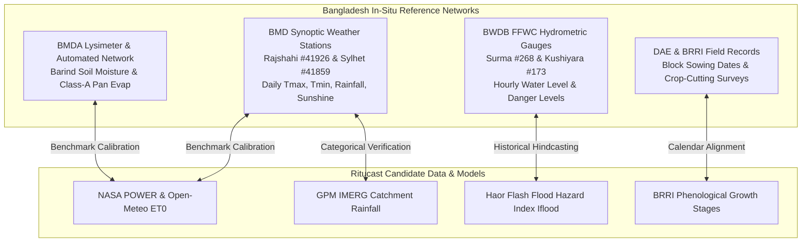
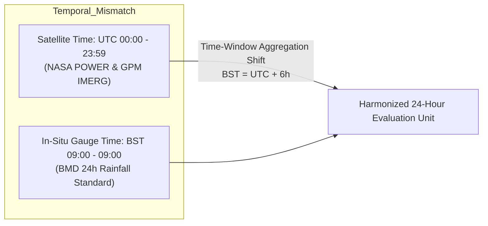
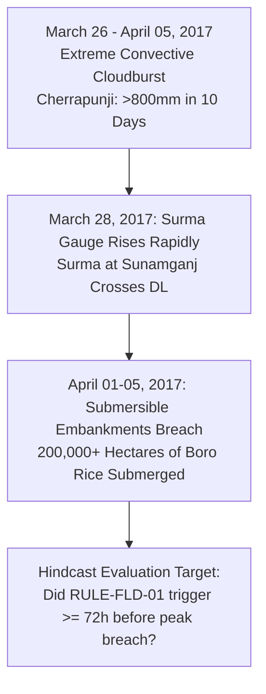

# Ritucast: Scientific Validation Plan & Ground-Truth Benchmarking

## 1. Executive Summary & Purpose

A remote-sensing or meteorological indicator cannot be assumed accurate simply because it originates from NASA, ESA, or ECMWF. Scientific credibility requires rigorous validation against independent ground-truth observations from Bangladesh's national research and monitoring networks.

This document establishes the **Scientific Validation Plan** for Ritucast, detailing:
- Authoritative reference datasets for ground-truth comparisons.
- Spatial and temporal alignment protocols (converting UTC satellite grids to Bangladesh Standard Time in-situ station records).
- Historical hindcasting protocols (testing algorithms against historic disaster events).
- Operational verification workflows.

---

## 2. In-Situ Reference Datasets & Ground-Truth Networks

---

### 2.1 Meteorological & Atmospheric Reference Data (BMD)

The **Bangladesh Meteorological Department (BMD)** operates 35 first-order synoptic weather stations across the country:

| Station Name | WMO Station Index | Coordinates | Agro-Ecological Context | Primary Benchmark Role |
| :--- | :--- | :--- | :--- | :--- |
| **Rajshahi Station** | `41926` | $24.37^\circ\text{N}, 88.60^\circ\text{E}$ (Elev: $20\text{ m}$) | High Barind Tract (Rajshahi Division) | Validating NASA POWER and Open-Meteo $T_{\text{max}}$, $T_{\text{min}}$, $RH$, and rainfall for Godagari and Tanore. |
| **Sylhet Station** | `41859` | $24.90^\circ\text{N}, 91.88^\circ\text{E}$ (Elev: $34\text{ m}$) | Eastern Surma-Kushiyara Basin | Regional reference for eastern Haor atmospheric humidity and convective rain. |
| **Srimangal Station** | `41883` | $24.30^\circ\text{N}, 91.73^\circ\text{E}$ (Elev: $22\text{ m}$) | Southern Sylhet Basin | Reference for pre-monsoon temperature and micro-fog dynamics. |
| **Sunamganj Sub-Station** | `N/A` (Agro-met station) | $25.07^\circ\text{N}, 91.40^\circ\text{E}$ (Elev: $8\text{ m}$) | Central Haor Basin | Local manual daily rainfall gauge for Haor basin ground truthing. |

---

### 2.2 Hydrological Reference Network (BWDB - FFWC)

The **Flood Forecasting and Warning Centre (FFWC)** of the Bangladesh Water Development Board maintains the official hydrometric network:

| Hydrometric Station | River Basin | Station ID | Danger Level ($DL$, m PWD) | Recorded Peak High Flood Level (HFL) | Benchmark Role in Ritucast |
| :--- | :--- | :--- | :--- | :--- | :--- |
| **Surma at Sunamganj** | Surma-Meghalaya | `268` | **$8.25\text{ m}$** | $9.82\text{ m}$ (June 2022) | Primary operational gauge for `RULE-FLD-01` in Sunamganj Sadar and Tahirpur. |
| **Kushiyara at Sheola** | Kushiyara | `173` | **$13.00\text{ m}$** | $14.60\text{ m}$ (June 2022) | Benchmark for eastern Haor basin transboundary inflow. |
| **Jadukata at Lorergarh** | Jadukata | `128` | **$8.00\text{ m}$** | $11.85\text{ m}$ (June 2022) | Critical rapid-response station immediately below the Meghalaya hill border. |

---

### 2.3 Agro-Hydrological & Lysimeter Reference Data (BMDA & BRRI)

- **BMDA Agro-Weather Network**: The Barind Multipurpose Development Authority maintains automated weather stations (AWS) across Rajshahi and Chapainawabganj recording hourly soil temperature, air temperature, and rain.
- **BRRI Lysimeter Testbeds**: BRRI Gazipur and regional stations maintain drained and constant-water-table percolation lysimeters and Class-A evaporation pans. These provide the ground-truth standard for validating FAO-56 Penman-Monteith $ET_0$ calculations against actual measured open-water pan evaporation ($E_{\text{pan}}$):
  $$ET_0 \approx K_{\text{pan}} \times E_{\text{pan}} \quad (K_{\text{pan}} \approx 0.70–0.75 \text{ for humid lowlands})$$

---

## 3. Spatial and Temporal Alignment Protocols

Comparing gridded satellite observations with in-situ station measurements introduces spatial representation mismatches and temporal boundary discrepancies.

### 3.1 Temporal Window Harmonization
- **BMD Daily Rainfall Convention**: A daily rainfall record labeled "April 15" at BMD represents rain collected between **09:00 BST on April 14 and 09:00 BST on April 15** (which corresponds to **03:00 UTC April 14 to 03:00 UTC April 15**).
- **Satellite Day Convention**: NASA POWER and GPM IMERG daily files report for **00:00 to 23:59 UTC**.
- **Alignment Protocol**:
  - To validate against BMD daily rainfall, GPM IMERG half-hourly grids must be summed across the custom window $t \in [03:00\text{ UTC}_{d-1}, 03:00\text{ UTC}_d]$.
  - Failure to perform this 3-hour shift introduces false timing errors during early-morning convective downpours.

### 3.2 Spatial Alignment: Point-to-Grid vs Zonal Sampling
- **Point-to-Grid Extraction**: For BMD station comparisons, extract satellite values using **bilinear interpolation** of the four surrounding grid centroids rather than nearest-neighbor, which prevents artificial discontinuities at grid edges.
- **Zonal Upazila Aggregation**: When evaluating upazila-level indices, compute the **area-weighted mean** of all grid cells intersecting the official `DATA-BND-01` GeoJSON polygon:
  $$\bar{X}_{\text{upazila}} = \frac{\sum_{i=1}^N (X_i \cdot A_i)}{\sum_{i=1}^N A_i}$$
  Where $A_i$ is the intersection area of grid cell $i$ within the upazila boundary.

---

## 4. Historical Event Hindcasting Protocols

Before approving any operational rule, its predictive performance must be evaluated retrospectively against major documented disaster events.

### 4.1 Case Study 1: The 2017 Catastrophic Haor Flash-Flood Disaster

- **Event Context**: An unprecedented early western disturbance brought extreme pre-monsoon rainfall to the Meghalaya hills in late March 2017. Over $800\text{ mm}$ fell in Cherrapunji between March 26 and April 5. Submersible embankments across Sunamganj breached between March 29 and April 3, submerging 220,000 hectares of nearly-ripe Boro rice, causing national food supply disruption.
- **Hindcast Test Protocol**:
  1. Feed historical GPM IMERG V07 precipitation and BWDB Surma river stage records from March 20 to April 10, 2017 into the `RULE-FLD-01` engine.
  2. Compute daily $I_{\text{flood}}$ values.
  3. **Success Criterion**: $I_{\text{flood}}$ must cross the emergency threshold ($\ge 0.75$) **no later than March 27, 2017**, providing at least **72 to 96 hours of lead time** before widespread embankment overtopping on March 30–31.

### 4.2 Case Study 2: The April 2021 Pre-Monsoon Barind Heatwave

- **Event Context**: Between April 24 and April 28, 2021, a severe westerly heatwave affected Rajshahi Division, with temperatures exceeding $38.5–40.2^\circ\text{C}$ during morning and midday hours. Boro rice crops planted in early January were at peak anthesis (flowering), resulting in widespread floret desiccation and high percentage of empty grains (*chita*).
- **Hindcast Test Protocol**:
  1. Feed historical NASA POWER and Open-Meteo temperature forecasts into `RULE-TMP-02`.
  2. **Success Criterion**: System must trigger the Anthesis Heat Stress Alert $\ge 48\text{ hours}$ prior to the peak temperature day, providing farmers with sufficient time to irrigate fields to $3–5\text{ cm}$ standing water for evaporative microclimate cooling.

---

## 5. Independent Cross-Validation & Anti-Leakage Rules

To prevent statistical overfitting during subsequent modeling phases (Phase 9 and Phase 15):
1. **Strict Spatial Block Cross-Validation**: Validation must never randomly split pixels within the same upazila. The evaluation must use **Spatial Leave-One-Upazila-Out (LOGO)** cross-validation to prove geographic transferability.
2. **Temporal Season Splitting**: Training and tuning must use historical seasons prior to 2023; the 2023–2025 agricultural seasons are held out as a strict, untouched **Out-of-Sample Test Set**.
3. **No Leakage from Future Data**: Daily water balance calculations must strictly use causal time series ($t, t-1, \dots$); backward smoothing filters (e.g., zero-phase Butterworth filters) using future observations $t+1$ are strictly banned from operational pipelines.
