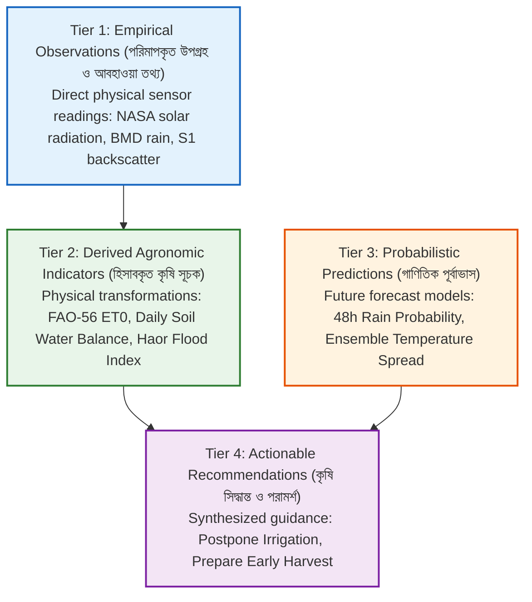
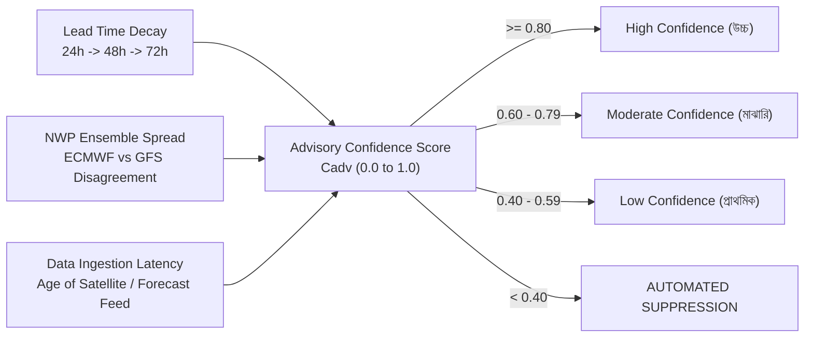

# Ritucast: Uncertainty & Risk Communication Framework

## 1. Executive Summary & Purpose

Agricultural decisions are made under pervasive environmental uncertainty. Farmers, frontline extension agents (SAAOs), and tubewell operators must manage risks associated with variable weather forecasts, imperfect satellite coverage, and localized microclimates. Communicating uncertainty poorly—either by expressing false certainty or confusing users with abstract statistical jargon—destroys farmer trust and leads to poor operational choices.

This document establishes the **Uncertainty and Risk Communication Framework** for Ritucast, defining:
- The mathematical formulation for computing advisory confidence scores.
- Forecast skill decay over lead time ($24\text{h} \rightarrow 48\text{h} \rightarrow 72\text{h}$).
- Plain-language Bangla and English communication standards.
- Anti-overconfidence language safeguards.

---

## 2. Four-Tier Information Taxonomy Alignment

Every user-facing element in Ritucast must visually and structurally adhere to the 4-tier information taxonomy established in `DEC-08` and `FR-ADV-04`:

---

## 3. Mathematical Formulation of Advisory Confidence Score ($C_{\text{adv}}$)

The confidence score of any agricultural recommendation ($C_{\text{adv}} \in [0.0, 1.0]$) is computed through a multi-factor degradation model:

$$C_{\text{adv}} = C_{\text{base}} \times f_{\text{decay}}(t_{\text{lead}}) \times f_{\text{ensemble}}(S_{\text{spread}}) \times f_{\text{freshness}}(\Delta t_{\text{data}})$$

Where:
- $C_{\text{base}}$: Baseline confidence of the underlying rule ($0.95$ for Evidence-Supported rules; $0.80$ for Context-Dependent rules).
- $f_{\text{decay}}$: Forecast lead-time decay factor.
- $f_{\text{ensemble}}$: Numerical weather prediction ensemble spread penalty.
- $f_{\text{freshness}}$: Data latency degradation factor.

### 3.1 Sub-Factor Formulations

#### 1. Lead-Time Decay Function ($f_{\text{decay}}$):
Atmospheric predictability decays exponentially with increasing forecast horizon:
$$f_{\text{decay}}(t_{\text{lead}}) = \exp\left(-\lambda \cdot \frac{t_{\text{lead}}}{24}\right)$$
- Where $t_{\text{lead}}$ is the forecast lead time in hours, and $\lambda = 0.12$ (calibrated for tropical pre-monsoon convective regimes).
- At $24\text{ hours}$ ($1\text{ day}$): $f_{\text{decay}} = \exp(-0.12 \times 1) = 0.887$.
- At $48\text{ hours}$ ($2\text{ days}$): $f_{\text{decay}} = \exp(-0.12 \times 2) = 0.787$.
- At $72\text{ hours}$ ($3\text{ days}$): $f_{\text{decay}} = \exp(-0.12 \times 3) = 0.698$.

#### 2. Ensemble Spread Penalty Function ($f_{\text{ensemble}}$):
Measures disagreement between global NWP models (ECMWF IFS vs NOAA GFS):
$$S_{\text{spread}} = \frac{\lvert P_{\text{ECMWF}} - P_{\text{GFS}} \rvert}{\max(10.0, \frac{P_{\text{ECMWF}} + P_{\text{GFS}}}{2})}$$
$$f_{\text{ensemble}}(S_{\text{spread}}) = \begin{cases}
1.0, & \text{if } S_{\text{spread}} \le 0.20 \text{ (High model agreement)} \\
1.0 - 0.75 \times (S_{\text{spread}} - 0.20), & \text{if } 0.20 < S_{\text{spread}} \le 0.60 \\
0.70, & \text{if } S_{\text{spread}} > 0.60 \text{ (Severe model disagreement)}
\end{cases}$$

#### 3. Data Freshness Degradation Function ($f_{\text{freshness}}$):
$$f_{\text{freshness}}(\Delta t_{\text{data}}) = \begin{cases}
1.0, & \text{if } \Delta t_{\text{data}} \le 12\text{ hours} \\
1.0 - 0.02 \times (\Delta t_{\text{data}} - 12), & \text{if } 12 < \Delta t_{\text{data}} \le 36\text{ hours} \\
0.0, & \text{if } \Delta t_{\text{data}} > 36\text{ hours} \implies \textbf{MANDATORY SUPPRESSION}
\end{cases}$$

---

## 4. Confidence Tiers & User-Facing Communication Standards

| Confidence Tier | Score Range ($C_{\text{adv}}$) | UI Visual Badge | Bangla User-Facing Label & Guidance | English Guidance |
| :--- | :--- | :--- | :--- | :--- |
| **High Confidence** | $\ge 0.80$ | **Green Badge** (`#2e7d32`) | **উচ্চ নির্ভরযোগ্যতা** *"পূর্বাভাস ও উপগ্রহ তথ্যে সুস্পষ্ট প্রমাণ রয়েছে। পরামর্শ অনুযায়ী প্রস্তুতি গ্রহণ করুন।"* | High confidence based on multi-model consensus and fresh satellite observations. Action recommended. |
| **Moderate Confidence** | $0.60 – 0.79$ | **Amber Badge** (`#f57c00`) | **মাঝারি নির্ভরযোগ্যতা** *"পরামর্শটি সম্ভাব্য পরিস্থিতির ভিত্তিতে দেয়া হয়েছে। সিদ্ধান্ত বাস্তবায়নের আগে নিজের জমির অবস্থা সরাসরি পর্যবেক্ষণ করুন।"* | Moderate confidence. Inspect local field conditions before making irreversible commitments. |
| **Low Confidence** | $0.40 – 0.59$ | **Grey/Blue Badge** (`#546e7a`) | **প্রাথমিক সংকেত** *"পূর্বাভাসে অনিশ্চয়তা বেশি রয়েছে। কোনো চূড়ান্ত সিদ্ধান্ত নেয়ার আগে স্থানীয় উপ-সহকারী কৃষি কর্মকর্তা (SAAO)-এর সাথে কথা বলুন।"* | Early advisory with higher atmospheric uncertainty. Consult local extension agent. |
| **Suppressed** | $< 0.40$ (or stale) | **Neutral Grey** (`#757575`) | **তথ্য হালনাগাদ হচ্ছে** *"তথ্য হালনাগাদ হচ্ছে বা পূর্বাভাসের অনিশ্চয়তা বেশি থাকায় এই মুহূর্তে সুনির্দিষ্ট স্বয়ংক্রিয় পরামর্শ দেয়া সম্ভব হচ্ছে না।"* | Automated advisory suppressed due to high forecast uncertainty or data refresh cycle. |

---

## 5. Anti-Overconfidence Safeguards & Linguistic Rules

Smallholder farmers must be protected from over-relying on algorithmic recommendations:

### 1. Banned Terminology
The following words and expressions are strictly prohibited across all Ritucast UI copy, notifications, and generated share cards:
- **Banned in Bangla**: *"১০০% নিশ্চিত"* (100% certain), *"নিশ্চিত বৃষ্টি"* (guaranteed rain), *"অবশ্যই কাটুন"* (definitely harvest), *"ফলনের নিশ্চয়তা"* (yield guarantee), *"কোনো ঝুঁকি নেই"* (zero risk).
- **Mandatory Replacement**: *"উচ্চ সম্ভাবনা"* (high probability), *"সম্ভাব্য বৃষ্টিপাত"* (expected rain), *"ঝুঁকি হ্রাসে প্রস্তুতি নিন"* (prepare to mitigate risk).

### 2. Mandatory Verification Copy
Every advisory card recommending an action must append a standard local cross-check instruction:
- **Irrigation Advisory**: *"সেচ স্থগিত করার আগে জমির আইল এবং মাটির রস নিজে হাত দিয়ে পরীক্ষা করুন।"* (Check bunds and soil moisture by hand before shutting down pumps).
- **Flood Harvest Advisory**: *"ধান কাটার আগে শীষের শতকরা ৮০ ভাগ পেকেছে কিনা তা নিশ্চিত করুন।"* (Ensure 80% grains are yellow before cutting).

### 3. Transparent "কেন এই পরামর্শ?" (Why This Advice?) Modal
Clicking the explanation link on any advisory card reveals a structured 3-part breakdown:
1. **বিগত দিনের পর্যবেক্ষণ**: What was observed over the last 7 days (e.g., $18\text{ mm}$ rain, $28\text{ mm}$ evapotranspiration).
2. **আগামী দিনের পূর্বাভাস**: What is forecast over the next 48 hours (e.g., $65\%$ rain probability, $25\text{ mm}$ expected rain).
3. **হিসাবকৃত যুক্তি**: Agronomic rationale (e.g., soil has sufficient storage capacity to absorb rain without stress).
