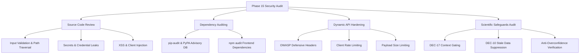

# Phase 15 Baseline Security Assessment — Ritucast

## 1. Executive Summary

As part of **Phase 15: Security, Privacy, and Responsible Agricultural Intelligence**, this assessment establishes the empirical security, privacy, and agronomic safety baseline for **Ritucast**. Ritucast is an evidence-based agricultural intelligence and decision-support platform delivering localized agro-meteorological advisories to smallholders and Sub-Assistant Agriculture Officers (SAAOs) in Bangladesh.

The scope of this audit encompasses the verified system outputs of Phases 1–14:
- The FastAPI backend service ([`api/main.py`](file:///Users/kazi/Projects/RITUCAST/api/main.py)), data access repository ([`api/data_access/repository.py`](file:///Users/kazi/Projects/RITUCAST/api/data_access/repository.py)), and endpoint routers ([`api/routers/`](file:///Users/kazi/Projects/RITUCAST/api/routers)).
- The React 19 / TypeScript single-page client ([`frontend/src/App.tsx`](file:///Users/kazi/Projects/RITUCAST/frontend/src/App.tsx), [`frontend/src/services/apiClient.ts`](file:///Users/kazi/Projects/RITUCAST/frontend/src/services/apiClient.ts)).
- The agronomic recommendation engine and scientific safety rules ([`analytics/engine/`](file:///Users/kazi/Projects/RITUCAST/analytics/engine), [`analytics/rules/`](file:///Users/kazi/Projects/RITUCAST/analytics/rules)).
- The containerization and deployment infrastructure ([`deploy/docker/`](file:///Users/kazi/Projects/RITUCAST/deploy/docker), [`Dockerfile`](file:///Users/kazi/Projects/RITUCAST/Dockerfile), [`docker-compose.yml`](file:///Users/kazi/Projects/RITUCAST/docker-compose.yml)).
- Continuous integration and release pipelines ([`.github/workflows/`](file:///Users/kazi/Projects/RITUCAST/.github/workflows)).

---

## 2. Assessment Methodology & Scope

The audit was conducted using automated security scanning, source code static analysis, dependency vulnerability auditing, and manual security architecture evaluation:



### 2.1 Scope Inclusions
1. **Public Endpoint Exposure**: Assessment of all 12 public API endpoints under `/api/v1/` and health probes.
2. **Credential and Secret Hygiene**: Full repository scan for hardcoded tokens, private keys, cloud credentials, and `.env` files.
3. **Software Supply Chain**: Direct and transitive dependency evaluation across Python (`requirements.txt`) and Node.js (`frontend/package.json`).
4. **Denial of Service (DoS) Resilience**: Assessment of unbounded inputs, oversized JSON bodies, and high-frequency endpoint polling.
5. **Data Privacy**: Audit of data ingestion, storage, logging, and client transmission for Personally Identifiable Information (PII) or sensitive farm locations.
6. **Scientific Integrity**: Audit of the recommendation pipeline against mandatory disclaimers, contextual gating, and suppression rules.

### 2.2 Scope Exclusions (DEC-06 Scope Boundaries)
- No user account authentication or RBAC evaluation: Ritucast is engineered as a public, read-only decision-support platform with no user accounts, private sessions, or administrative mutation endpoints.
- No hardware actuator security: Ritucast has zero remote pump control or hardware interfaces (`DEC-06`).
- No commercial credit-underwriting or crop-insurance decision auditing (`DEC-06`).

---

## 3. Baseline Audit Findings Summary

| Identifier | Category | Finding Summary | Severity | Remediation Status |
| :--- | :--- | :--- | :--- | :--- |
| `SEC-15-01` | Network / API | Missing OWASP defensive HTTP security headers on FastAPI backend responses | Medium | **Remediated** ([`api/middleware/security.py`](file:///Users/kazi/Projects/RITUCAST/api/middleware/security.py)) |
| `SEC-15-02` | DoS / Abuse | Lack of server-level request payload size enforcement (memory exhaustion risk) | Medium | **Remediated** ([`api/middleware/security.py`](file:///Users/kazi/Projects/RITUCAST/api/middleware/security.py)) |
| `SEC-15-03` | DoS / Abuse | In-memory API client rate limiting not active on backend service layer | Medium | **Remediated** ([`api/middleware/security.py`](file:///Users/kazi/Projects/RITUCAST/api/middleware/security.py)) |
| `SEC-15-04` | Input Validation | `load_parquet_table` lacked explicit path traversal rejection and file type guards | Medium | **Remediated** ([`api/data_access/repository.py`](file:///Users/kazi/Projects/RITUCAST/api/data_access/repository.py)) |
| `SEC-15-05` | Input Validation | Request schemas lacked explicit string length (`max_length`) and numerical bounds | Low | **Remediated** ([`api/schemas/advisories.py`](file:///Users/kazi/Projects/RITUCAST/api/schemas/advisories.py)) |
| `SEC-15-06` | Supply Chain | Starlette 0.46.2 transitive advisories flagged by `pip-audit` | Low | **Analyzed & Documented** ([`docs/security/secrets-and-dependency-management.md`](file:///Users/kazi/Projects/RITUCAST/docs/security/secrets-and-dependency-management.md)) |
| `SEC-15-07` | Responsible AI | Suppression reason hardcoded rather than propagating engine rationale | Low | **Remediated** ([`api/data_access/repository.py`](file:///Users/kazi/Projects/RITUCAST/api/data_access/repository.py)) |
| `SEC-15-08` | Secret Hygiene | Verified zero committed secrets, `.env` excluded, example files sanitize tokens | Informational | **Verified Clean** |

---

## 4. Architectural Trust Boundaries

```
[ Rural Mobile Client (React PWA) ]
                |
                | HTTPS / TLS 1.3
                v
[ NGINX Alpine Gateway / Cloud Run Frontend ]
   - Security Headers (DEC-53)
   - Static Asset Caching
   - Reverse Proxy (/api/ -> Backend)
                |
                | Internal Docker / VPC Network (Private)
                v
[ FastAPI Backend Service (UID 10001) ]
   - SecurityHeadersMiddleware (nosniff, DENY, CSP)
   - RequestSizeLimitMiddleware (1 MB ceiling)
   - RateLimitMiddleware (60 req/min sliding window)
   - Centralized Exception Sanitizer (Zero stack traces)
                |
                | Local In-Memory / Parquet Filesystem Read-Only
                v
[ Pre-Packaged Local Parquet Tables (<110 KB) ]
   - Path Traversal Guard (Strict .parquet allowlist)
```

1. **Client to Edge Gateway**: Untrusted boundary. Public clients on variable 2G/3G networks. All responses enforced with HSTS, CSP, and X-Frame-Options.
2. **Edge Gateway to Application Container**: Semi-trusted boundary within Cloud Run serverless execution sandbox or Docker Compose bridge network.
3. **Application Container to Data Storage**: Fully trusted internal container filesystem. Data tables are read-only Parquet files packaged at container build time ([`Dockerfile.backend`](file:///Users/kazi/Projects/RITUCAST/deploy/docker/Dockerfile.backend)), preventing runtime data injection.

---

## 5. Verification & Test Evidence

All security remediations have been verified with automated regression suites:
- **Python Security Test Suite**: [`tests/api/test_security_hardening.py`](file:///Users/kazi/Projects/RITUCAST/tests/api/test_security_hardening.py) covers 11 dedicated security tests (104 total repository tests passing in 4.24s).
- **Frontend Security Test Suite**: [`frontend/src/test/security.test.tsx`](file:///Users/kazi/Projects/RITUCAST/frontend/src/test/security.test.tsx) covers 4 security rules (21 total Vitest tests passing in 2.10s).
- **Frontend Production Build**: Zero compilation or type errors (`tsc -b && vite build` passing, 88.6 kB gzip).

Detailed threat modeling and findings registers are documented in:
- [`docs/security/threat-model.md`](file:///Users/kazi/Projects/RITUCAST/docs/security/threat-model.md)
- [`docs/security/security-boundaries.md`](file:///Users/kazi/Projects/RITUCAST/docs/security/security-boundaries.md)
- [`docs/security/security-findings-register.md`](file:///Users/kazi/Projects/RITUCAST/docs/security/security-findings-register.md)
