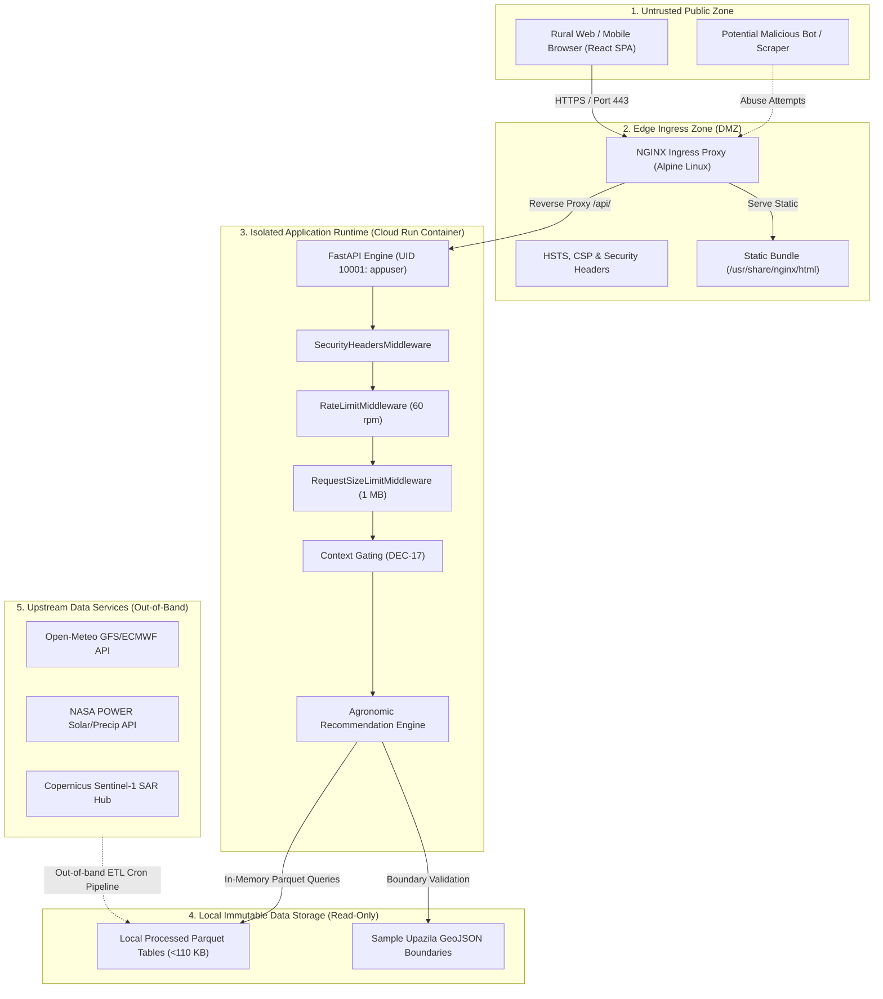

# Security Boundaries and Trust Architecture — Ritucast

## 1. Trust Architecture Overview

Ritucast establishes clear, defensive trust boundaries between public network clients, edge reverse proxies, application runtime containers, internal data stores, and external upstream APIs.

---

## 2. Zone-by-Zone Trust Boundary Analysis

### 2.1 Zone 1: Untrusted Public Client Zone
- **Environment**: Public Internet over rural 2G/3G/4G cellular connections in Bangladesh.
- **Client Runtime**: Low-spec budget Android devices (2GB–3GB RAM, Android 8+).
- **Assumed Threats**: Untrusted scripts, browser extensions, network packet snooping on unencrypted Wi-Fi, spoofed query parameters.
- **Security Posture**: The client is treated as completely untrusted. Zero security enforcement or business validation relies exclusively on client-side logic. All requests are re-validated on the backend.

### 2.2 Zone 2: Edge Ingress Zone (DMZ)
- **Component**: NGINX 1.25 Alpine Linux container ([`deploy/docker/nginx.conf`](file:///Users/kazi/Projects/RITUCAST/deploy/docker/nginx.conf)).
- **Boundary Role**: Terminates client connections, strips hop-by-hop headers, forwards real client IP via `X-Forwarded-For`, enforces Content Security Policy (CSP), and serves static React assets.
- **Defenses**:
  - `add_header X-Frame-Options "DENY" always;`
  - `add_header X-Content-Type-Options "nosniff" always;`
  - `add_header Content-Security-Policy "default-src 'self'; ...";`
  - Gzip compression for wire-efficiency ($\le 1.5\text{MB}$ payload budget).

### 2.3 Zone 3: Application Runtime Container
- **Component**: FastAPI application runtime inside Python 3.10-slim ([`deploy/docker/Dockerfile.backend`](file:///Users/kazi/Projects/RITUCAST/deploy/docker/Dockerfile.backend)).
- **Boundary Role**: Business logic execution, agronomic calculations, contextual gating, and advisory delivery.
- **Defenses**:
  - Non-root user execution: Enforces `USER 10001:10001` (`appuser`).
  - Read-only code execution: Application directory `/app` is owned by root, unmodifiable by runtime processes.
  - Rate limiting: [`RateLimitMiddleware`](file:///Users/kazi/Projects/RITUCAST/api/middleware/security.py) (60 req/min sliding window per client IP).
  - Request body limits: [`RequestSizeLimitMiddleware`](file:///Users/kazi/Projects/RITUCAST/api/middleware/security.py) (1 MB max payload).
  - Centralized error sanitization: [`api/middleware/error_handlers.py`](file:///Users/kazi/Projects/RITUCAST/api/middleware/error_handlers.py) masks internal server traces.

### 2.4 Zone 4: Local Immutable Data Storage
- **Component**: Processed Parquet tables in `/app/data/processed/` ($<110\text{KB}$, `DEC-52`).
- **Boundary Role**: Serves daily meteorology, weather forecasts, and soil moisture features.
- **Defenses**:
  - Read-only file access: No mutation or file upload endpoints exist.
  - Path traversal guard: [`AgriculturalDataRepository.load_parquet_table`](file:///Users/kazi/Projects/RITUCAST/api/data_access/repository.py#L192) rejects any filename containing path separators or non-parquet extensions.

### 2.5 Zone 5: Upstream Earth-Observation Services
- **Component**: NASA POWER, Open-Meteo, Copernicus Open Access Hub.
- **Boundary Role**: Supplies satellite observations and numerical weather predictions.
- **Defenses**:
  - Strict isolation: Zero direct browser querying of external upstream APIs (`DEC-09`).
  - Asynchronous pipeline decoupling: Data ingestion runs via scheduled batch ETL pipelines ([`pipelines/ingestion/`](file:///Users/kazi/Projects/RITUCAST/pipelines/ingestion)) or isolated smoke tests ([`.github/workflows/live-data-smoke.yml`](file:///Users/kazi/Projects/RITUCAST/.github/workflows/live-data-smoke.yml)).
  - Physical sanity validation: All ingested variables undergo strict range checks ([`pipelines/validation/semantic_validator.py`](file:///Users/kazi/Projects/RITUCAST/pipelines/validation/semantic_validator.py)) before inclusion in Parquet tables.

---

## 3. Communication Channel Protection

1. **Client-to-Gateway**: TLS 1.3 encryption over HTTPS. Plain HTTP requests are redirected or rejected.
2. **Gateway-to-Backend**: Internal Docker network bridge or Google Cloud serverless VPC network. Not reachable from public internet.
3. **Backend-to-Storage**: Internal OS POSIX filesystem read calls. No remote NFS or object-storage credentials accessed at request time.

Related documentation:
- [`docs/security/threat-model.md`](file:///Users/kazi/Projects/RITUCAST/docs/security/threat-model.md)
- [`docs/security/api-security.md`](file:///Users/kazi/Projects/RITUCAST/docs/security/api-security.md)
- [`docs/security/frontend-security.md`](file:///Users/kazi/Projects/RITUCAST/docs/security/frontend-security.md)
