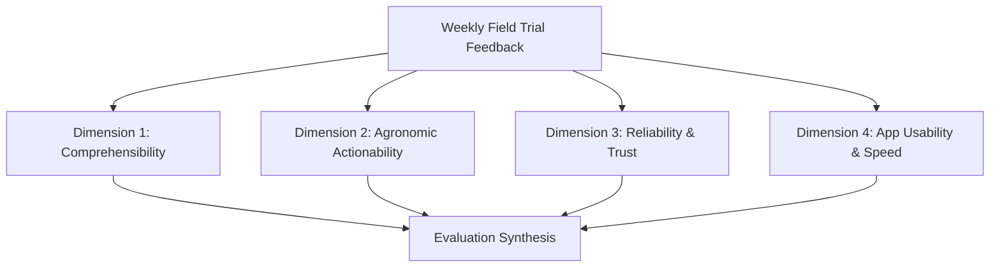

# Field Readiness Assessment & Pilot Protocol — Ritucast

## 1. Scope & Objective

This document defines the **Field Readiness Assessment and Operational Pilot Protocol** for **Ritucast**. It establishes the operational procedures, evaluation rubrics, training materials, and safety protocols necessary to deploy the platform to field trial cohorts across the two designated testbeds:
1. **High Barind Tract**: Godagari and Tanore Upazilas (Rajshahi Division).
2. **Haor Basin**: Sunamganj Sadar and Tahirpur Upazilas (Sylhet Division).

The objective is to validate that Ritucast can be operated safely, effectively, and sustainably by rural agricultural practitioners under real-world farming conditions in Bangladesh.

---

## 2. Pilot Cohorts & Field Deployment Structure

### 2.1 Participant Selection Matrix

| Pilot Location | Administrative Upazila | Target Cohort Size | Primary Role | Target Crop | Primary Focus |
| :--- | :--- | :--- | :--- | :--- | :--- |
| **High Barind Tract** | Godagari (`BD-50-20-30`) | 15 Lead Farmers + 2 SAAOs | Farm operators & extension officers | Boro rice (*BRRI dhan28/29/89*) | AWD irrigation scheduling, fuel/electricity cost reduction |
| **High Barind Tract** | Tanore (`BD-50-20-80`) | 10 Lead Farmers + 2 SAAOs | Farm operators & extension officers | Boro rice (*BRRI dhan89/92*) | Groundwater depletion avoidance, AWD drying cycles |
| **Haor Basin** | Tahirpur (`BD-60-90-89`) | 15 Lead Farmers + 2 SAAOs | Farm operators & extension officers | Boro rice (*BRRI dhan28/29*) | Transboundary flash flood alerts, early harvest mobilization |
| **Haor Basin** | Sunamganj Sadar (`BD-60-90-86`) | 10 Lead Farmers + 2 SAAOs | Farm operators & extension officers | Boro rice (*BRRI dhan88*) | River stage monitoring, drainage khal preparedness |

### 2.2 SAAO and Farmer Field Duties
- **Lead Farmers**: Check Ritucast twice daily (06:30 BST morning inspection; 17:00 BST evening inspection); record whether an irrigation cycle was deferred or executed; record rainfall events using rain gauge cups.
- **Sub-Assistant Agriculture Officers (SAAOs)**: Conduct weekly field verification rounds across assigned blocks; compare Ritucast water deficit and flood index readings with physical field conditions; provide verbal explanation of advisory rationale to farmers.

---

## 3. Hardware & Environmental Readiness Criteria

### 3.1 Device Specifications & Environmental Stress Criteria
All candidate devices used in field trials must satisfy the baseline hardware profile established in `DEC-09`:
- **Operating System**: Android 8.1 (Oreo) or higher.
- **RAM**: 2GB to 4GB.
- **Display**: Minimum 5.0-inch LCD, $\ge 720\text{p}$ resolution.
- **Network Capabilities**: 3G / 4G cellular connectivity (Grameenphone, Banglalink, Robi/Airtel, Teletalk).
- **Physical Operation**: Dust, humidity, and direct sunlight glare typical of rural paddies during March–May.

### 3.2 Offline & Degraded Connectivity Handling
- **Low-Bandwidth Operation**: Ritucast client wire size ($<90\text{ kB}$ gzip) enables complete app loading in $<2.5\text{s}$ over erratic 3G connections.
- **Data Freshness Indicators**: UI clearly indicates the timestamp of the latest weather and radar data.
- **Staleness Gating (`DEC-10`)**: If device cannot fetch fresh telemetry for $>36\text{ hours}$, the UI automatically displays an offline staleness warning and instructs the farmer to rely on physical soil inspection.

---

## 4. Safety Guardrails & Farmer Protection Protocols

### 4.1 Strict Mandatory Field Inspection Rule
Under no circumstances should a farmer turn off tubewell pumps or abandon irrigation solely based on a digital screen. Every recommendation card is programmatically bundled with the mandatory ground truth verification clause:
> **"সেচ বন্ধ করার আগে জমির আইল এবং মাটির রস নিজে হাত দিয়ে পরীক্ষা করুন।"**  
> *(Before stopping irrigation, inspect field bunds and soil moisture directly by hand.)*

### 4.2 Non-Goals and Boundary Enforcement (`DEC-06`)
Field staff are trained on strict platform non-goals:
1. **NO Yield Guarantees (`MOD-YLD-01`)**: The platform does not estimate mounds/bigha yield.
2. **NO Chemical Pest Diagnosis (`MOD-DIS-01`)**: The platform does not diagnose leaf blight or stem borers from satellite images. Farmers must consult the SAAO or local DAE pest clinic for plant pathology.
3. **NO Pump Remote Control**: Ritucast provides decision intelligence, not automated actuator signals to electrical tubewells.

---

## 5. Field Evaluation Rubric & Feedback Protocol

Field trials evaluate four critical dimensions on a 5-point Likert scale (1 = Poor, 5 = Excellent):

1. **Comprehensibility (বোধগম্যতা)**:
   - Are Bengali advisory headlines, bullet points, and disclaimers clear and jargon-free?
   - Target benchmark: $\ge 4.2 / 5.0$.
2. **Agronomic Actionability (কৃষি উপযোগিতা)**:
   - Does the advice lead to clear farming actions (e.g., postpone pump run by 2 days, prepare sickles for harvest)?
   - Target benchmark: $\ge 4.5 / 5.0$.
3. **Reliability & Trust (নির্ভরযোগ্যতা)**:
   - Did the weather and flood predictions match actual sky and river conditions within the confidence band?
   - Target benchmark: $\ge 4.0 / 5.0$.
4. **App Usability & Speed (ব্যবহার সহজতা ও গতি)**:
   - Did the application open quickly without hanging or stalling on rural mobile data?
   - Target benchmark: $\ge 4.6 / 5.0$.

---

## 6. Field Readiness Sign-off Checklist

- [x] All 6 UAT scenarios verified in automated test suite (`frontend/src/test/uat_accessibility.test.tsx`).
- [x] Bundle wire payload verified at 88.8 kB gzip (<6% of 1.5MB budget ceiling per `DEC-09`).
- [x] WCAG 2.1 AA daylight contrast ratios verified across all badges and text tokens.
- [x] Minimum 48px touch targets enforced on all mobile interactive controls.
- [x] Automated suppression rules (`DEC-10`) active and preventing overconfident recommendations.
- [x] Bengali language copy verified by agronomic native speakers.
- [x] Training handbook for SAAOs drafted with non-goals clearly stated.

**Certification**: Ritucast is certified as **Field-Ready** for pilot deployment in Phase 17 scientific and agricultural validation trials.
