# Ritucast Master Application Sitemap

## 1. Executive Summary & Page Taxonomy

This document outlines the complete sitemap for the Ritucast platform. It details all user-accessible routes, page objectives, layout structures, and navigation states for the Initial Release (Minimum Complete Product), while formally marking future/deferred pages.

### Gating & Lifecycle Categories
- **Initial Release (MCP)**: Core views required to deliver irrigation and flood decision-support in the dual-zone testbeds.
- **Contextual Modals / Drawers**: Lightweight slide-up drawers for location selection, explainability, and sharing that preserve view state without full page reloads.
- **Future / Deferred**: Features scheduled for Phase 17–18 expansion.

---

## 2. Visual Sitemap Hierarchy

```mermaid
graph TD
    classDef initial fill:#2E7D32,stroke:#1B5E20,stroke-width:2px,color:#fff;
    classDef modal fill:#1565C0,stroke:#0D47A1,stroke-width:2px,color:#fff;
    classDef subpage fill:#37474F,stroke:#263238,stroke-width:1px,color:#fff;
    classDef future fill:#757575,stroke:#616161,stroke-width:1px,stroke-dasharray: 5 5,color:#fff;

    Root["/ (App Entry Point)"]:::initial --> Onboarding["/onboarding (First Visit Location Pick)"]:::modal
    Root --> Overview["PAGE-01: /advisory (আজকের পরামর্শ)"]:::initial
    Root --> Weather["PAGE-02: /weather (আবহাওয়া ও পূর্বাভাস)"]:::initial
    Root --> Regional{"Agro-Zone Check"}
    Root --> Map["PAGE-04: /map (মানচিত্র ও বিশ্লেষণ)"]:::initial
    Root --> Help["PAGE-05: /help (সাহায্য ও তথ্যসূত্র)"]:::initial

    Regional -->|Barind Upazila| Soil["PAGE-03A: /soil-irrigation (মাটি ও সেচ)"]:::initial
    Regional -->|Haor Upazila| Flood["PAGE-03B: /flood-hazard (বন্যা ও প্লাবন)"]:::initial

    %% Modals & Overlays
    Overview -.-> LocModal["Modal: Location & Crop Stage Selector"]:::modal
    Overview -.-> ShareModal["Modal: WhatsApp Advisory Share Sheet"]:::modal
    Overview -.-> ExplainModal["Drawer: কেন এই পরামর্শ? (Reasoning & Freshness)"]:::modal

    %% Detail Views
    Weather --> WDetail1["Sub-View: বর্তমান পর্যবেক্ষণ (Observations)"]:::subpage
    Weather --> WDetail2["Sub-View: ৪৮ ঘণ্টা বৃষ্টিপাত (48h Rain Forecast)"]:::subpage
    Weather --> WDetail3["Sub-View: ৭ দিনের আবহাওয়া ধারা (Weekly Trend)"]:::subpage

    Soil --> SDetail1["Drawer: এডব্লিউডি (AWD) পাইপ পরীক্ষা নির্দেশিকা"]:::subpage
    Soil --> SDetail2["Sub-View: সেচ খরচ সাশ্রয় হিসাব"]:::subpage

    Flood --> FDetail1["Sub-View: মেঘালয় ক্যাচমেন্ট বৃষ্টিপাত বিশদ"]:::subpage
    Flood --> FDetail2["Sub-View: সুরমা নদীর পানি বৃদ্ধির হার"]:::subpage

    Help --> HDetail1["Sub-Page: /help/sources (উৎস ও সার্ভার স্থিতি)"]:::subpage
    Help --> HDetail2["Sub-Page: /help/glossary (কৃষি পরিভাষাকোষ)"]:::subpage
    Help --> HDetail3["Sub-Page: /help/contacts (ডিএই উপসহকারী কৃষি কর্মকর্তা তালিকা)"]:::subpage

    %% Future Pages
    Root -.-> HistoricalTrends["/trends (ঐতিহাসিক বছরভিত্তিক তুলনা)"]:::future
    Root -.-> MultiBlockAdmin["/admin/upazila (ইউএও ব্লক সারসংক্ষেপ)"]:::future
```

---

## 3. Master Pages Specification Table

| Page ID | Route Path | Bangla Page Title | Primary Purpose | Release Status |
| :--- | :--- | :--- | :--- | :--- |
| **`PAGE-00`** | `/onboarding` | প্রাথমিক এলাকা নির্বাচন | First-time location and crop setup modal. | **Initial Release** |
| **`PAGE-01`** | `/advisory` (or `/`) | আজকের পরামর্শ | Daily dashboard; Tier 4 recommendation card; weather snapshot; active alerts. | **Initial Release** |
| **`PAGE-02`** | `/weather` | আবহাওয়া ও পূর্বাভাস | Tier 1 BMD/NASA observations; Tier 3 48-hour rain forecast bar chart; 7-day trend. | **Initial Release** |
| **`PAGE-03A`**| `/soil-irrigation` | মাটি ও সেচ | Barind only: Daily soil water deficit ($D_t$), $ET_0$, AWD plastic pipe verification guide. | **Initial Release** |
| **`PAGE-03B`**| `/flood-hazard` | বন্যা ও প্লাবন | Haor only: Flash flood hazard index ($I_{\text{flood}}$), Meghalaya rainfall, Surma river level. | **Initial Release** |
| **`PAGE-04`** | `/map` | মানচিত্র ও বিশ্লেষণ | Lazy-loaded MapLibre GIS viewer for Upazila boundary, rainfall anomaly, SAR flood extent. | **Initial Release** |
| **`PAGE-05`** | `/help` | সহায়িকা ও তথ্যসূত্র | Methodology guides, data source transparency registry, Bangla glossary, SAAO phonebook. | **Initial Release** |
| **`PAGE-05A`**| `/help/sources` | উপাত্তের উৎস ও সময় | Detailed data registry showing satellite observation timestamps and latency. | **Initial Release** |
| **`PAGE-05B`**| `/help/glossary` | কৃষি পরিভাষাকোষ | Searchable glossary explaining agronomic and meteorological terminology. | **Initial Release** |
| **`PAGE-05C`**| `/help/contacts` | কৃষি কর্মকর্তার তথ্য | Contact directory for DAE SAAOs in pilot Upazilas. | **Initial Release** |
| **`PAGE-F01`**| `/trends` | ঐতিহাসিক প্রবণতা | Multi-year drought/flood trend comparison tool. | **Future (Phase 18)** |
| **`PAGE-F02`**| `/admin/upazila` | ইউএও ব্লক ড্যাশবোর্ড | Administrative overview across multiple blocks for UAOs. | **Future (Phase 16)** |

---

## 4. Navigation Rules & Transition Triggers

1. **First-Visit Routing**:
   - If `localStorage.getItem('ritucast_upazila')` is empty, route user to `/onboarding`.
   - Once selected, store choice and transition immediately to `/advisory`.
2. **Context Persistence**:
   - Upazila and Crop/Stage state persist in `localStorage` across page navigations.
   - Changing Upazila dynamically swaps navigation between `PAGE-03A` (Barind) and `PAGE-03B` (Haor).
3. **URL Route Sync**:
   - Every primary tab maps to a distinct URL route (`/advisory`, `/weather`, `/soil-irrigation`, `/map`, `/help`) enabling direct bookmarking and shareable links.
4. **Offline Fallback Route**:
   - When offline, service worker serves cached `/advisory` and `/weather` routes with an persistent top offline pill.

---

## 5. Artifact Reference
The standalone diagram source file is located at [docs/ux/diagrams/sitemap.mmd](file:///Users/kazi/Projects/RITUCAST/docs/ux/diagrams/sitemap.mmd).
