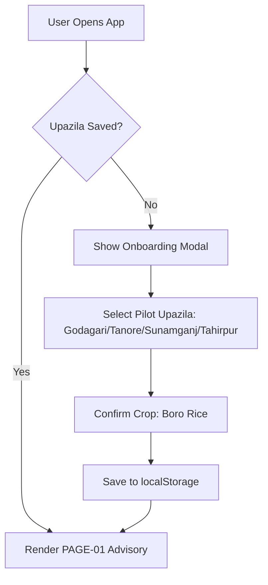

# Ritucast Critical User Journeys Specification

## 1. Executive Summary & Flow Architecture

This document specifies the six critical end-to-end user journeys for Ritucast's initial release.

Every journey is engineered to minimize cognitive load, respect the 3-tap rule, enforce scientific context gating (`DEC-17`), and handle connectivity and data degradation gracefully (`DEC-10`).

---

## 2. Overview of the 6 Critical Journeys

```
Journey A: First Visit & Orientation ───► [ Onboarding Modal ] ───► [ Set Upazila & Crop ] ───► [ Land on Advisory ]
Journey B: Geographic Selection ────────► [ Tap Location Pill ] ─► [ Search/Select 4 Upazilas ] ─► [ Reload Context ]
Journey C: Understand Conditions ───────► [ View Weather Tab ] ──► [ Check 48h Rain Bar ] ──────► [ Assess Moisture ]
Journey D: Explore Agronomic Insight ───► [ Open Soil/Flood Tab ] ► [ Inspect Deficit Gauge ] ──► [ View AWD/Rain Sum ]
Journey E: Review Recommendation ───────► [ Land on Overview ] ──► [ Verify Stage Context ] ────► [ Read Action & Ail Check ]
Journey F: Data Degradation/Suppression ► [ Stale/Divergent Data ] ► [ Suppression Middleware ] ─► [ Safe Field Fallback Banner ]
```

---

## 3. Detailed Journey Specifications

### Journey A: First Visit and Orientation
- **User Goal**: Open Ritucast for the first time, establish location, and see today's farming advice immediately.
- **Starting Point**: Visiting `https://ritucast.bd/` or opening installed PWA.
- **Preconditions**: First visit (`localStorage` has no saved Upazila).
- **Step-by-Step Flow**:
  1. *Step 1: Entry*: App loads lightweight skeleton screen (<1.5s).
  2. *Step 2: Welcome & Region Prompt*: Clean modal appears: *"স্বাগতম! আপনার এলাকা নির্বাচন করুন"* with two pilot zone tiles:
     - **বরেন্দ্র অঞ্চল (রাজশাহী)**: [গোদাগাড়ী] [তানোর]
     - **হাওর অঞ্চল (সিলেট)**: [সুনামগঞ্জ সদর] [তাহিরপুর]
  3. *Step 3: One-Tap Selection*: User taps their Upazila (e.g., Godagari).
  4. *Step 4: Default Crop Confirmation*: Screen displays *"ফসল: বোরো ধান (বিকাশমান/কুশি পর্যায়) — পরিবর্তন করতে ট্যাপ করুন"*. User taps "এগিয়ে যান" (Proceed).
  5. *Step 5: Completion*: User lands on `PAGE-01: আজকের পরামর্শ` showing the active Upazila badge, current weather, and today's irrigation recommendation card.
- **Flowchart**:

- **Error & Recovery**: If user selects "অন্যান্য উপজেলা" (Other), app shows a polite notice: *"রিতুকাস্ট বর্তমানে বরেন্দ্র ও হাওর অঞ্চলে পরীক্ষামূলকভাবে চালু রয়েছে। ডেমো দেখতে যেকোনো একটি এলাকা নির্বাচন করুন।"*
- **Friction Points**: Confusion regarding why other districts are not active. Addressed by clear pilot badge.
- **Accessibility**: Modal traps focus; screen reader announces: *"এলাকা নির্বাচন করুন"*. Large touch targets (52px height).

---

### Journey B: Select and Change Geographic Area
- **User Goal**: Switch from one Upazila to another (e.g., SAAO supervising two border blocks or checking Haor conditions).
- **Starting Point**: Any active view.
- **Step-by-Step Flow**:
  1. User taps the persistent **Location Pill** in the top header (e.g., `[ 📍 গোদাগাড়ী ▾ ]`).
  2. Slide-up bottom sheet opens displaying:
     - Search input field: *"উপজেলা খুঁজুন..."*
     - Quick select chips: [গোদাগাড়ী] [তানোর] [সুনামগঞ্জ সদর] [তাহিরপুর]
  3. User taps [তাহিরপুর] (Tahirpur).
  4. Sheet closes smoothly (200ms).
  5. Top banner flashes: *"তাহিরপুর, সুনামগঞ্জ লোড হচ্ছে..."*.
  6. Navigation bar automatically transitions Module 3 from **মাটি ও সেচ** to **বন্যা ও প্লাবন**.
  7. Content updates with Tahirpur's flash-flood hazard score and Meghalaya rainfall.
- **Completion Criteria**: New location data rendered in under 1 second without full page reload.

---

### Journey C: Understand Agricultural Weather Conditions
- **User Goal**: Determine whether it will rain in the next 48 hours to plan fertilizer application or field labor.
- **Starting Point**: `PAGE-01: আজকের পরামর্শ`.
- **Step-by-Step Flow**:
  1. User views the summary card: *"বৃষ্টির সম্ভাবনা: ৭০% (মাঝারি বৃষ্টি)"*.
  2. For granular detail, user taps bottom navigation tab: **🌦 আবহাওয়া**.
  3. Lands on `PAGE-02: আবহাওয়া ও পূর্বাভাস`.
  4. Top card presents Tier 1 Empirical Observations:
     - তাপমাত্রা: ২৮° সে | আর্দ্রতা: ৭৫% | সৌর বিকিরণ: ১৯.৫ MJ/m²
  5. Middle card presents Tier 3 48-Hour Rainfall Forecast:
     - Interactive 3-hour precipitation bar chart (0mm, 5mm, 18mm, 12mm).
     - Text summary: *"আগামীকাল দুপুর ১২টা থেকে সন্ধ্যা ৬টার মধ্যে ভারী বৃষ্টির প্রবল সম্ভাবনা রয়েছে।"*
     - Model consensus indicator: *"পূর্বাভাসে আস্থা: উচ্চ (ইসিএমডব্লিউএফ ও জিএফএস মডেল একমত)"*.
- **Completion Criteria**: User knows the timing and likelihood of rain in their Upazila.

---

### Journey D: Explore an Agricultural Insight (Deep Dive)
- **User Goal**: Investigate the scientific rationale behind a high flood alert or high soil water deficit.
- **Starting Point**: `PAGE-03B: বন্যা ও প্লাবন` (Haor).
- **Step-by-Step Flow**:
  1. User sees top alert badge: **"সতর্কবার্তা: মাঝারি আকস্মিক বন্যার ঝুঁকি"** (Hazard Level 0.68).
  2. User scrolls to the 3 component metric cards:
     - *Card 1: মেঘালয় চেরাপুঞ্জি ক্যাচমেন্ট বৃষ্টিপাত*: ১৬৫ মিমি (বিগত ৪৮ ঘণ্টা) — [ঝুঁকিপূর্ণ মাত্রা $\ge ১০০$ মিমি].
     - *Card 2: সুরমা নদী বিপদসীমা দূরত্ব*: ০.৪৫ মিটার নিচে (বিগত ২৪ ঘণ্টায় পানি বেড়েছে ০.৮৫ মি).
     - *Card 3: সেন্টিনেল-১ স্যাটেলাইট জলমগ্নতা*: হাওরের নিচু অংশের ১৮% ইতোমধ্যে প্লাবিত.
  3. User taps "কেন এই সতর্কতা?" (Explain Insight).
  4. Drawer slides up explaining the mathematical logic (`DEC-16`):
     - *"উজানে ভারী বৃষ্টি হওয়ায় এবং সুরমা নদীর পানি দ্রুত বাড়ায় আগামী ২৪–৪৮ ঘণ্টার মধ্যে নিচু হাওরের ফসলরক্ষা বাঁধ উপচে পানি প্রবেশের ঝুঁকি রয়েছে।"*
- **Completion Criteria**: Farmer/SAAO understands the exact hydrologic drivers behind the warning.

---

### Journey E: Review an Actionable Recommendation (Context Gating & Advisory Flow)
- **User Goal**: Read and evaluate today's irrigation recommendation card before turning on deep tubewell pumps.
- **Starting Point**: `PAGE-01: আজকের পরামর্শ`.
- **Preconditions**: Location confirmed (Godagari).
- **Step-by-Step Flow**:
  1. User views Tier 4 Advisory Card:
     - **Header Badge**: 🟢 **আজ সেচ দেওয়ার প্রয়োজন নেই (Postpone Irrigation)**
     - **Plain Bangla Rationale**: *"আগামীকাল মাঝারি ধরনের বৃষ্টির সম্ভাবনা রয়েছে এবং বর্তমান মাটিতে পর্যাপ্ত রস রয়েছে। আজ সেচ দিলে অতিরিক্ত খরচ হতে পারে।"*
     - **Cost Saving Pill**: *"আনুমানিক সাশ্রয়: ৫০০–৭০০ টাকা (ডিজেল/বিদ্যুৎ)"*
     - **Mandatory Field Verification Notice (`DEC-10`, `DEC-17`)**:
       > *"⚠️ সতর্কবার্তা: সেচ বন্ধ করার আগে আপনার জমির আইল ও মাটির রস নিজে হাত দিয়ে পরীক্ষা করুন।"*
  2. *Branch A (Stage Unconfirmed)*: If user had not selected growth stage, the action card is replaced with a prompt:
     - *"আপনার ধান এখন কোন পর্যায়ে আছে?"*
     - Options: [চারা/কুশি] [থোড় পর্যায়] [ফুল ফোটা] [দানা গঠন] [পাকা পর্যায়]
     - Upon tapping [থোড় পর্যায়], the card instantly calculates water balance for panicle initiation and renders the recommendation.
  3. *Action Button*: User taps "পরামর্শ শেয়ার করুন" to broadcast card to village WhatsApp group.
- **Completion Criteria**: Farmer understands the operational decision, recognizes the cost savings, and receives the reminder to inspect the field physically.

---

### Journey F: Handle Missing, Stale, or Suppressed Data Gracefully
- **User Goal**: Understand why a recommendation is suppressed and know what to do when weather forecasts conflict or satellite data is delayed.
- **Starting Point**: Any active advisory screen.
- **Scenario 1: Automated Advisory Suppression (`DEC-10`, `ADR-08`)**:
  - *Trigger*: GFS and ECMWF weather models disagree sharply (ensemble spread >50%), or satellite soil moisture data is >36 hours old.
  - *Screen State*:
    - The green/red actionable advisory card is replaced by an amber informational banner:
      > **"স্বয়ংক্রিয় পরামর্শ সাময়িকভাবে স্থগিত"**
      > *"বর্তমান আবহাওয়া পূর্বাভাসের অনিশ্চয়তা বেশি থাকায় স্বয়ংক্রিয় সেচ পরামর্শ সাময়িকভাবে স্থগিত রাখা হয়েছে। জমিতে গিয়ে নিজে মাটির রস পরীক্ষা করে সেচের সিদ্ধান্ত নিন।"*
    - The underlying empirical observations (Tier 1: current temperature, yesterday's rainfall) remain visible with a timestamp.
- **Scenario 2: Offline / Lost Cellular Connection (`NFR-REL-02`)**:
  - *Trigger*: User loses 3G signal in remote haor or field block.
  - *Screen State*:
    - Top sticky pill appears: **"📡 অফলাইন মোড (সংরক্ষিত তথ্য প্রদর্শিত)"**.
    - Advisory card displays the exact cache timestamp: *"সর্বশেষ আপডেট: আজ সকাল ৮:০০ টা"*.
    - User can navigate cached tabs without errors or broken layouts.
- **Completion Criteria**: Zero confusing crash errors; user receives safe, honest guidance without false certainty.
